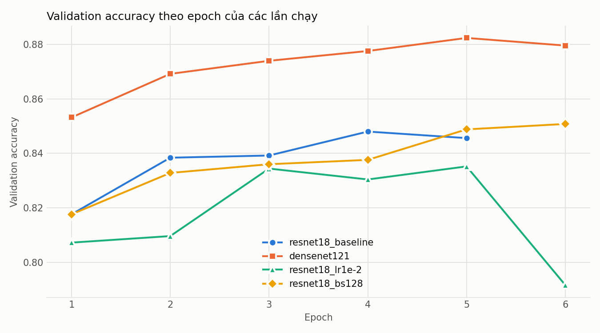
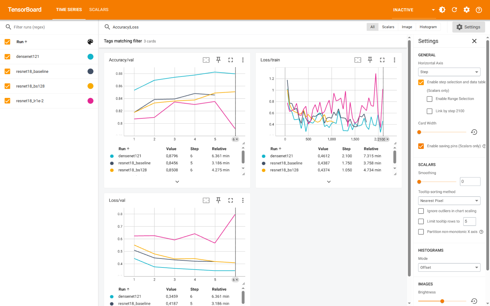
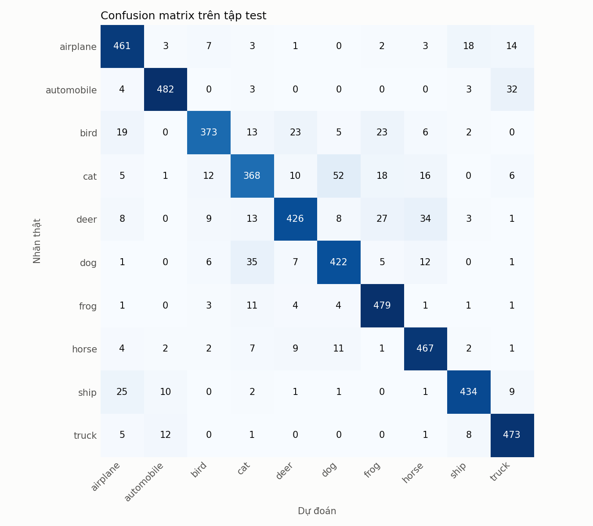
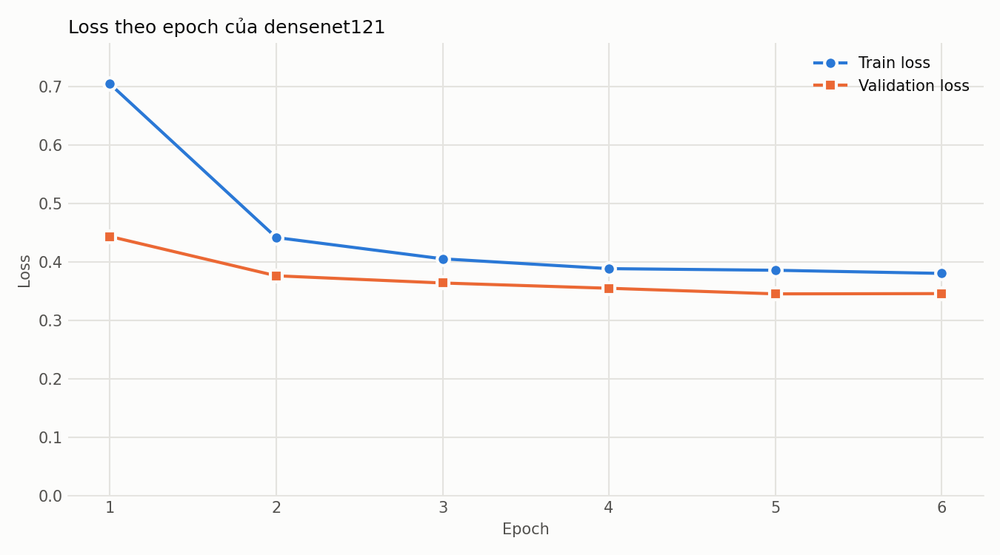

# Báo Cáo Đánh Giá (Performance Evaluation) — Lab 2

## 0. Thông tin tài liệu

| Trường | Nội dung |
| --- | --- |
| Name | Báo Cáo Đánh Giá (Performance Evaluation) — Lab 2 |
| Created date | Chưa xác nhận |
| Created by | HoangDang (Nguyễn Hoàng Đăng) |
| Ghi nhận Git đầu tiên | 2026-11-04T10:34:00+07:00 ; HoangDang ; aee3dd8 |
| Last updated | 2026-11-14 |
| Updated by | Nguyễn Quốc An (Quoc An), AI hỗ trợ: điền số liệu lần chạy T4 ngày 14/11 |
| Updated by — nguồn đặc tả/TV4 | Nguyễn Quốc An (Quoc An), `3a86e93`, `00b8d04`, `f9f2fd8` |
| Người cập nhật nguồn code evaluation | Nguyễn Quốc An (Quoc An), `32ca8b1`, 2026-11-10T21:18:59+07:00 |
| Người tích hợp/chuẩn hóa | HoangDang (Nguyễn Hoàng Đăng) |
| Phạm vi | Tài liệu đang dùng; phân biệt đặc tả, code hiện có và kiểm chứng runtime |

> **Trạng thái 2026-11-14**: Đã chạy `notebooks/lab_2_colab.ipynb` trên VS Code + Colab **Tesla T4**, code commit `f1c1a84`, người chạy Nguyễn Quốc An. Đủ 4 run, evaluation, demo; 13 checkpoint. Test accuracy **87,70%**, macro F1 **0,8757**; **7/7 KPI Đạt**. Nguồn số liệu: [reports/metrics.json](../reports/metrics.json).

Mã nguồn: `src/lab_2/evaluation.py`.

**Ghi nhận nguồn TV4:** Nguyễn Quốc An đưa `evaluation.py` vào repo tại `32ca8b1`; bộ test evaluation có trong `00b8d04`. HoangDang tích hợp vào package và thêm các kiểm tra bảo vệ tại `4176139`.

> **Phụ trách**: TV4. Đặc tả từng hàm đã triển khai nằm ở mục 8. Mục 1–6 lấy từ `reports/metrics.json`.

## 1. So Sánh Các Lần Chạy (Exercise 1 và 2)

So sánh bằng validation (2.500 ảnh), không dùng test. Một lần chạy mỗi cấu hình, seed 42, cùng Tesla T4. Nguồn: `evaluation.comparison`.

| Run | Model | LR | Batch | Epoch | Best epoch | Val accuracy | Val loss | Giây/epoch |
| --- | --- | ---: | ---: | ---: | ---: | ---: | ---: | ---: |
| `resnet18_baseline` | resnet18 | 0.001 | 64 | 5 | 4 | 84.80% | 0.4216 | 42.36 |
| `densenet121` | densenet121 | 0.001 | 64 | 6 | 5 | **88.24%** | **0.3455** | 68.30 |
| `resnet18_lr1e-2` | resnet18 | 0.01 | 64 | 6 | 5 | 83.52% | 0.5669 | 42.29 |
| `resnet18_bs128` | resnet18 | 0.001 | 128 | 6 | 6 | 85.08% | 0.4092 | 45.25 |



**Exercise 1 (đổi model):** DenseNet121 đạt 88,24%, cao hơn ResNet18 baseline **3,44 điểm phần trăm**, val loss thấp hơn (0,3455 so với 0,4216). Đổi lại, thời gian train tăng khoảng 61% (68,30 so với 42,36 giây/epoch). Lý do hợp lý: DenseNet121 cho đặc trưng 1.024 chiều so với 512 của ResNet18, nên lớp phân loại có nhiều thông tin hơn dù cả hai chỉ train lớp cuối. Baseline dừng sớm ở epoch 5 vì 3 epoch liên tiếp tăng không quá 1 điểm.

**Exercise 2 (đổi learning rate, batch size):**
- LR 0,01: val accuracy 83,52%, thấp hơn baseline **1,28 điểm**, val loss cao nhất (0,5669) và dao động mạnh; Loss/train trên TensorBoard nhiễu hơn hẳn các run khác. LR lớn làm lớp phân loại cập nhật quá mạnh, khó hội tụ.
- Batch 128: val accuracy 85,08%, cao hơn baseline **0,28 điểm**, thời gian gần như nhau (45,25 so với 42,36 giây/epoch). Chênh lệch này nhỏ hơn sai số của 2.500 ảnh validation (khoảng ±1,4 điểm), nên chưa đủ để kết luận batch 128 tốt hơn.
- Các kết luận dựa trên một seed; muốn chắc chắn cần chạy nhiều seed.

**Exercise 3 (TensorBoard):** log 4 run tại `reports/runs/`, ảnh giao diện (smoothing 0, đủ Accuracy/val, Loss/train, Loss/val):



## 2. Đối Chiếu KPI

Nguồn: `evaluation.kpi`. Thiết bị đánh giá Tesla T4, đúng chuẩn KPI tốc độ.

| Chỉ số | Giá trị | Mục tiêu | Kết quả |
| --- | ---: | ---: | --- |
| Validation Accuracy | 88.24% | 80% | Đạt |
| Test Accuracy | 87.70% | 80% | Đạt |
| Test Macro F1 | 0.8757 | 0.8 | Đạt |
| Thời gian train (giây/epoch) | 68.30 | 300 | Đạt |
| Độ trễ suy luận (ms/ảnh) | 16.10 (p95 19.75) | 25 | Đạt |
| VRAM cao nhất (GB) | 1.31 | 4 | Đạt |
| RAM cao nhất (GB) | 3.42 | 6 | Đạt |

## 3. Kết Quả Trên Tập Test

Chọn DenseNet121 bằng validation; test chỉ đánh giá một lần trên 5.000 ảnh. Nguồn: `evaluation.test_metrics`, `evaluation.per_class_accuracy`.

| Run được chọn | Epoch | Accuracy | Sai số 95% (điểm %) | Macro F1 | Loss |
| --- | ---: | ---: | ---: | ---: | ---: |
| `densenet121` | 5 | 87.70% | ±0.91 | 0.8757 | 0.3517 |

Test accuracy (87,70%) gần validation (88,24%), nên model không bị chọn quá khớp với validation.

### Accuracy từng lớp

| Lớp | Accuracy |
| --- | ---: |
| airplane | 90.04% |
| automobile | 91.98% |
| bird | 80.39% |
| cat | **75.41%** |
| deer | 80.53% |
| dog | 86.30% |
| frog | **94.85%** |
| horse | 92.29% |
| ship | 89.86% |
| truck | 94.60% |

Lớp `cat` thấp nhất, kế đến `bird` và `deer`: đây là các lớp động vật dễ lẫn với nhau (cat/dog, bird/airplane, deer/horse). Các lớp phương tiện và `frog` đều trên 89%.



## 4. Nhật Ký Lần Chạy Tốt Nhất

DenseNet121, nguồn `training.runs.densenet121.epochs`. Train loss là trung bình theo batch.

| Epoch | Train loss | Val loss | Val accuracy | LR | Giây train | Mốc lưu |
| ---: | ---: | ---: | ---: | ---: | ---: | --- |
| 1 | 0.7050 | 0.4438 | 85.32% | 0.001 | 69.76 | final_epoch, best_val_loss, best_val_acc |
| 2 | 0.4419 | 0.3764 | 86.92% | 0.001 | 67.85 | final_epoch, best_val_loss, best_val_acc |
| 3 | 0.4055 | 0.3641 | 87.40% | 0.001 | 67.77 | final_epoch, best_val_loss, best_val_acc |
| 4 | 0.3886 | 0.3551 | 87.76% | 0.001 | 68.17 | final_epoch, best_val_loss, best_val_acc |
| 5 | 0.3859 | 0.3455 | 88.24% | 0.001 | 68.22 | final_epoch, best_val_loss, best_val_acc |
| 6 | 0.3805 | 0.3459 | 87.96% | 0.001 | 68.00 | final_epoch |

DenseNet121 chạy đủ 6 epoch, không dừng sớm; tốt nhất ở epoch 5. Scheduler không giảm LR vì val loss vẫn giảm đến epoch 5.



## 5. Checkpoint

| Mốc | Trọng số | Epoch |
| --- | --- | ---: |
| `final_epoch` | `checkpoints/densenet121/final_epoch.pth` | 6 |
| `best_val_loss` | `checkpoints/densenet121/best_val_loss.pth` | 5 |
| `best_val_acc` | `checkpoints/densenet121/best_val_acc.pth` | 5 |
| `best` | `checkpoints/best.pth` (bản sao model được chọn) | 5 |
| `best_val_pause` | Không có file riêng; DenseNet121 không dừng sớm (`stop_epoch` rỗng) | — |

Tổng 13 file: 3 mốc × 4 run và `best.pth`. Dừng sớm: baseline ở epoch 5, LR 0,01 ở epoch 6 (bằng giới hạn); DenseNet121 và batch 128 chạy đủ 6 epoch.

## 6. Môi Trường Chạy

| GPU | torch | torchvision | tensorboard | scikit-learn |
| --- | --- | --- | --- | --- |
| Tesla T4 (Colab, qua extension VS Code) | 2.14.1+cu130 | 0.29.1+cu130 | 2.21.0 | 1.6.1 |

Người chạy Nguyễn Quốc An; code commit `f1c1a84` (nhánh `QuocAn`). Bốn run chạy từ 2026-11-14 16:57 đến 17:19 (giờ Việt Nam). Kết quả trùng với lần chạy T4 trước đó của nhóm ngày 13/11 (cùng seed 42), cho thấy tái lập được.

## 7. Lần Chạy Trước (Chỉ Để Tham Khảo)

Kết quả trong notebook cũ `notebooks/lab_2_old.ipynb`. Lần chạy này khác đặc tả hiện tại nên **không dùng để nghiệm thu**: SGD, 2 epoch, ảnh $32 \times 32$, chuẩn hóa $(0.5, 0.5, 0.5)$, không có tập validation, so sánh các model trực tiếp trên toàn bộ 10.000 ảnh test.

| Model | Learning rate | Batch size | Test Accuracy |
| :--- | :---: | :---: | :---: |
| ResNet18 | 0,001 | 32 | 43,93% |
| DenseNet121 | 0,001 | 32 | 51,44% |
| ResNet18 | 0,01 | 32 | 38,56% |
| ResNet18 | 0,001 | 128 | 43,95% |

---

## 8. Đặc Tả Mã Nguồn (TV4)

**File đã triển khai**: `src/lab_2/evaluation.py`. **Điều kiện trước**: TV5 đã đẩy `common.py`; TV1, TV2 đã đẩy `data.py`, `model.py`; TV3 đã đẩy `select_best_run`.
**Người khác dùng lại**: `evaluate_model` (TV3), `style_axis`, `SERIES`, `SURFACE` (TV5).

**Đầu file**: Gọi `matplotlib.use("Agg")` trước khi import `matplotlib.pyplot`, vì `!python` trên Colab thừa hưởng backend inline của notebook.

**Hằng số**:

```python
LATENCY_SAMPLES = 200
LATENCY_WARMUP_RUNS = 5
SURFACE, INK, MUTED, GRID = "#fcfcfb", "#0b0b0b", "#52514e", "#e4e3df"
SERIES = [("#2a78d6", "o"), ("#eb6834", "s"), ("#1baf7a", "^"), ("#eda100", "D")]
```

Bảng màu này đã qua validator. Mỗi màu đi với một hình marker riêng để người khó phân biệt màu vẫn đọc được biểu đồ.

Giao diện triển khai và test tương ứng như dưới đây. Các test nằm trong `tests/test_evaluation.py`.

#### `evaluate_model(model, loader, device)`
- **Trả về**: Dict `loss`, `accuracy`, `predictions` (list), `labels` (list).
- **Quy tắc**: Loader rỗng hoặc logits không hữu hạn báo lỗi. `model.eval()` và `torch.no_grad()`. `loss` là trung bình theo ảnh: cộng `cross_entropy(..., reduction="sum")` rồi chia cho số ảnh, vì batch cuối có thể nhỏ hơn.
- **Test**: `test_evaluate_model_computes_accuracy_loss_and_predictions`.

#### `kpi_status(value, target, higher_is_better)`
- **Trả về**: `"Không đo được"` nếu `value` là `None`; ngược lại `"Đạt"` hoặc `"Không đạt"`. Bằng đúng mục tiêu tính là đạt.
- **Test**: `test_kpi_status_handles_both_directions_and_missing_value`.

#### `completed_runs(config, report)`
- **Trả về**: `{tên: kết quả}` theo thứ tự trong `config["runs"]`, lấy từ `report["training"]["runs"]`.
- **Lỗi**: Thiếu lần nào thì `raise SystemExit` nêu tên lần đó. Báo cáo chưa có mục `training` cũng tính là thiếu.
- **Test**: `test_evaluation_stops_and_names_the_missing_runs`.

#### `measure_latency_ms(model, transform, samples, device)`
- **Đầu vào**: `samples` là list `(ảnh, nhãn)` từ `raw_samples`.
- **Trả về**: `{"mean": ..., "p95": ...}`, đơn vị mili giây.
- **Cách đo**: Chạy nháp `LATENCY_WARMUP_RUNS` ảnh đầu, không tính. Sau đó bấm giờ từng ảnh gồm `transform`, `unsqueeze(0)`, `.to(device)` và suy luận trong `no_grad`. Khi `device == "cuda"`, gọi `torch.cuda.synchronize()` trước khi dừng đồng hồ.
- **Test**: `test_latency_returns_mean_and_p95`.

#### `comparison_table(runs)`
- **Trả về**: List dict, một dòng mỗi lần chạy, có các khóa `run`, `purpose`, `model`, `learning_rate`, `batch_size`, `epochs_run`, `best_epoch`, `val_accuracy` (từ `best_val_accuracy`), `val_loss` (từ `best_val_accuracy_loss`), `seconds_per_epoch` (từ `mean_train_seconds_per_epoch`).
- **Test**: `test_comparison_table_has_one_row_per_run`.

#### `style_axis(axis, title, xlabel, ylabel)`
Nền `SURFACE`; tiêu đề căn trái màu `INK`; nhãn trục và số trên trục màu `MUTED`; lưới `GRID` nằm dưới dữ liệu; bỏ viền trên, phải, trái; viền dưới màu `GRID`.

#### `plot_loss_curve(run_name, run, path)`
Vẽ `train_loss` và `val_loss` theo epoch từ `run["epochs"]`, dùng `SERIES[0]`, `SERIES[1]`, có chú giải, trục y bắt đầu từ 0, đường dày 2, marker cỡ 8. Lưu với `dpi=150` rồi `plt.close`.

#### `plot_val_accuracy(runs, path)`
Mỗi lần chạy một đường `val_accuracy` theo epoch, dùng lần lượt các cặp trong `SERIES`, chú giải là tên lần chạy, trục x là số nguyên.

#### `plot_confusion_matrix(matrix, path)`
`imshow` với `cmap="Blues"`, hai trục ghi tên lớp, ô nào cũng ghi số. Chữ màu trắng nếu ô lớn hơn một nửa giá trị lớn nhất, ngược lại màu `INK`.

**Test của 3 hàm vẽ**: `test_plots_write_image_files`. Phải mở ảnh để xem bằng mắt, vì test chỉ kiểm tra file được tạo.

#### `copy_best(config, run_name)`
- **Trả về**: Đường dẫn `<checkpoints_dir>/best.pth`.
- **Cách làm**: `shutil.copyfile` từ `<checkpoints_dir>/<run_name>/best_val_acc.pth` sang file tạm, rồi `os.replace`.

#### `main()`
1. Chặn nếu báo cáo đã có `evaluation`; yêu cầu đủ 4 run và `config` trong từng summary khớp config hiện tại. Chọn `best_name = select_best_run(runs)` bằng validation.
2. Nếu có GPU thì `reset_peak_memory_stats`. Nạp `load_checkpoint(copy_best(config, best_name), device)`.
3. Lấy tập test từ `load_splits`, đánh giá với `make_loader(test, eval_batch_size, config)`.
4. Tính bằng `sklearn.metrics`, luôn truyền `labels=list(range(10))`, `zero_division=0` nếu hàm có tham số này:
   - `confusion_matrix`
   - `f1_score(average="macro")`
   - Accuracy từng lớp bằng `recall_score(average=None)`
5. Đo độ trễ bằng `measure_latency_ms(model, build_transform(config, train=False), raw_samples(test, LATENCY_SAMPLES), device)`.
6. Lập bảng KPI theo đúng thứ tự, mỗi dòng có `metric`, `value`, `target`, `status`:

| `metric` | `value` | `target` | Cao hơn là tốt |
| :--- | :--- | :--- | :---: |
| `Validation Accuracy` | `best_val_accuracy` của lần tốt nhất | `kpi.accuracy` | Có |
| `Test Accuracy` | Kết quả test | `kpi.accuracy` | Có |
| `Test Macro F1` | Kết quả test | `kpi.macro_f1` | Có |
| `Thời gian train (giây/epoch)` | `mean_train_seconds_per_epoch`; `None` nếu GPU train không phải T4 | `kpi.seconds_per_epoch` | Không |
| `Độ trễ suy luận (ms/ảnh)` | `latency["mean"]`; `None` nếu GPU đánh giá không phải T4 | `kpi.latency_ms` | Không |
| `VRAM cao nhất (GB)` | Lớn nhất của 4 lần chạy và bước này; `None` nếu không có số nào | `kpi.peak_vram_gb` | Không |
| `RAM cao nhất (GB)` | Lớn nhất của 4 lần chạy và `peak_ram_gb()` | `kpi.peak_ram_gb` | Không |

7. Vẽ vào `<reports_dir>/figures/`: `loss_curve_best.png`, `val_accuracy_by_run.png`, `confusion_matrix.png`. Tự tạo thư mục.
8. Ghi `update_report(config, "evaluation", ...)` với các khóa trong `lab_2_description.md` mục 10, rồi in bảng KPI và `Test Accuracy ± sai số`.

Kiểm chứng phần cứng ngày 2026-11-12: `evaluation.device_name` ghi tên thiết bị thật, `speed_kpi_reference` là `NVIDIA T4`. Trên RTX/CPU, hai KPI tốc độ mang trạng thái `Không đo được` theo chuẩn T4; số đo thô vẫn có ở `comparison.seconds_per_epoch` và `latency_ms`, không bị xóa hoặc đánh đồng phần cứng.

**Tiêu chí đạt**: `python -m pytest tests/test_evaluation.py -q` không có test lỗi. Kiểm lại ngày 2026-11-13 cùng `tests/test_handoff.py`: **25 passed**, 9,10 giây; không chạy lại training hoặc test set thật.
