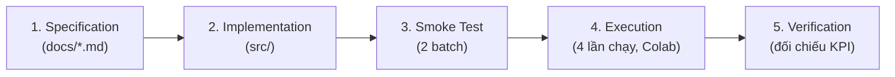
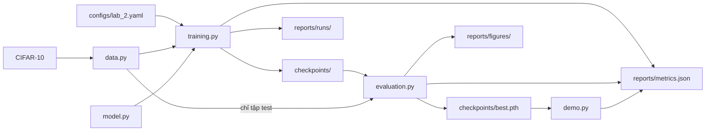

# Practice 2 — Hands-on Practice with Pre-trained Neural Network Architectures: Đặc Tả Tổng Quan

## 1. Bài Toán & Mục Tiêu
- **Lĩnh vực**: Thị giác máy tính, phân loại ảnh bằng học chuyển giao (transfer learning).
- **Công nghệ**: PyTorch, `torchvision.models`, `torchvision.transforms`, `torch.utils.data.DataLoader`, TensorBoard.
- **Mục tiêu theo đề bài**:
  - Làm quen với việc tải và dùng model pre-trained từ `torchvision.models`.
  - Hiểu cách điều chỉnh và fine-tune model pre-trained cho một bài toán cụ thể.

### Đầu vào và đầu ra

| Giai đoạn | Đầu vào | Đầu ra |
| :--- | :--- | :--- |
| **Huấn luyện** | CIFAR-10 và `configs/lab_2.yaml` | Các mốc trong `checkpoints/`, `reports/metrics.json`, log trong `reports/runs/` |
| **Đánh giá** | Mốc `best` và tập test | Kết quả test, KPI, biểu đồ trong `reports/figures/` |
| **Suy luận** | Một ảnh màu | 1 trong 10 lớp, kèm xác suất của từng lớp |

---

## 2. Đối Chiếu Với Đề Bài

| Đề bài | Yêu cầu | Đặc tả | Mã nguồn |
| :--- | :--- | :--- | :--- |
| Bước 1 | Cài PyTorch và torchvision | `README.md` | `requirements.txt`, cell cài đặt trong notebook |
| Bước 2 | Tải model pre-trained | `model.md` mục 1 | `src/lab_2/model.py` |
| Bước 3 | In model, xác định các tầng và tham số | `model.md` mục 2, 5 | `src/lab_2/model.py` |
| Bước 4 | Thay lớp cuối, đóng băng, mở khóa để fine-tune | `model.md` mục 3, 4 | `src/lab_2/model.py` |
| Bước 5 | Tải dữ liệu, dùng `transforms` và `DataLoader` | `data.md` | `src/lab_2/data.py` |
| Bước 6 | Khai báo loss, optimizer, viết vòng lặp train | `training.md` mục 1, 3 | `src/lab_2/training.py` |
| Bước 7 | Đánh giá trên tập test | `evaluation.md` mục 3 | `src/lab_2/evaluation.py` |
| Exercise 1 | Thử các model pre-trained khác | `training.md` mục 2, `evaluation.md` mục 1 | `configs/lab_2.yaml`, `src/lab_2/training.py` |
| Exercise 2 | Điều chỉnh siêu tham số | `training.md` mục 2, `evaluation.md` mục 1 | `configs/lab_2.yaml`, `src/lab_2/training.py` |
| Exercise 3 | Theo dõi huấn luyện bằng TensorBoard | `training.md` mục 5 | `src/lab_2/training.py`, cell TensorBoard trong notebook |

---

## 3. Phạm Vi, Ràng Buộc & Giả Định

- **Ngoài phạm vi**: VGG, dò siêu tham số tự động, triển khai thành dịch vụ, tiếp tục huấn luyện từ giữa một lần chạy.
- **Ràng buộc môi trường**: Máy cá nhân không đủ khả năng huấn luyện. Giảng viên cho phép viết mã trong file `.py` và chạy qua `.ipynb` trên Google Colab để lấy số liệu.
- **Ràng buộc dữ liệu và thời gian**: Đề bài không quy định số mẫu hay số epoch. Nhóm dùng 22.500/2.500/5.000 ảnh, tối đa 6 epoch và 4 lần chạy để giảm thời gian dùng GPU.
- **Giả định**: Colab có GPU T4 và Google Drive còn trống khoảng 1 GB (khoảng 530 MB checkpoint, phần còn lại cho dữ liệu và log).

---

## 4. Quy Trình Thực Hiện

---

## 5. Thiết Kế

### Luồng dữ liệu

### Giao diện giữa các file

| File | Hàm chính | Đầu vào | Đầu ra |
| :--- | :--- | :--- | :--- |
| `common.py` | `load_config`, `update_report`, `read_report` | Đường dẫn cấu hình; tên mục và giá trị | Cấu hình dạng `dict`; `metrics.json` |
| `data.py` | `load_splits`, `make_loader` | Cấu hình; dataset và batch size | Tập train, val, test; `DataLoader` |
| `model.py` | `build_model` | Tên model, dropout, các khối cần mở khóa | Model 10 lớp |
| `model.py` | `save_checkpoint`, `load_checkpoint` | Model và thông tin epoch; đường dẫn | File `.pth`; model đã nạp trọng số |
| `training.py` | `train_run` | Cấu hình và một lần chạy | Nhật ký và kết quả của lần chạy đó |
| `training.py` | `select_best_run` | Kết quả các lần chạy | Tên lần chạy tốt nhất theo validation |
| `evaluation.py` | `evaluate_model` | Model, `DataLoader`, thiết bị | Loss, accuracy, dự đoán, nhãn |

### Rủi ro kỹ thuật

| Rủi ro | Ảnh hưởng | Cách xử lý |
| :--- | :--- | :--- |
| Chỉ huấn luyện lớp cuối, dữ liệu giảm một nửa | Có thể không đạt mục tiêu accuracy $80\%$ | Giữ nguyên mục tiêu, ghi "Không đạt" kèm lý do |
| Colab ngắt phiên khi đang train | Mất tiến trình của lần đang chạy | Mỗi lần chạy là một cell; chỉ cần chạy lại lần bị ngắt |
| Không có GPU | Không đo được KPI tốc độ và VRAM | Vẫn chạy, các KPI đó ghi "Không đo được" |
| Phiên bản thư viện thay đổi | API có thể khác | Ghi phiên bản thật vào `metrics.json` và `evaluation.md` |

---

## 6. Chỉ Số Đánh Giá (KPIs)

1. **Chất lượng model**: Validation Accuracy và Test Accuracy $\ge 80.0\%$; Macro F1 trên tập test $\ge 0.80$.
2. **Tốc độ**: Thời gian train mỗi epoch $\le 300$ giây trên GPU T4; độ trễ suy luận $\le 25$ ms/ảnh.
3. **Tài nguyên**: VRAM cao nhất $\le 4.0$ GB; RAM cao nhất $\le 6.0$ GB.

Đề bài không quy định các mức này. Nhóm tự đặt và chốt trước khi chạy. Cách đo nằm trong `evaluation.md` mục 2. Nếu kết quả không đạt, giữ nguyên mục tiêu và ghi "Không đạt" kèm lý do.

---

## 7. Chính Sách Checkpoint & Early Stopping

Mỗi lần chạy có thư mục riêng `checkpoints/<tên lần chạy>/`.

| Mốc | Đường dẫn | Điều kiện |
| :--- | :--- | :--- |
| **`final_epoch`** | `checkpoints/<lần chạy>/final_epoch.pth` | Trọng số của epoch cuối cùng đã chạy. |
| **`best_val_loss`** | `checkpoints/<lần chạy>/best_val_loss.pth` | Epoch có validation loss thấp nhất. |
| **`best_val_acc`** | `checkpoints/<lần chạy>/best_val_acc.pth` | Epoch có validation accuracy cao nhất; nếu bằng nhau thì lấy loss thấp hơn. |
| **`best_val_pause`** | Không có file riêng | Quy tắc dừng sớm: dừng khi val accuracy không tăng hơn 1 điểm phần trăm trong 3 epoch liên tiếp. Epoch dừng được ghi trong `evaluation.md`. |
| **`best`** | `checkpoints/best.pth` | Bản sao `best_val_acc` của lần chạy tốt nhất, dùng cho đánh giá test và demo. |

**Quy tắc chọn `best`**: so sánh các lần chạy theo val accuracy cao nhất; nếu bằng nhau thì lấy loss thấp hơn. Tập test tuyệt đối không tham gia vào việc chọn model.

---

## 8. Bảng Nghiệm Thu

Cột "Kết quả" chỉ được ghi Đạt hoặc Không đạt sau khi đã có bằng chứng từ lần chạy thật.

| Mã | Tiêu chí | Cách kiểm tra | Bằng chứng | Kết quả |
| :--- | :--- | :--- | :--- | :--- |
| AC-01 | In được kiến trúc, các tầng và số tham số | `python -m lab_2.model` | Đầu ra notebook, mục `model` trong `metrics.json` | Chờ chạy Colab |
| AC-02 | Lớp cuối có 10 đầu ra; chỉ phần được mở khóa mới huấn luyện | `tests/test_lab_2.py` | Kết quả pytest | Chờ chạy Colab |
| AC-03 | Các tập đúng số ảnh; train và val không trùng ảnh | `tests/test_lab_2.py`, `python -m lab_2.data` | Kết quả pytest, mục `data` trong `metrics.json` | Chờ chạy Colab |
| AC-04 | Smoke test 2 batch đạt | `tests/test_smoke.py` | Kết quả pytest | Chờ chạy Colab |
| AC-05 | Exercise 1: có bảng so sánh ResNet18 và DenseNet121 | `python -m lab_2.training --run ...` | `evaluation.md` mục 1 | Chờ chạy Colab |
| AC-06 | Exercise 2: có bảng so sánh learning rate và batch size | `python -m lab_2.training --run ...` | `evaluation.md` mục 1 | Chờ chạy Colab |
| AC-07 | Exercise 3: có log TensorBoard của cả 4 lần chạy và xem được biểu đồ | Cell TensorBoard trong notebook | `reports/runs/`, ảnh chụp `reports/figures/tensorboard.png` | Chờ chạy Colab |
| AC-08 | Đủ checkpoint và early stopping dừng đúng quy tắc | `python -m lab_2.training --run ...` | `checkpoints/`, mục `training` trong `metrics.json` | Chờ chạy Colab |
| AC-09 | Đánh giá `best` trên tập test và đo đủ KPI | `python -m lab_2.evaluation` | Mục `evaluation` trong `metrics.json`, `evaluation.md` | Chờ chạy Colab |
| AC-10 | Demo suy luận được bằng mốc `best` | `python -m lab_2.demo` | Mục `demo` trong `metrics.json`, `demo.md` | Chờ chạy Colab |
| AC-11 | Run all trên notebook không lỗi | Chạy `notebooks/Lab_2_colab.ipynb` trên Colab | Notebook đã lưu kết quả | Chờ chạy Colab |
