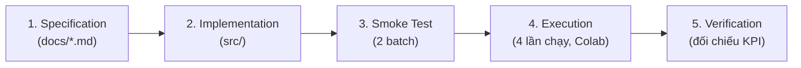
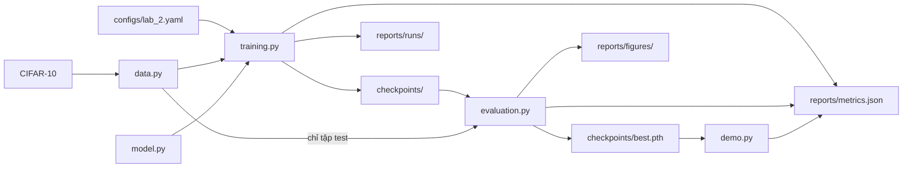

# Practice 2 — Hands-on Practice with Pre-trained Neural Network Architectures: Đặc Tả Tổng Quan

## 0. Thông tin tài liệu

| Trường | Nội dung |
| --- | --- |
| Name | Practice 2 — Hands-on Practice with Pre-trained Neural Network Architectures: Đặc Tả Tổng Quan |
| Created date | Chưa xác nhận |
| Created by | Chưa xác nhận người tạo nội dung |
| Ghi nhận Git đầu tiên | 2026-11-04T10:34:00+07:00 ; HoangDang ; aee3dd8 |
| Last updated | 2026-11-11T11:13:30+07:00 |
| Updated by — nguồn đặc tả | Nguyễn Quốc An (Quoc An), `3a86e93`, `00b8d04` |
| Người tích hợp/chuẩn hóa | HoangDang (Nguyễn Hoàng Đăng), hỗ trợ OpenAI Codex |
| Phạm vi | Tài liệu đang dùng; phân biệt đặc tả, code hiện có và kiểm chứng runtime |

## 1. Bài Toán & Mục Tiêu

Nguồn cập nhật đặc tả, cấu hình và bộ test ban đầu: **Nguyễn Quốc An (Quoc An)**, theo `3a86e93`/`00b8d04`. Các phần triển khai của Vân Anh, Xuân Bảo, Quốc An và HoangDang được phân biệt trong [tiến độ và ghi nhận đóng góp](plan_progress_status.md). Ghi nhận nguồn bổ sung ngày 2026-11-12 do HoangDang/OpenAI Codex đối chiếu lịch sử; giữ khai báo AI của nguồn ở mục 5 của tiến độ.
- **Lĩnh vực**: Thị giác máy tính, phân loại ảnh bằng học chuyển giao (transfer learning).
- **Công nghệ**: PyTorch, `torchvision.models`, `torchvision.transforms`, `torch.utils.data.DataLoader`, TensorBoard.
- **Mục tiêu theo đề bài**:
  - Làm quen với việc tải và dùng model pre-trained từ `torchvision.models`.
  - Hiểu cách điều chỉnh và fine-tune model pre-trained cho một bài toán cụ thể.

> Sau ghép TV3: 85 test offline và 3 smoke thật trên RTX 5060 đạt; đã nhận phiên lịch sử của Thanh Bình với bốn cấu hình và 12 checkpoint, đã hoàn tất tái lập riêng. Chưa nghiệm thu Colab T4; kế hoạch thực hiện: [training_handoff.md](training_handoff.md). Notebook dùng config phiên để giữ nguyên báo cáo lịch sử.

### Đầu vào và đầu ra

| Giai đoạn | Đầu vào | Đầu ra |
| :--- | :--- | :--- |
| **Huấn luyện** | CIFAR-10 và `configs/lab_2.yaml` | Các mốc trong `checkpoints/`, `reports/metrics.json`, log trong `reports/runs/` |
| **Đánh giá** | Mốc `best` và tập test | Kết quả test, KPI, biểu đồ trong `reports/figures/` |
| **Suy luận** | Một ảnh màu | 1 trong 10 lớp, kèm xác suất của từng lớp |

---

## 2. Đối Chiếu Với Đề Bài

| Đề bài | Yêu cầu | Đặc tả | Mã nguồn |
| :--- | :--- | :--- | :--- |
| Bước 1 | Cài PyTorch và torchvision | `README.md` | `requirements.txt`, cell cài đặt trong notebook |
| Bước 2 | Tải model pre-trained | `model.md` mục 1 | `src/lab_2/model.py` |
| Bước 3 | In model, xác định các tầng và tham số | `model.md` mục 2, 5 | `src/lab_2/model.py` |
| Bước 4 | Thay lớp cuối, đóng băng, mở khóa để fine-tune | `model.md` mục 3, 4 | `src/lab_2/model.py` |
| Bước 5 | Tải dữ liệu, dùng `transforms` và `DataLoader` | `data.md` | `src/lab_2/data.py` |
| Bước 6 | Khai báo loss, optimizer, viết vòng lặp train | `training_specification.md` mục 1, 3 | `src/lab_2/training.py` |
| Bước 7 | Đánh giá trên tập test | `evaluation.md` mục 3 | `src/lab_2/evaluation.py` |
| Exercise 1 | Thử các model pre-trained khác | `training_specification.md` mục 2, `evaluation.md` mục 1 | `configs/lab_2.yaml`, `src/lab_2/training.py` |
| Exercise 2 | Điều chỉnh siêu tham số | `training_specification.md` mục 2, `evaluation.md` mục 1 | `configs/lab_2.yaml`, `src/lab_2/training.py` |
| Exercise 3 | Theo dõi huấn luyện bằng TensorBoard | `training_specification.md` mục 5 | `src/lab_2/training.py`, cell TensorBoard trong notebook |

---

## 3. Phạm Vi, Ràng Buộc & Giả Định

- **Ngoài phạm vi**: VGG, dò siêu tham số tự động, triển khai thành dịch vụ, tiếp tục huấn luyện từ giữa một lần chạy.
- **Ràng buộc môi trường**: Chuẩn bị và kiểm tra offline trên máy cá nhân; giao người train chạy file `.py` qua notebook Colab để lấy số liệu. Chưa xác nhận hiệu năng GPU ở giai đoạn chuẩn bị.
- **Ràng buộc dữ liệu và thời gian**: Đề bài không quy định số mẫu hay số epoch. Nhóm dùng 22.500/2.500/5.000 ảnh, tối đa 6 epoch và 4 lần chạy để giảm thời gian dùng GPU.
- **Giả định**: Colab có GPU T4 và Google Drive còn trống ít nhất 2 GB cho mỗi phiên (dự trù, chưa đo phiên thật); xem kế hoạch bàn giao.

---

## 4. Quy Trình Thực Hiện

---

## 5. Thiết Kế

### Luồng dữ liệu

### Giao diện giữa các file

| Phụ trách | File | Hàm chính | Đầu vào | Đầu ra |
| :---: | :--- | :--- | :--- | :--- |
| TV5 | `common.py` | `load_config`, `update_report`, `read_report` | Đường dẫn cấu hình; tên mục và giá trị | Cấu hình dạng `dict`; `metrics.json` |
| TV1 | `data.py` | `load_splits`, `make_loader` | Cấu hình; dataset và batch size | Tập train, val, test; `DataLoader` |
| TV2 | `model.py` | `build_model` | Tên model, dropout, các khối cần mở khóa | Model 10 lớp |
| TV2 | `model.py` | `save_checkpoint`, `load_checkpoint` | Model và thông tin epoch; đường dẫn | File `.pth`; model đã nạp trọng số |
| TV3 | `training.py` | `train_run` | Cấu hình và một lần chạy | Nhật ký và kết quả của lần chạy đó |
| TV3 | `training.py` | `select_best_run` | Kết quả các lần chạy | Tên lần chạy tốt nhất theo validation |
| TV4 | `evaluation.py` | `evaluate_model` | Model, `DataLoader`, thiết bị | Loss, accuracy, dự đoán, nhãn |

`demo.py` (TV5) dùng `load_checkpoint`, `raw_samples`, `style_axis` của các file trên. Không đổi tên hàm, tham số và các khóa trong `metrics.json` nếu chưa báo cho người dùng chúng.

### Rủi ro kỹ thuật

| Rủi ro | Ảnh hưởng | Cách xử lý |
| :--- | :--- | :--- |
| Chỉ huấn luyện lớp cuối, dữ liệu giảm một nửa | Có thể không đạt mục tiêu accuracy $80\%$ | Giữ nguyên mục tiêu, ghi "Không đạt" kèm lý do |
| Một thành viên viết chậm | Các phần sau không ghép được | Làm theo thứ tự trong `plan_progress_status.md` mục 2; TV5 theo dõi tiến độ và chạy `tests/test_integration.py` khi ghép |
| Colab ngắt phiên khi đang train | Mất tiến trình của lần đang chạy | Mỗi lần chạy là một cell; chỉ cần chạy lại lần bị ngắt |
| Không có GPU | Không đo được KPI tốc độ và VRAM | Vẫn chạy, các KPI đó ghi "Không đo được" |
| Phiên bản thư viện thay đổi | API có thể khác | Ghi phiên bản thật vào `metrics.json` và `evaluation.md` |

---

## 6. Chỉ Số Đánh Giá (KPIs)

1. **Chất lượng model**: Validation Accuracy và Test Accuracy $\ge 80.0\%$; Macro F1 trên tập test $\ge 0.80$.
2. **Tốc độ**: Thời gian train mỗi epoch $\le 300$ giây trên GPU T4; độ trễ suy luận $\le 25$ ms/ảnh.
3. **Tài nguyên**: VRAM cao nhất $\le 4.0$ GB; RAM cao nhất $\le 6.0$ GB.

Đề bài không quy định các mức này. Nhóm tự đặt và chốt trước khi chạy. Cách đo nằm trong `evaluation.md` mục 2. Nếu kết quả không đạt, giữ nguyên mục tiêu và ghi "Không đạt" kèm lý do.

---

## 7. Chính Sách Checkpoint & Early Stopping

Mỗi lần chạy có thư mục riêng `checkpoints/<tên lần chạy>/`.

| Mốc | Đường dẫn | Điều kiện |
| :--- | :--- | :--- |
| **`final_epoch`** | `checkpoints/<lần chạy>/final_epoch.pth` | Trọng số của epoch cuối cùng đã chạy. |
| **`best_val_loss`** | `checkpoints/<lần chạy>/best_val_loss.pth` | Epoch có validation loss thấp nhất. |
| **`best_val_acc`** | `checkpoints/<lần chạy>/best_val_acc.pth` | Epoch có validation accuracy cao nhất; nếu bằng nhau thì lấy loss thấp hơn. |
| **`best_val_pause`** | Không có file riêng | Quy tắc dừng sớm: dừng khi val accuracy không tăng hơn 1 điểm phần trăm trong 3 epoch liên tiếp. Epoch dừng được ghi trong `evaluation.md`. |
| **`best`** | `checkpoints/best.pth` | Bản sao `best_val_acc` của lần chạy tốt nhất, dùng cho đánh giá test và demo. |

**Quy tắc chọn `best`**: so sánh các lần chạy theo val accuracy cao nhất; nếu bằng nhau thì lấy loss thấp hơn. Tập test tuyệt đối không tham gia vào việc chọn model.

---

## 8. Bảng Nghiệm Thu

Cột "Kết quả" chỉ ghi Đạt/Không đạt theo bằng chứng phù hợp. AC-02 đã đạt test offline; các tiêu chí dữ liệu thật/GPU/Colab còn chờ người train. Xem [verification.md](verification.md).

| Mã | Phụ trách | Tiêu chí | Cách kiểm tra | Bằng chứng | Kết quả |
| :--- | :---: | :--- | :--- | :--- | :--- |
| AC-01 | TV2 | In được kiến trúc, các tầng và số tham số | `python -m lab_2.model` | Đầu ra notebook, mục `model` trong `metrics.json` | Chờ chạy Colab |
| AC-02 | TV2 | Lớp cuối có 10 đầu ra; chỉ phần được mở khóa mới huấn luyện | `tests/test_model.py` | Kết quả pytest offline, 12 test model | Đạt offline |
| AC-03 | TV1 | Các tập đúng số ảnh; train và val không trùng ảnh | `tests/test_data.py`, `python -m lab_2.data` | 20 test data; [kiểm chứng CIFAR-10 thật](../reports/data_validation_2026-11-12.json), báo cáo phiên riêng | Đạt trên Windows 2026-11-12; Colab cần kiểm tra lại |
| AC-04 | TV3 | Smoke test 2 batch đạt | `tests/test_smoke.py` | Kết quả pytest | Đạt trên RTX 5060; Colab cần kiểm tra lại |
| AC-05 | TV3 | Exercise 1: có bảng so sánh ResNet18 và DenseNet121 | `python -m lab_2.training --run ...` | `evaluation.md` mục 1 | Đạt trên Windows, phiên nguồn và phiên mới tách riêng |
| AC-06 | TV3 | Exercise 2: có bảng so sánh learning rate và batch size | `python -m lab_2.training --run ...` | `evaluation.md` mục 1 | Đạt trên Windows, phiên nguồn và phiên mới tách riêng |
| AC-07 | TV3 | Exercise 3: có log TensorBoard của cả 4 lần chạy và xem được biểu đồ | Cell TensorBoard trong notebook | `reports/runs/`, ảnh chụp `reports/figures/tensorboard.png` | Đạt event/plot; ảnh UI phiên mới chưa chụp |
| AC-08 | TV3 | Đủ checkpoint và early stopping dừng đúng quy tắc | `python -m lab_2.training --run ...` | `checkpoints/`, mục `training` trong `metrics.json` | Đạt trên Windows, phiên nguồn và phiên mới tách riêng |
| AC-09 | TV4 | Đánh giá `best` trên tập test và đo đủ KPI | `python -m lab_2.evaluation` | Mục `evaluation` trong `metrics.json`, `evaluation.md` | Đạt chất lượng/tài nguyên trên Windows; tốc độ T4 chưa nghiệm thu |
| AC-10 | TV5 | Demo suy luận được bằng mốc `best` | `python -m lab_2.demo` | Mục `demo` trong `metrics.json`, `demo.md` | Đạt demo thật trên Windows |
| AC-11 | TV5 | Run all trên notebook không lỗi | Chạy `notebooks/Lab_2_colab.ipynb` trên Colab | Notebook đã lưu kết quả | Chờ chạy Colab |

---

## 9. Đặc Tả Mã Nguồn Dùng Chung (TV5)

### `src/lab_2/common.py`

Làm đầu tiên vì mọi file khác đều import file này. Không import file nào khác trong `lab_2`.

Hằng số: `PROJECT_ROOT = Path(__file__).resolve().parents[2]`, `DEFAULT_CONFIG = PROJECT_ROOT / "configs" / "lab_2.yaml"`.

#### `load_config(path=DEFAULT_CONFIG)`
Đọc YAML bằng `yaml.safe_load`, mở file với `encoding="utf-8"`. Trả về `dict`; tên run phải duy nhất, chỉ gồm chữ, số, `_`, `-`. **Test**: `test_load_config_reads_the_lab_config`.

#### `argument_parser(description)`
Trả về `argparse.ArgumentParser` đã có tham số `--config`, mặc định `DEFAULT_CONFIG`.

#### `project_path(relative_or_absolute)`
Trả về `PROJECT_ROOT / relative_or_absolute`. Toán tử `/` của `pathlib` tự giữ nguyên đường dẫn tuyệt đối.

#### `read_report(config)`
Đọc `<reports_dir>/metrics.json`. Chưa có file thì trả về `{}`.

#### `update_report(config, section, values)`
Đọc báo cáo hiện có, gán `report[section] = values`, rồi ghi lại với `indent=2`, `ensure_ascii=False`, `encoding="utf-8"`. Tự tạo thư mục, ghi file tạm rồi `os.replace`, từ chối NaN/Infinity và giữ báo cáo cũ khi lỗi. Không chạy nhiều tiến trình ghi cùng JSON. **Test**: `test_report_keeps_sections_written_by_other_steps`.

#### `ci_half_width(accuracy, sample_count)`
Trả về $1.96 \sqrt{p(1-p)/n}$. **Test**: `test_ci_half_width_for_five_thousand_samples`.

#### `peak_ram_gb()`
Trả về RAM cao nhất của tiến trình, đơn vị GB. Thử `import resource` (Linux, Colab) và dùng `getrusage(RUSAGE_SELF).ru_maxrss / 1024**2`. Nếu `ImportError` (Windows) thì dùng `psutil.Process().memory_info().peak_wset / 1024**3`.

**Tiêu chí đạt**: `python -m pytest tests/test_common.py -q` cho `3 passed`.

### `notebooks/Lab_2_colab.ipynb`

Notebook chỉ gọi code trong `src/`, không chứa logic. Tạo các cell theo đúng thứ tự, có tiêu đề markdown theo bước của đề bài:

| Thứ tự | Đề bài | Nội dung cell |
| --- | --- | --- |
| 1 | Bước 1 | Mount Drive; điền PROJECT_DIR, OPERATOR, SESSION_ID; đặt PYTHONPATH |
| 2 | Bước 1 | Cài requirements bằng subprocess `check=True` |
| 3 | Cấu hình phiên | In GPU, tạo config phiên giữ tham số gốc, đổi nơi lưu output; khai báo helper gọi module |
| 4 | Kiểm tra offline | `pytest tests test.py --ignore=tests/test_smoke.py` |
| 5 | Bước 5 | Tải archive qua mirror, `lab_2.data` kiểm tra MD5 và chia tập |
| 6 | Bước 2–4 | `lab_2.model`: in kiến trúc/tham số và báo cáo package |
| 7 | Smoke thật | `pytest tests/test_smoke.py -q -s` |
| 8–11 | Bước 6, Exercise 1/2 | 4 run theo thứ tự trong training.md; mỗi run một tiến trình |
| 12 | Bước 7 | `lab_2.evaluation` một lần |
| 13 | Biểu đồ | Hiện 3 biểu đồ evaluation |
| 14–15 | Demo | `lab_2.demo`, hiện demo_probabilities.png |
| 16 | Báo cáo | Hiện bảng so sánh/KPI, số liệu test, môi trường và người chạy từ JSON thật |
| 17 | Exercise 3 | TensorBoard với logdir của phiên; người train chụp tensorboard.png |

Đặt metadata `"accelerator": "GPU"` để Colab gợi ý bật GPU.

---

## 10. Hợp Đồng `reports/metrics.json`

Mỗi file chỉ ghi mục của mình qua `update_report`. Tên khóa là hợp đồng giữa các thành viên, đổi tên thì phải báo người đọc mục đó.

| Mục | Người ghi | Người đọc | Khóa |
| :--- | :---: | :---: | :--- |
| `data` | TV1 | TV4 khi viết báo cáo | `train`, `val`, `test`; mỗi khóa có `samples`, `class_counts` |
| `model` | TV2 | TV2 khi viết báo cáo | `resnet18`, `densenet121`, `resnet18_unfreeze_layer4`; mỗi khóa có `total`, `trainable` |
| `training.runs.<tên>` | TV3 | TV4 | Xem bảng dưới |
| `evaluation` | TV4 | TV5 trong notebook | Xem bảng dưới |
| `demo` | TV5 | TV5 khi viết báo cáo | List, xem `demo.md` mục 4 |

### `training.runs.<tên>`

| Khóa | Ý nghĩa |
| :--- | :--- |
| `purpose`, `model`, `learning_rate`, `batch_size` | Lấy từ `run` trong cấu hình |
| `device` | Tên GPU từ `torch.cuda.get_device_name(0)`, không có GPU thì là `"cpu"` |
| `library_versions` | `{tên: importlib.metadata.version(tên)}` với các tên trong `LIBRARIES` |
| `epochs` | List theo epoch: `epoch`, `train_loss`, `val_loss`, `val_accuracy`, `learning_rate`, `train_seconds`, `marks` (các mốc đã lưu ở epoch đó) |
| `epochs_run` | Số epoch đã chạy |
| `stop_epoch` | Epoch dừng sớm, không dừng sớm thì là `null` |
| `best_epoch`, `best_val_accuracy`, `best_val_accuracy_loss` | Epoch của mốc `best_val_acc`, accuracy và loss tại epoch đó |
| `best_val_loss_epoch`, `best_val_loss` | Epoch của mốc `best_val_loss` và loss tại epoch đó |
| `mean_train_seconds_per_epoch` | Trung bình `train_seconds` |
| `peak_vram_gb` | `torch.cuda.max_memory_allocated() / 1024**3`, không có GPU thì là `null` |
| `peak_ram_gb` | `peak_ram_gb()` |

### `evaluation`

| Khóa | Ý nghĩa |
| :--- | :--- |
| `device` | `"cuda"` hoặc `"cpu"` |
| `best_run`, `best_epoch`, `test_samples` | Lần chạy được chọn, epoch của mốc, số ảnh test |
| `test_metrics` | `accuracy`, `accuracy_ci95_half_width`, `macro_f1`, `loss` |
| `comparison` | Kết quả `comparison_table` |
| `kpi` | List dòng trong `evaluation.md` mục 8 |
| `per_class_accuracy` | `{tên lớp: accuracy}` |
| `confusion_matrix` | `labels`, `rows_true_columns_pred` (dòng là nhãn thật, cột là dự đoán) |
| `latency_ms` | `mean`, `p95` |

---

## 11. Các Trường Hợp Dễ Sai

Test không phủ hết các trường hợp này, người phụ trách cần tự kiểm tra.

| Tình huống | Hành vi đúng | Phụ trách |
| :--- | :--- | :---: |
| Chạy trên máy không có GPU | Vẫn chạy được, không gọi hàm `torch.cuda` nào gây lỗi; KPI tốc độ và VRAM ghi "Không đo được" | TV3, TV4 |
| Dừng sớm trước `max_epochs` | Biểu đồ và bảng vẫn đúng với số epoch thực tế | TV3, TV4 |
| Run đã tồn tại | Báo lỗi, giữ nguyên log/checkpoint/JSON; dùng mã phiên mới để chạy lại | TV3 |
| Ảnh demo là ảnh xám, PNG có kênh trong suốt, hoặc rất lớn | Vẫn suy luận được nhờ `convert("RGB")` và `Resize` | TV5 |
| Đường dẫn Drive có dấu cách (`.../Lab 2`) | Đặt trong dấu ngoặc kép khi gọi lệnh shell | TV5 |

### Bổ sung lưu vết training

`training.runs.<tên>` có thêm `config`, `operator`, `started_at`, `finished_at`, `code_commit` theo training.md. Config phải giữ nguyên trong cả 4 run và khớp khi evaluate. Chặn đánh giá test lặp nếu JSON đã có `evaluation`.
