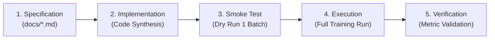

# Module 02 — Deep Neural Networks & Transfer Learning Specification

## 1. Project Overview & Objectives
- **Domain**: Deep Learning Optimization & Computer Vision Transfer Learning.
- **Frameworks**: PyTorch Core (`torch`, `torchvision.models`, `torch.utils.tensorboard`).
- **Core Deliverables**:
  - Tối ưu hóa quá trình huấn luyện mạng sâu: Khắc phục hiện tượng Vanishing/Exploding Gradients bằng **Batch Normalization** và **He/Xavier Initialization**.
  - Kiểm soát Overfitting bằng kỹ thuật điều chuẩn **Dropout** và **L2 Regularization (Weight Decay)**.
  - Triển khai **Transfer Learning & Fine-Tuning** với các kiến trúc pre-trained (ResNet-18/50, VGG-16, DenseNet) trên tập dữ liệu ảnh màu đa lớp (CIFAR-10).

---

## 2. Engineering Methodology (Spec-Driven Development)

---

## 3. Key Performance Indicators (KPIs & Metrics)
1. **Model Accuracy**: Validation Accuracy trên 10 lớp vật thể của CIFAR-10.
2. **Computational Latency**: Thời gian hoàn tất mỗi epoch và độ trễ suy luận phân loại ảnh.
3. **Resource Footprint**: Mức đỉnh bộ nhớ GPU VRAM và dung lượng RAM hệ thống.

---

## 4. Checkpoint Policy & Early Stopping Management
- `final_epoch.pth`: Trọng số tại epoch cuối cùng.
- `best_val_loss.pth`: Trọng số đạt hàm mất mát nhỏ nhất trên tập validation.
- `best_val_acc.pth`: Trọng số đạt độ chính xác cao nhất trên tập validation.
- `best_val_pause`: Cơ chế Early Stopping dừng tự động khi mức cải thiện $\le 1.0\%$.
- `best.pth`: Checkpoint tối ưu được đóng gói cho việc suy luận thực tế.
