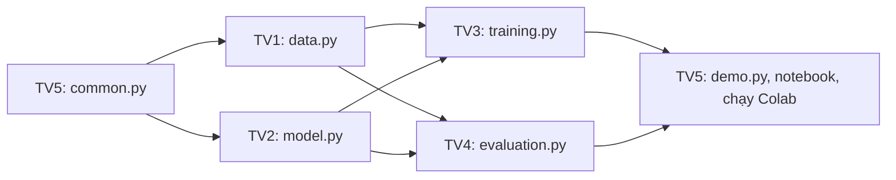

# Tiến Độ Thực Hiện (Project Status) — Lab 2

## 0. Thông tin tài liệu

| Trường | Nội dung |
| --- | --- |
| Name | Tiến Độ Thực Hiện (Project Status) — Lab 2 |
| Created date | Chưa xác nhận |
| Created by | Chưa xác nhận người tạo nội dung |
| Ghi nhận Git đầu tiên | 2026-11-04T10:34:00+07:00 ; HoangDang ; aee3dd8 |
| Last updated | 2026-11-11T08:52:28+07:00 |
| Updated by | HoangDang (Nguyễn Hoàng Đăng), hỗ trợ OpenAI Codex |
| Phạm vi | Tài liệu đang dùng; phân biệt đặc tả, code hiện có và kiểm chứng runtime |

## 1. Thành Viên

Điền họ tên trước khi nộp.

| Mã | Họ tên | Phụ trách |
| :---: | :--- | :--- |
| **TV1** | Chưa điền | Dữ liệu: `data.py`, `data.md` |
| **TV2** | Chưa điền | Model: `model.py`, `model.md` |
| **TV3** | Chưa điền | Huấn luyện, TensorBoard: `training.py`, `training.md` |
| **TV4** | Chưa điền | Đánh giá, KPI, biểu đồ: `evaluation.py`, `evaluation.md` |
| **TV5** | Chưa điền | Tiện ích, demo, notebook, ghép và chạy Colab: `common.py`, `demo.py`, `Lab_2_colab.ipynb`, `demo.md`, file này |

---

## 2. Cách Làm Việc Nhóm

Thư mục `src/lab_2/` hiện có `evaluation.py`. Model của Xuân Bảo (Git: `hbao2123-debug`) nằm ở `Lab 2/model.py`, kiểm thử ở `test.py`; chưa chuyển sang giao diện package. Các module phụ thuộc còn thiếu. Mỗi người tự tạo file của mình theo mục "Đặc Tả Mã Nguồn" trong file đặc tả tương ứng. Mỗi hàm đã được ghi chữ ký, quy tắc và tên test. Không sửa file của người khác, không sửa test để cho đạt.

TV3 đã có `training.py`; ngày 2026-11-11 bổ sung `common.py`, `data.py` để ghép, adapter model dùng lại implementation của Xuân Bảo. Đã chạy 41 test và ba smoke test thật trên CPU/GPU. Trạng thái bốn run đọc từ `reports/tv3/20261111-123519/manifest.json`; không suy nghiệm thu toàn notebook từ kết quả này.

| Thành viên | File cần tạo | Đặc tả từng hàm | Số test phải đạt |
| :---: | :--- | :--- | :---: |
| **TV1** | `src/lab_2/data.py` | `data.md` mục 5 | 9 |
| **TV2** | `src/lab_2/model.py` | `model.md` mục 7 | 12 |
| **TV3** | `src/lab_2/training.py` | `training_specification.md` mục 8 | 6, cộng 3 smoke test |
| **TV4** | `src/lab_2/evaluation.py` | `evaluation.md` mục 8 | 6 |
| **TV5** | `src/lab_2/common.py`, `src/lab_2/demo.py`, `notebooks/Lab_2_colab.ipynb` | `lab_2_description.md` mục 9, `demo.md` mục 4 | 3 + 2, cộng 2 test ghép |

`lab_2_description.md` mục 10 ghi các khóa trong `metrics.json`, mục 11 ghi các trường hợp dễ sai. Không cần tạo `__init__.py`.

**Thứ tự thực hiện:**



| Đợt | Việc phải đẩy lên | Lý do |
| :---: | :--- | :--- |
| 1 | TV5: `common.py` | Mọi file đều import file này, nên làm đầu tiên |
| 2 | TV1: `data.py`, TV2: `model.py` | Chỉ cần `common.py`, hai người làm song song |
| 3 | TV3: `is_better`, `select_best_run`, rồi phần còn lại của `training.py` | Cần `data.py`, `model.py`. `evaluation.py` import `select_best_run` |
| 3 | TV4: `evaluation.py` | Cần `data.py`, `model.py`, `select_best_run`. Làm song song với TV3 |
| 4 | TV5: `demo.py`, notebook, chạy Colab | Cần đủ các phần trên |

Một người có thể viết code trước khi đợt trước xong, nhưng test của họ chỉ chạy được khi các file cần import đã có. Trước đó test báo `ModuleNotFoundError`, đây là điều bình thường.

**Cách đẩy code:** làm trên nhánh cá nhân, sau đó tạo pull request vào `main`. Với người tích hợp hiện tại:

```powershell
git switch hoangdang
git pull --ff-only origin hoangdang
# Viết code, chạy kiểm tra đúng phạm vi và stage các file liên quan.
git commit -m "Lab 2: cập nhật phần việc đã kiểm chứng"
git push origin hoangdang
```

**Quy tắc ghép:**

| Việc | Lệnh | Ai làm | Khi nào |
| :--- | :--- | :---: | :--- |
| Kiểm tra phần của mình | `python -m pytest tests/test_<tên>.py -q` | Từng người | Trước khi gộp code |
| Kiểm tra ghép | `python -m pytest tests/test_integration.py -q` | TV5 | Sau khi đủ 5 phần |
| Kiểm tra 2 batch | `python -m pytest tests/test_smoke.py -q -s` | TV3 | Sau khi TV1, TV2 xong |
| Chạy thật | `notebooks/Lab_2_colab.ipynb` trên Colab | TV5 | Sau khi các lệnh trên đạt |

Muốn đổi tên hàm, tham số hoặc khóa trong `metrics.json` thì phải báo người đang dùng chúng và cập nhật đặc tả trước.

---

## 3. Bảng Công Việc

`DONE` chỉ được ghi khi đã có bằng chứng tương ứng. Mã nghiệm thu `AC` xem tại `lab_2_description.md` mục 8.

| Mã | Công việc | Bước trong đề | Trạng thái | Owner | Bằng chứng |
| :---: | :--- | :--- | :---: | :---: | :--- |
| **TASK-01** | Hoàn thiện đặc tả `docs/` | Toàn bài | **DONE** | Team | 7 file trong `docs/`, đã duyệt |
| **TASK-02** | Viết đặc tả từng hàm, test và phân công | Toàn bài | **DONE** | Team | Mục "Đặc Tả Mã Nguồn" trong `docs/`, `tests/`, mục 1, 2 của file này |
| **TASK-03** | Cài đặt môi trường; viết `common.py` | Bước 1 | **ĐÃ GHÉP CỤC BỘ** | TV5 / Codex hỗ trợ TV3 | common: 3 test đạt; .venv CUDA RTX 4060; chưa phải Colab |
| **TASK-04** | Dữ liệu CIFAR-10 và `DataLoader` | Bước 5 | **ĐÃ GHÉP CỤC BỘ** | TV1 / Codex hỗ trợ TV3 | 9 test đạt; dữ liệu thật 22.500/2.500/5.000, reports/metrics.json |
| **TASK-05** | Tải model, xem kiến trúc, thay lớp cuối | Bước 2, 3, 4 | **ĐÃ GHÉP QUA ADAPTER** | TV2 | Dùng nguyên model Xuân Bảo; 12 test model đạt trong lượt 41 test; chưa chạy notebook Colab |
| **TASK-06** | Logic huấn luyện và early stopping | Bước 6 | **DONE** | TV3 | 6 test gốc + 5 test bổ sung đạt; cần review/ghép module; chưa thay thế smoke thật |
| **TASK-07** | Smoke test 2 batch | Quy trình `docs/` | **DONE CỤC BỘ** | TV3 | 3 passed CPU/GPU; reports/tv3/20261111-123359/smoke.log; chưa phải Colab |
| **TASK-08** | Huấn luyện mô hình gốc | Bước 6 | **DONE CỤC BỘ** | TV3 | Baseline 5 epoch; 3 checkpoint; metrics.json và checkpoint_check.json |
| **TASK-09** | So sánh ResNet18 và DenseNet121 | Exercise 1 | **DONE CỤC BỘ** | TV3 | reports/tv3/comparison.csv; training.md |
| **TASK-10** | So sánh learning rate và batch size | Exercise 2 | **DONE CỤC BỘ** | TV3 | Đủ 4 run; bảng so sánh validation và đồ thị |
| **TASK-11** | Theo dõi bằng TensorBoard | Exercise 3 | **DONE CỤC BỘ** | TV3 | 4 thư mục event; tensorboard_check.json; reports/figures/tensorboard.png |
| **TASK-12** | Viết code đánh giá và biểu đồ | Bước 7 | **CÓ CODE, CHỜ PHỤ THUỘC** | TV4 | `tests/test_evaluation.py` đạt |
| **TASK-13** | Đánh giá trên tập test và đối chiếu KPI | Bước 7 | **TODO** | TV4 | AC-09, `evaluation.md` |
| **TASK-14** | Demo suy luận | Quy trình `docs/` | **TODO** | TV5 | `tests/test_demo.py` đạt, AC-10 |
| **TASK-15** | Ghép code, hoàn thiện notebook | Toàn bài | **TODO** | TV5 | `tests/test_integration.py` đạt |
| **TASK-16** | Run all notebook trên Colab | Toàn bài | **TODO** | TV5 | AC-11 |

---

## 4. Nhật Ký Thực Hiện
- `2026-11-11` — Hoàn tất bốn run TV3 trên RTX 4060 Laptop (không phải Colab T4): baseline 84,80%, DenseNet121 88,24%, LR 0.01 đạt 83,48%, batch 128 đạt 85,08% validation accuracy. Đã đối chiếu 12 checkpoint, đủ tag/event TensorBoard và chụp giao diện thật; xem training.md. Không dùng tập test để chọn run; phần đánh giá test/demo/notebook còn riêng. Code/model gốc và nguồn thành viên được giữ nguyên; Codex hỗ trợ bổ sung và thực thi theo yêu cầu người dùng.
- `2026-11-11` — Theo yêu cầu tiếp tục TV3: Codex bổ sung common/data và adapter model, giữ nguyên model gốc Xuân Bảo và evaluation TV4. Tải CIFAR-10 từ mirror trong notebook, MD5 khớp. CPU: 41 test + 3 smoke đạt; GPU: 41 test + 3 smoke đạt. Chuẩn bị CUDA trong .venv riêng, bắt đầu bốn run trên RTX 4060 Laptop; log/manifest tại reports/tv3/20261111-123519. Chưa ghi kết quả Colab hoặc test accuracy cho phần TV3.
- `2026-11-11` — HoangDang, hỗ trợ OpenAI Codex: nhận model/test từ xbao và evaluation từ QuocAn; cập nhật trạng thái, đường dẫn và workflow nhánh cá nhân → PR main. Chưa chạy lại kiểm thử trên máy hiện tại; chưa đủ module package để chạy tích hợp.
- `2026-11-10`: TV3 triển khai `src/lab_2/training.py` bằng Codex; thêm `tests/test_training_standalone.py` và `docs/TV3_TRAINING_GUIDE.md`. Chạy `python -m pytest tests/test_training.py tests/test_training_standalone.py -q`: **11 passed**. Kiểm tra vòng điều phối bằng model nhỏ và dependency thay thế, TensorBoard event thật; chưa có smoke pretrained, full training hay kết quả KPI. Không sửa test gốc hoặc code thành viên khác.
- `2026-10-31`: Chạy notebook cũ trên Colab với SGD, 2 epoch, ảnh $32 \times 32$. Kết quả xem tại `evaluation.md` mục 7.
- `2026-11-04`: Tạo bộ khung tài liệu đặc tả.
- `2026-11-07`:
  - Đối chiếu đặc tả và notebook cũ với đề bài. Notebook có đủ 7 bước và 3 Exercise, nhưng khác đặc tả về optimizer, kích thước ảnh, số epoch và checkpoint. Đặc tả thiếu 3 Exercise, bước xem kiến trúc và đánh giá trên tập test.
  - Thống nhất làm lại theo đặc tả. Hoàn thiện đặc tả theo đề bài: 2 model, 4 lần chạy, tối đa 6 epoch, 22.500/2.500/5.000 ảnh.
  - Chia việc cho 5 thành viên: xóa code, ghi đặc tả từng hàm vào `docs/`, tách test theo từng người. Chuyển notebook cũ vào `notebooks/`.

---

## 5. Việc Dùng AI

| Công cụ | Mục đích | AI hỗ trợ | Đóng góp của sinh viên |
| :--- | :--- | :--- | :--- |
| Codex | Triển khai và chạy TV3 theo yêu cầu người dùng | Sinh training, 5 test bổ sung, common/data để ghép, adapter dùng model gốc Xuân Bảo; công cụ lưu log/xuất báo cáo/chụp TensorBoard. Chạy 41 test, 3 smoke CPU/GPU và 4 run thật trên RTX 4060 Laptop | Người dùng xác định phụ trách TV3 và yêu cầu thực hiện; cần đọc hiểu, review và bàn giao code/checkpoint. Chưa chạy Colab, demo hoặc đánh giá test |
| Claude Code (Claude Opus 5.5) | Rà soát tài liệu, viết đặc tả và test | Đối chiếu đề bài với đặc tả và notebook; cập nhật `docs/`; viết test; viết một bản code đầy đủ để kiểm tra test và đặc tả, lưu riêng ở nhánh `lab2-ban-day-du` trên máy người điều phối, không có trong nhánh `main` và `QuocAn` | Làm notebook ban đầu; cung cấp đề bài; chọn model, số lần chạy, số epoch, số ảnh, cách chia việc; duyệt các điểm sửa. Phần code của từng thành viên: chưa thực hiện. Nếu dùng hoặc tham khảo nhánh trên, phải ghi rõ tại đây. TV4: `evaluation.py` lấy từ nhánh trên, đã đối chiếu từng hàm với `evaluation.md` mục 8, chạy `tests/test_evaluation.py` (6 passed, dùng tạm các file khác của nhánh trên) và xem lại 3 biểu đồ |


Phần khai báo AI ở bảng trên là thông tin kế thừa do thành viên ghi. Lần chuẩn hóa ngày 2026-11-11 dùng OpenAI Codex để rà tài liệu, không sinh thêm code model/training hoặc số đo mới.
