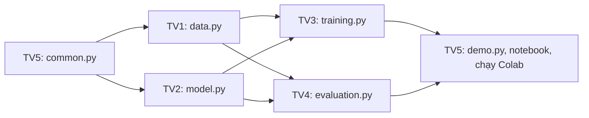

# Tiến Độ Thực Hiện (Project Status) — Lab 2

## 1. Thành Viên

Điền họ tên trước khi nộp.

| Mã | Họ tên | Phụ trách |
| :---: | :--- | :--- |
| **TV1** | Chưa điền | Dữ liệu: `data.py`, `data.md` |
| **TV2** | Chưa điền | Model: `model.py`, `model.md` |
| **TV3** | Chưa điền | Huấn luyện, TensorBoard: `training.py`, `training.md` |
| **TV4** | Chưa điền | Đánh giá, KPI, biểu đồ: `evaluation.py`, `evaluation.md` |
| **TV5** | Chưa điền | Tiện ích, demo, notebook, ghép và chạy Colab: `common.py`, `demo.py`, `Lab_2_colab.ipynb`, `demo.md`, file này |

---

## 2. Cách Làm Việc Nhóm

Thư mục `src/lab_2/` chưa có code. Mỗi người tự tạo file của mình theo mục "Đặc Tả Mã Nguồn" trong file đặc tả tương ứng. Mỗi hàm đã được ghi chữ ký, quy tắc và tên test. Không sửa file của người khác, không sửa test để cho đạt.

| Thành viên | File cần tạo | Đặc tả từng hàm | Số test phải đạt |
| :---: | :--- | :--- | :---: |
| **TV1** | `src/lab_2/data.py` | `data.md` mục 5 | 9 |
| **TV2** | `src/lab_2/model.py` | `model.md` mục 7 | 12 |
| **TV3** | `src/lab_2/training.py` | `training.md` mục 8 | 6, cộng 3 smoke test |
| **TV4** | `src/lab_2/evaluation.py` | `evaluation.md` mục 8 | 6 |
| **TV5** | `src/lab_2/common.py`, `src/lab_2/demo.py`, `notebooks/Lab_2_colab.ipynb` | `lab_2_description.md` mục 9, `demo.md` mục 4 | 3 + 2, cộng 2 test ghép |

`lab_2_description.md` mục 10 ghi các khóa trong `metrics.json`, mục 11 ghi các trường hợp dễ sai. Không cần tạo `__init__.py`.

**Thứ tự thực hiện:**



| Đợt | Việc phải đẩy lên | Lý do |
| :---: | :--- | :--- |
| 1 | TV5: `common.py` | Mọi file đều import file này, nên làm đầu tiên |
| 2 | TV1: `data.py`, TV2: `model.py` | Chỉ cần `common.py`, hai người làm song song |
| 3 | TV3: `is_better`, `select_best_run`, rồi phần còn lại của `training.py` | Cần `data.py`, `model.py`. `evaluation.py` import `select_best_run` |
| 3 | TV4: `evaluation.py` | Cần `data.py`, `model.py`, `select_best_run`. Làm song song với TV3 |
| 4 | TV5: `demo.py`, notebook, chạy Colab | Cần đủ các phần trên |

Một người có thể viết code trước khi đợt trước xong, nhưng test của họ chỉ chạy được khi các file cần import đã có. Trước đó test báo `ModuleNotFoundError`, đây là điều bình thường.

**Cách đẩy code**, làm việc trên nhánh `main`:

```bash
git pull origin main
# Viết code, chạy test của mình cho đến khi đạt
git add "Lab 2/src/lab_2/<file của bạn>"
git commit -m "Lab 2: them <file của bạn>"
git pull --rebase origin main
git push origin main
```

**Quy tắc ghép:**

| Việc | Lệnh | Ai làm | Khi nào |
| :--- | :--- | :---: | :--- |
| Kiểm tra phần của mình | `python -m pytest tests/test_<tên>.py -q` | Từng người | Trước khi gộp code |
| Kiểm tra ghép | `python -m pytest tests/test_integration.py -q` | TV5 | Sau khi đủ 5 phần |
| Kiểm tra 2 batch | `python -m pytest tests/test_smoke.py -q -s` | TV3 | Sau khi TV1, TV2 xong |
| Chạy thật | `notebooks/Lab_2_colab.ipynb` trên Colab | TV5 | Sau khi các lệnh trên đạt |

Muốn đổi tên hàm, tham số hoặc khóa trong `metrics.json` thì phải báo người đang dùng chúng và cập nhật đặc tả trước.

---

## 3. Bảng Công Việc

`DONE` chỉ được ghi khi đã có bằng chứng tương ứng. Mã nghiệm thu `AC` xem tại `lab_2_description.md` mục 8.

| Mã | Công việc | Bước trong đề | Trạng thái | Owner | Bằng chứng |
| :---: | :--- | :--- | :---: | :---: | :--- |
| **TASK-01** | Hoàn thiện đặc tả `docs/` | Toàn bài | **DONE** | Team | 7 file trong `docs/`, đã duyệt |
| **TASK-02** | Viết đặc tả từng hàm, test và phân công | Toàn bài | **DONE** | Team | Mục "Đặc Tả Mã Nguồn" trong `docs/`, `tests/`, mục 1, 2 của file này |
| **TASK-03** | Cài đặt môi trường; viết `common.py` | Bước 1 | **TODO** | TV5 | `requirements.txt`, `tests/test_common.py` đạt |
| **TASK-04** | Dữ liệu CIFAR-10 và `DataLoader` | Bước 5 | **TODO** | TV1 | `tests/test_data.py` đạt, AC-03 |
| **TASK-05** | Tải model, xem kiến trúc, thay lớp cuối | Bước 2, 3, 4 | **TODO** | TV2 | `tests/test_model.py` đạt, AC-01, AC-02 |
| **TASK-06** | Logic huấn luyện và early stopping | Bước 6 | **TODO** | TV3 | `tests/test_training.py` đạt |
| **TASK-07** | Smoke test 2 batch | Quy trình `docs/` | **TODO** | TV3 | AC-04 |
| **TASK-08** | Huấn luyện mô hình gốc | Bước 6 | **TODO** | TV3 | AC-08 |
| **TASK-09** | So sánh ResNet18 và DenseNet121 | Exercise 1 | **TODO** | TV3 | AC-05 |
| **TASK-10** | So sánh learning rate và batch size | Exercise 2 | **TODO** | TV3 | AC-06 |
| **TASK-11** | Theo dõi bằng TensorBoard | Exercise 3 | **TODO** | TV3 | AC-07 |
| **TASK-12** | Viết code đánh giá và biểu đồ | Bước 7 | **TODO** | TV4 | `tests/test_evaluation.py` đạt |
| **TASK-13** | Đánh giá trên tập test và đối chiếu KPI | Bước 7 | **TODO** | TV4 | AC-09, `evaluation.md` |
| **TASK-14** | Demo suy luận | Quy trình `docs/` | **TODO** | TV5 | `tests/test_demo.py` đạt, AC-10 |
| **TASK-15** | Ghép code, hoàn thiện notebook | Toàn bài | **TODO** | TV5 | `tests/test_integration.py` đạt |
| **TASK-16** | Run all notebook trên Colab | Toàn bài | **TODO** | TV5 | AC-11 |

---

## 4. Nhật Ký Thực Hiện
- `2026-10-31`: Chạy notebook cũ trên Colab với SGD, 2 epoch, ảnh $32 \times 32$. Kết quả xem tại `evaluation.md` mục 7.
- `2026-11-04`: Tạo bộ khung tài liệu đặc tả.
- `2026-11-07`:
  - Đối chiếu đặc tả và notebook cũ với đề bài. Notebook có đủ 7 bước và 3 Exercise, nhưng khác đặc tả về optimizer, kích thước ảnh, số epoch và checkpoint. Đặc tả thiếu 3 Exercise, bước xem kiến trúc và đánh giá trên tập test.
  - Thống nhất làm lại theo đặc tả. Hoàn thiện đặc tả theo đề bài: 2 model, 4 lần chạy, tối đa 6 epoch, 22.500/2.500/5.000 ảnh.
  - Chia việc cho 5 thành viên: xóa code, ghi đặc tả từng hàm vào `docs/`, tách test theo từng người. Chuyển notebook cũ vào `notebooks/`.

---

## 5. Việc Dùng AI

| Công cụ | Mục đích | AI hỗ trợ | Đóng góp của sinh viên |
| :--- | :--- | :--- | :--- |
| Claude Code (Claude Opus 5.5) | Rà soát tài liệu, viết đặc tả và test | Đối chiếu đề bài với đặc tả và notebook; cập nhật `docs/`; viết test; viết một bản code đầy đủ để kiểm tra test và đặc tả, lưu riêng ở nhánh `lab2-ban-day-du` trên máy người điều phối, không có trong nhánh `main` và `QuocAn` | Làm notebook ban đầu; cung cấp đề bài; chọn model, số lần chạy, số epoch, số ảnh, cách chia việc; duyệt các điểm sửa. Phần code của từng thành viên: chưa thực hiện. Nếu dùng hoặc tham khảo nhánh trên, phải ghi rõ tại đây |
