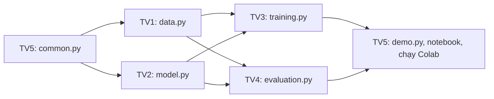

# Tiến Độ Thực Hiện (Project Status) — Lab 2

## 0. Thông tin tài liệu

| Trường | Nội dung |
| --- | --- |
| Name | Tiến Độ Thực Hiện (Project Status) — Lab 2 |
| Created date | Chưa xác nhận |
| Created by | Chưa xác nhận người tạo nội dung |
| Ghi nhận Git đầu tiên | 2026-11-04T10:34:00+07:00 ; HoangDang ; aee3dd8 |
| Last updated | 2026-11-11T11:13:30+07:00 |
| Updated by | HoangDang (Nguyễn Hoàng Đăng), hỗ trợ OpenAI Codex |
| Phạm vi | Tài liệu đang dùng; phân biệt đặc tả, code hiện có và kiểm chứng runtime |

## 1. Thành Viên

Họ tên giữ theo bảng đang có trong workspace trong lúc chuẩn bị. Vai trò phụ trách không thay thế ghi nhận tác giả code gốc; người thực hiện phiên train mới phải khai báo riêng trong notebook.

| Mã | Họ tên | Phụ trách |
| :---: | :--- | :--- |
| **TV1** | Nguyễn Thị Vân Anh | Dữ liệu: `data.py`, `data.md` |
| **TV2** | Huỳnh Công Xuân Bảo | Model: `model.py`, `model.md` |
| **TV3** | Nguyễn Thanh Bình | Huấn luyện, TensorBoard: `training.py`, `training.md` |
| **TV4** | Nguyễn Quốc An | Đánh giá, KPI, biểu đồ: `evaluation.py`, `evaluation.md` |
| **TV5** | Nguyễn Hoàng Đăng | Tiện ích, demo, notebook, ghép và chạy Colab: `common.py`, `demo.py`, `Lab_2_colab.ipynb`, `demo.md`, file này |

### 1.1. Đóng góp đã đối chiếu của Nguyễn Quốc An — 2026-11-12

Tên nguồn được đối chiếu từ tác giả commit `Quoc An` và khai báo AI của thành viên, không suy từ tên nhánh. Vai trò trong bảng phân công không thay thế hồ sơ đóng góp dưới đây.

| Phần Quốc An thực hiện | File/phạm vi | Commit nguồn |
| --- | --- | --- |
| Cập nhật đặc tả theo đề, thêm cấu hình và yêu cầu môi trường | `README.md`, `configs/lab_2.yaml`, `requirements.txt`, `.gitignore`, `docs/lab_2_description.md`, `docs/data.md`, `docs/model.md`, `docs/training.md`, `docs/evaluation.md`, `docs/demo.md`, `docs/plan_progress_status.md` | `3a86e93` |
| Viết đặc tả từng hàm, giao diện và bộ test nền | Các tài liệu `docs/` trên; `tests/conftest.py`, `test_common.py`, `test_data.py`, `test_demo.py`, `test_evaluation.py`, `test_integration.py`, `test_model.py`, `test_training.py`; smoke test ban đầu ở `tests/test_smoke.py` | `00b8d04`; smoke có từ `3a86e93` |
| Khôi phục các mục tài liệu bị mất | `data.md`, `model.md`, `training.md`, `evaluation.md`, `demo.md` | `fa27469`, `0f71b4f`, `9096223`, `f9f2fd8`, `d0cd42f` |
| Tích hợp, đối chiếu và kiểm thử evaluation TV4 | `src/lab_2/evaluation.py`, khai báo AI trong file tiến độ này | `32ca8b1` |
| Đưa notebook cũ vào repo và chuyển vị trí | `notebooks/Lab 2.ipynb` | `186582e`, `00b8d04`; ghi nhận thao tác nhập/chuyển file, không tự kết luận người viết mọi nội dung hoặc người chạy notebook |

Phần đặc tả/test/evaluation của Quốc An có khai báo Claude Code ở mục 5, được giữ nguyên. Bản data/tài liệu hiện hành của Vân Anh, model của Xuân Bảo, cùng các sửa đổi/tích hợp sau đó được ghi riêng; bộ test hiện hành có các bổ sung sau bộ test nền, không quy toàn bộ cho Quốc An. HoangDang, hỗ trợ OpenAI Codex, thực hiện đối chiếu và bổ sung hồ sơ ngày 2026-11-12; không đổi tác giả commit nguồn và không tạo kết quả thực nghiệm mới.

---

## 2. Cách Làm Việc Nhóm

Đã có đủ package `common`, `data`, `model`, `training`, `evaluation`, `demo` và notebook Colab. HoangDang/Codex chuẩn bị theo main tại `a7b7ef8`, kế thừa model Xuân Bảo và evaluation Quốc An; phần data của Vân Anh được nhận qua merge `828e5ef`. Sau ghép TV3, 85 test offline và 3 smoke thật đạt trên RTX 5060; đã nhận phiên lịch sử gồm bốn cấu hình/12 checkpoint của Thanh Bình và chuẩn bị chạy lại bằng phiên riêng. Phân công TV1–TV5 bên dưới giữ theo bảng hiện có; người nhận train phiên mới chưa chỉ định. Người nhận train làm theo [training_handoff.md](training_handoff.md).

| Thành viên | File phụ trách | Đặc tả từng hàm | Số test phải đạt |
| :---: | :--- | :--- | :---: |
| **TV1** | `src/lab_2/data.py` | `data.md` mục 4 | 20 |
| **TV2** | `src/lab_2/model.py` | `model.md` mục 7 | 12 |
| **TV3** | `src/lab_2/training.py` | `training.md` mục 8 | 6, cộng 3 smoke test |
| **TV4** | `src/lab_2/evaluation.py` | `evaluation.md` mục 8 | 6 |
| **TV5** | `src/lab_2/common.py`, `src/lab_2/demo.py`, `notebooks/Lab_2_colab.ipynb` | `lab_2_description.md` mục 9, `demo.md` mục 4 | 3 + 2, cộng 2 test ghép |

`lab_2_description.md` mục 10 ghi các khóa trong `metrics.json`, mục 11 ghi các trường hợp dễ sai. Không cần tạo `__init__.py`.

**Thứ tự phụ thuộc module (đã triển khai):**



| Đợt ghép theo thiết kế | Thành phần | Phụ thuộc |
| :---: | :--- | :--- |
| 1 | TV5: `common.py` | Mọi file đều import file này, nên làm đầu tiên |
| 2 | TV1: `data.py`, TV2: `model.py` | Chỉ cần `common.py`, hai người làm song song |
| 3 | TV3: `is_better`, `select_best_run`, rồi phần còn lại của `training.py` | Cần `data.py`, `model.py`. `evaluation.py` import `select_best_run` |
| 3 | TV4: `evaluation.py` | Cần `data.py`, `model.py`, `select_best_run`. Làm song song với TV3 |
| 4 | TV5: `demo.py`, notebook, chạy Colab | Cần đủ các phần trên |

Các module trên hiện đã import được và test offline đạt. Nếu người nhận gặp ModuleNotFoundError, kiểm tra đã lấy đủ phiên bản bàn giao, cài requirements và đặt PYTHONPATH=src; không coi lỗi import là trạng thái bình thường của bản bàn giao.

**Cách đẩy code:** làm trên nhánh cá nhân, sau đó tạo pull request vào `main`. Với người tích hợp hiện tại:

```powershell
git switch hoangdang
git pull --ff-only origin hoangdang
# Viết code, chạy kiểm tra đúng phạm vi và stage các file liên quan.
git commit -m "Lab 2: cập nhật phần việc đã kiểm chứng"
git push origin hoangdang
```

**Quy tắc ghép:**

| Việc | Lệnh | Ai làm | Khi nào |
| :--- | :--- | :---: | :--- |
| Kiểm tra phần của mình | `python -m pytest tests/test_<tên>.py -q` | Từng người | Trước khi gộp code |
| Kiểm tra ghép | `python -m pytest tests/test_integration.py -q` | TV5 | Sau khi đủ 5 phần |
| Kiểm tra 2 batch | `python -m pytest tests/test_smoke.py -q -s` | TV3 | Sau khi TV1, TV2 xong |
| Chạy thật | `notebooks/Lab_2_colab.ipynb` trên Colab | TV5 | Sau khi các lệnh trên đạt |

Muốn đổi tên hàm, tham số hoặc khóa trong `metrics.json` thì phải báo người đang dùng chúng và cập nhật đặc tả trước.

---

## 3. Bảng Công Việc

`DONE` chỉ được ghi khi đã có bằng chứng tương ứng. Mã nghiệm thu `AC` xem tại `lab_2_description.md` mục 8.

| Mã | Công việc | Bước trong đề | Trạng thái | Owner | Bằng chứng |
| :---: | :--- | :--- | :---: | :---: | :--- |
| **TASK-01** | Hoàn thiện đặc tả `docs/` | Toàn bài | **DONE** | Team | Bộ đặc tả gốc và tài liệu bàn giao/kiểm chứng đã cập nhật theo code |
| **TASK-02** | Viết đặc tả từng hàm, test và phân công | Toàn bài | **DONE** | Team | Mục "Đặc Tả Mã Nguồn" trong `docs/`, `tests/`, mục 1, 2 của file này |
| **TASK-03** | Cài đặt môi trường; viết `common.py` | Bước 1 | **ĐẠT OFFLINE** | TV5 | `requirements.txt`, 3 test common đạt |
| **TASK-04** | Dữ liệu CIFAR-10 và `DataLoader` | Bước 5 | **ĐẠT DỮ LIỆU THẬT TRÊN WINDOWS** | TV1 | 20 test data; [checksum/split/batch/CLI thật](../reports/data_validation_2026-11-12.json); AC-03 đạt trên máy này, cần kiểm tra lại khi chạy Colab |
| **TASK-05** | Tải model, xem kiến trúc, thay lớp cuối | Bước 2, 3, 4 | **ĐÃ GHÉP, ĐẠT OFFLINE** | TV2 | `tests/test_model.py` đạt, AC-01, AC-02 |
| **TASK-06** | Logic huấn luyện và early stopping | Bước 6 | **ĐẠT OFFLINE** | TV3 | 13 test training/điều phối; giữ chống ghi đè và kiểm tra đường dẫn |
| **TASK-07** | Smoke test 2 batch | Quy trình `docs/` | **ĐẠT TRÊN RTX 5060** | TV3 | 3 smoke pretrained/CIFAR-10 thật, 29,94 giây; AC-04 |
| **TASK-08** | Huấn luyện mô hình gốc | Bước 6 | **ĐÃ NHẬN NGUỒN, ĐANG TÁI LẬP** | TV3 | Phiên nhập `92930e6` có bốn cấu hình, 12 checkpoint; phiên mới tách riêng |
| **TASK-09** | So sánh ResNet18 và DenseNet121 | Exercise 1 | **CÓ BẢN NGUỒN** | TV3 | [Báo cáo lịch sử](../reports/imported-thanhbinh-92930e6/training_report.md); đối chiếu mới sau tái lập |
| **TASK-10** | So sánh learning rate và batch size | Exercise 2 | **CÓ BẢN NGUỒN** | TV3 | Bảng validation của bốn cấu hình được giữ nguyên trong phiên nhập |
| **TASK-11** | Theo dõi bằng TensorBoard | Exercise 3 | **CÓ BẢN NGUỒN** | TV3 | Event bốn run tại `reports/runs/`; phiên chạy lại có log riêng |
| **TASK-12** | Viết code đánh giá và biểu đồ | Bước 7 | **ĐẠT OFFLINE** | TV4 | `tests/test_evaluation.py` đạt |
| **TASK-13** | Đánh giá trên tập test và đối chiếu KPI | Bước 7 | **TODO** | TV4 | AC-09, `evaluation.md` |
| **TASK-14** | Demo suy luận | Quy trình `docs/` | **ĐẠT OFFLINE, CHỜ MODEL THẬT** | TV5 | 2 test demo và luồng giả đạt; AC-10 chờ model thật |
| **TASK-15** | Ghép code, hoàn thiện notebook | Toàn bài | **ĐẠT OFFLINE, CHỜ COLAB** | TV5 | 2 test integration và 9 test handoff đạt; notebook chưa chạy Colab |
| **TASK-16** | Run all notebook trên Colab | Toàn bài | **TODO** | TV5 | AC-11 |

---

## 4. Nhật Ký Thực Hiện
- `2026-11-12` — Nhận TV3 Nguyễn Thanh Bình tại `92930e6`: một phiên lịch sử, bốn cấu hình, 12 checkpoint LFS. HoangDang/OpenAI Codex đối chiếu 21 snapshot source, ba manifest, hash checkpoint và nạp bốn model; 85 test offline và ba smoke thật trên RTX 5060 đạt. Chuẩn bị phiên mới `rerun-thanhbinh-20261112-175308`, không ghi đè kết quả nguồn; tên người bàn giao và người chạy lại tách riêng. [Biên bản nhập](../reports/imported-thanhbinh-92930e6/IMPORT.json).
- `2026-11-12` — HoangDang, hỗ trợ OpenAI Codex: rà cả Lab 1/Lab 2 của nhánh `QuocAn` (`32ca8b1`); xác nhận toàn bộ lịch sử nguồn đã có trong main `bae987d`. Bổ sung tên Nguyễn Quốc An cho training/test training Lab 1, đặc tả/cấu hình/test nền và evaluation Lab 2; ghi rõ các thao tác lấy file của thành viên khác là tích hợp. Giữ tên Vân Anh/Xuân Bảo ở phần của họ, giữ khai báo AI nguồn, code và artifact đã kiểm chứng. Xem mục 1.1 và nhật ký đồng bộ ở gốc repo.
- `2026-11-12` — Nguồn phần dữ liệu/tài liệu: Nguyễn Thị Vân Anh (`origin/vananh`, `4d3fb94`, merge `828e5ef`). HoangDang, hỗ trợ OpenAI Codex, hoàn thiện kiểm tra kiểu/kích thước, bổ sung test `load_splits`/`main`, đồng bộ tài liệu; 20 test data và toàn bộ 74 test offline đạt. CIFAR-10 thật đã kiểm tra checksum, chia tập, batch ba tập với worker=2 và CLI ghi báo cáo phiên riêng; giữ nguyên metrics lịch sử. Chưa smoke model thật/train/KPI/Colab. Bằng chứng: `reports/data_validation_2026-11-12.json`. Tên người cập nhật nguồn giữ là Vân Anh; người tích hợp/kiểm chứng ghi riêng.
- `2026-11-11T11:06:40+07:00` — HoangDang (Nguyễn Hoàng Đăng), hỗ trợ OpenAI Codex: hoàn thiện package theo main a7b7ef8, wrapper model cũ, notebook Colab, hướng dẫn bàn giao; 63 test offline đạt. Chưa tải dữ liệu/model thật, chưa smoke thật/4 run, không tạo số accuracy. Báo cáo tham số cũ được giữ nguyên.

Các dòng dưới là lịch sử từng giai đoạn:
- `2026-11-11` — HoangDang, hỗ trợ OpenAI Codex: nhận model/test từ xbao và evaluation từ QuocAn; cập nhật trạng thái, đường dẫn và workflow nhánh cá nhân → PR main. Chưa chạy lại kiểm thử trên máy hiện tại; chưa đủ module package để chạy tích hợp.
- `2026-10-31`: Chạy notebook cũ trên Colab với SGD, 2 epoch, ảnh $32 \times 32$. Kết quả xem tại `evaluation.md` mục 7.
- `2026-11-04`: Tạo bộ khung tài liệu đặc tả.
- `2026-11-07`:
  - Đối chiếu đặc tả và notebook cũ với đề bài. Notebook có đủ 7 bước và 3 Exercise, nhưng khác đặc tả về optimizer, kích thước ảnh, số epoch và checkpoint. Đặc tả thiếu 3 Exercise, bước xem kiến trúc và đánh giá trên tập test.
  - Thống nhất làm lại theo đặc tả. Hoàn thiện đặc tả theo đề bài: 2 model, 4 lần chạy, tối đa 6 epoch, 22.500/2.500/5.000 ảnh.
  - Chia việc cho 5 thành viên: xóa code, ghi đặc tả từng hàm vào `docs/`, tách test theo từng người. Chuyển notebook cũ vào `notebooks/`.

---

## 5. Việc Dùng AI

| Công cụ | Mục đích | AI hỗ trợ | Đóng góp của sinh viên |
| :--- | :--- | :--- | :--- |
| Claude Code (Claude Opus 5.5) | Rà soát tài liệu, viết đặc tả và test | Đối chiếu đề bài với đặc tả và notebook; cập nhật `docs/`; viết test; viết một bản code đầy đủ để kiểm tra test và đặc tả, lưu riêng ở nhánh `lab2-ban-day-du` trên máy người điều phối, không có trong nhánh `main` và `QuocAn` | Làm notebook ban đầu; cung cấp đề bài; chọn model, số lần chạy, số epoch, số ảnh, cách chia việc; duyệt các điểm sửa. Phần code của từng thành viên: chưa thực hiện. Nếu dùng hoặc tham khảo nhánh trên, phải ghi rõ tại đây. TV4: `evaluation.py` lấy từ nhánh trên, đã đối chiếu từng hàm với `evaluation.md` mục 8, chạy `tests/test_evaluation.py` (6 passed, dùng tạm các file khác của nhánh trên) và xem lại 3 biểu đồ |


Phần khai báo AI ở bảng trên là thông tin kế thừa do thành viên ghi. Lần chuẩn hóa ngày 2026-11-11 dùng OpenAI Codex để rà tài liệu, không sinh thêm code model/training hoặc số đo mới.

### AI và nguồn của đợt chuẩn bị này

OpenAI Codex hỗ trợ HoangDang triển khai common/data/training/demo, ghép model của Xuân Bảo và evaluation của Quốc An, viết kiểm tra bàn giao, notebook và cập nhật tài liệu. Không truy cập hay lấy code từ nhánh `lab2-ban-day-du` (không có trên origin). Lịch sử khai báo Claude phía trên được giữ nguyên như nguồn kế thừa, không phải công cụ của đợt này. Người train và kết quả thật chưa xác nhận.
