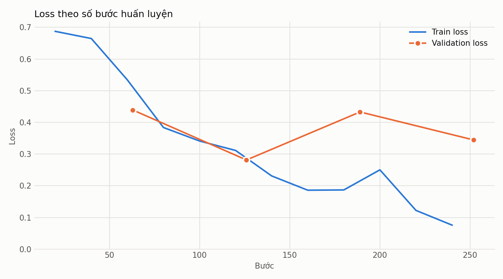
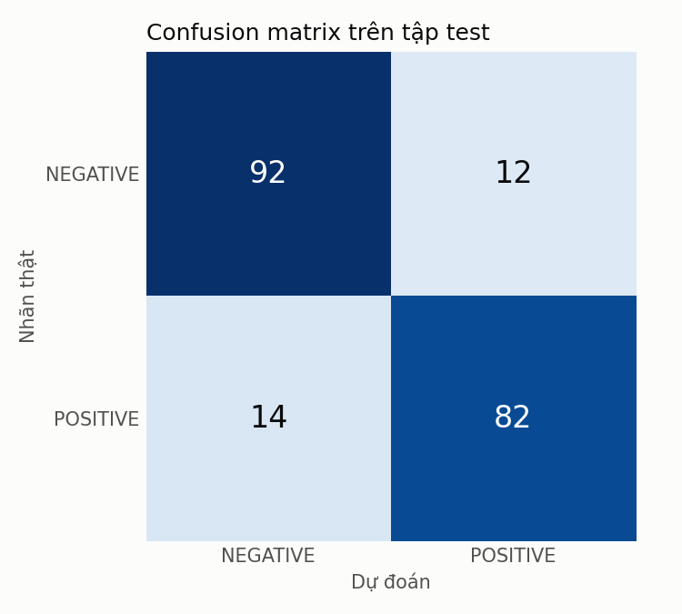

# Báo Cáo Đánh Giá (Performance Evaluation) — Lab 3

## 0. Thông tin tài liệu

| Trường | Nội dung |
| --- | --- |
| Name | Báo Cáo Đánh Giá (Performance Evaluation) — Lab 3 |
| Created date | Chưa xác nhận |
| Created by | HoangDang (Nguyễn Hoàng Đăng) |
| Ghi nhận Git đầu tiên | 2026-11-04T10:34:00+07:00 ; HoangDang ; aee3dd8 |
| Last updated | 2026-11-13T08:55:07+07:00 |
| Updated by | AI agent (thực thi kế hoạch của HoangDang) |
| Phạm vi | Tài liệu kế thừa bản QuocAn; nội dung lịch sử, xem bộ 01–12 cho bản chính |

> **Trạng thái**: Đã có số liệu chính thức từ lần chạy trên Colab, GPU Tesla T4, ngày 2026-11-06. Toàn bộ số liệu lấy từ `reports/metrics.json`. Cả 7 KPI đều đạt.

Mã nguồn: `src/exercise_2/evaluation.py`.

Bổ sung tích hợp ngày 2026-11-12 bởi HoangDang theo `08_implementation.md` mục 10. Hai KPI tốc độ được đối chiếu khi tên GPU đo là T4. Báo cáo mới lưu tên GPU và mốc phần cứng, thời gian thô tiếp tục được ghi. Lệnh đánh giá từ chối ghi đè mục evaluation đã có.

## 1. Nhật Ký Huấn Luyện

Số dòng phụ thuộc vào epoch dừng thực tế, tối đa 5 dòng. Nguồn: `training.epochs`.

| Epoch | Train Loss | Val Loss | Val Accuracy | Val Precision | Val Recall | Val F1 | Val Macro F1 | Giây | Mốc đạt được |
| :---: | :---: | :---: | :---: | :---: | :---: | :---: | :---: | :---: | :--- |
| 1 | 0,6287 | 0,4392 | 0,8050 | 0,9605 | 0,6697 | 0,7892 | 0,8039 | 6,59 | `final_epoch`, `best_val_loss`, `best_val_acc` |
| 2 | 0,3456 | 0,2815 | 0,8850 | 0,9057 | 0,8807 | 0,8930 | 0,8843 | 7,04 | `final_epoch`, `best_val_loss`, `best_val_acc` |
| 3 | 0,2014 | 0,4330 | 0,8500 | 0,9647 | 0,7523 | 0,8454 | 0,8499 | 6,31 | `final_epoch` |
| 4 | 0,1496 | 0,3447 | 0,8900 | 0,9394 | 0,8532 | 0,8942 | 0,8898 | 6,35 | `final_epoch`, `best_val_acc` |

- **Train Loss** là trung bình các giá trị được ghi trong epoch đó.
- **Đã chạy**: 4 / 5 epoch. **Dừng sớm**: Có. **Mốc `best` ở epoch**: 4.
- **Lý do dừng sớm**: Accuracy tốt nhất tính đến epoch 2 là 0,885. Epoch 3 giảm còn 0,850, epoch 4 chỉ tăng 0,005 lên 0,890, chưa vượt ngưỡng cải thiện 0,01. Sau 2 epoch không cải thiện đủ ngưỡng, quá trình huấn luyện dừng đúng quy tắc `patience = 2`.
- **Nhận xét**: Từ epoch 3, train loss tiếp tục giảm trong khi validation loss cao hơn mức thấp nhất ở epoch 2, cho thấy model bắt đầu overfit. Mốc `best` chọn theo accuracy nên là epoch 4, còn mốc `best_val_loss` là epoch 2.
- **Biểu đồ loss**: `reports/figures/loss_curve.png`.

## 2. Đối Chiếu KPI

Nguồn: `evaluation.kpi`. Điều kiện chạy: GPU T4, 1.000 mẫu train, batch 16.

| Chỉ số | Giá trị đo | Mục tiêu | Kết quả | Cách đo |
| :--- | :---: | :---: | :---: | :--- |
| Validation Accuracy | $89.0\%$ | $\ge 85.0\%$ | Đạt | Của mốc `best` |
| Test Accuracy | $87.0\%$ | $\ge 85.0\%$ | Đạt | Mốc `best`, 200 mẫu test |
| Test Macro F1 | $0.8697$ | $\ge 0.85$ | Đạt | Mốc `best`, 200 mẫu test |
| Thời gian train | $6.57$ giây/epoch | $\le 180$ giây/epoch | Đạt | Trung bình các epoch, không tính thời gian đánh giá |
| Độ trễ suy luận | $7.64$ ms/mẫu | $\le 25$ ms/mẫu | Đạt | Tokenize và suy luận từng mẫu trên GPU, trung bình 200 mẫu test, 5 lần chạy nháp đầu không tính |
| VRAM cao nhất | $1.68$ GB | $\le 4.0$ GB | Đạt | `torch.cuda.max_memory_allocated()`, đặt lại ở đầu mỗi tiến trình; lấy mức cao nhất của train và đánh giá |
| RAM cao nhất | $1.91$ GB | $\le 6.0$ GB | Đạt | Mức cao nhất của tiến trình tính từ khi khởi động; lấy mức cao nhất của train và đánh giá |

## 3. Kết Quả Trên Tập Test

Tập test chỉ dùng một lần, trên mốc `best`. Nguồn: `evaluation.test_metrics`.

| Accuracy | Sai số (95%) | Precision | Recall | F1 | Macro F1 | Loss |
| :---: | :---: | :---: | :---: | :---: | :---: | :---: |
| 0,8700 | $\pm 4{,}66$ điểm % | 0,8723 | 0,8542 | 0,8632 | 0,8697 | 0,3505 |

Test Accuracy đạt mục tiêu, nhưng khoảng tin cậy 95% là 82,3%–91,7%, có phần nằm dưới mức 85%. Vì vậy, với 200 mẫu test, kết quả này chưa đủ để khẳng định accuracy thực của model chắc chắn từ 85% trở lên.

### Confusion Matrix

| Nhãn thật \ Dự đoán | NEGATIVE | POSITIVE |
| :--- | :---: | :---: |
| **NEGATIVE** | 92 | 12 |
| **POSITIVE** | 14 | 82 |

Model đoán sai 26/200 mẫu: 12 mẫu NEGATIVE bị đoán thành POSITIVE và 14 mẫu POSITIVE bị đoán thành NEGATIVE, nên lỗi khá cân bằng giữa 2 lớp.

### Kiểm tra lại checkpoint

Sau khi tải checkpoint về máy, nhóm nạp lại và đo trên CPU để xác nhận số liệu khớp với báo cáo. Lần đo này không dùng để chọn model.

| Mốc | Tập | Kết quả báo cáo trên GPU | Kết quả đo lại trên CPU |
| :--- | :--- | :---: | :---: |
| `best` | Test | Accuracy 0,8700; Loss 0,3505 | Accuracy 0,8700; Loss 0,3505; cùng confusion matrix |
| `best` | Validation | Accuracy 0,8900; Loss 0,3447 | Accuracy 0,8900; Loss 0,3446 |
| `best_val_loss` | Validation | Accuracy 0,8850; Loss 0,2815 | Accuracy 0,8850; Loss 0,2815 |

## 4. Checkpoint

| Mốc | Đường dẫn | Epoch | Giá trị |
| :--- | :--- | :---: | :---: |
| `final_epoch` | `checkpoints/final_epoch/` | 4 | Accuracy: 0,8900; Loss: 0,3447 |
| `best_val_loss` | `checkpoints/best_val_loss/` | 2 | Loss: 0,2815 |
| `best_val_acc` | `checkpoints/best_val_acc/` | 4 | Accuracy: 0,8900 |
| `best_val_pause` | Không có thư mục | 4 | Có dừng sớm |
| `best` | `checkpoints/best/` | 4 | Bản sao của `best_val_acc` |

## 5. Môi Trường Chạy

Nguồn: `training.device`, `training.library_versions`.

| GPU | torch | transformers | datasets | evaluate | accelerate | scikit-learn |
| :--- | :---: | :---: | :---: | :---: | :---: | :---: |
| Tesla T4 | 2.11.0+cu130 | 5.22.0 | 4.8.5 | 0.4.6 | 1.15.0 | 1.6.1 |

## 6. Lần Chạy Trước (Chỉ Để Tham Khảo)

Kết quả trong `notebooks/Lab_3_quocan.ipynb`. Lần chạy này khác đặc tả hiện tại nên **không dùng để nghiệm thu**: 2 epoch, batch 8, chưa làm sạch ` `, dùng model ở bước cuối thay vì model tốt nhất.

| Tập | Mẫu | Accuracy | Precision | Recall | F1 | Loss |
| :--- | :---: | :---: | :---: | :---: | :---: | :---: |
| Validation | 200 | 0,885 | 0,898 | 0,890 | 0,894 | 0,312 |
| Test | 200 | 0,830 | 0,792 | 0,875 | 0,832 | 0,364 |

## Nguồn và phạm vi

- Nhập từ nhánh QuocAn, đầu nhánh `32ca8b1`; không diễn giải kết quả cũ thành số đo sau chuẩn hóa.
- [Bản chính](01_lab_3_description.md), [nhật ký đồng bộ](../../BRANCH_SYNC_2026-11-11.md). Lần cập nhật hiện tại chỉ chuẩn hóa thông tin và phân loại tài liệu.
