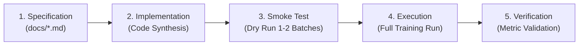

# Module 03 — Transformers Fine-Tuning & Sentiment Analysis Specification

## 1. Project Overview & Objectives
- **Domain**: Natural Language Processing (NLP) / Text Classification.
- **Frameworks**: Hugging Face Ecosystem (`transformers`, `datasets`, `evaluate`, `accelerate`) & PyTorch.
- **Core Deliverables**:
  - **Module A (Inference Pipeline)**: End-to-end sentiment analysis inference pipeline leveraging pre-trained transformer checkpoints.
  - **Module B (Fine-Tuning Architecture)**: Domain adaptation & fine-tuning of `distilbert-base-uncased` for binary sentiment classification on the IMDB benchmark.

---

## 2. Engineering Methodology (Spec-Driven Development)

Mô hình triển khai kiểm thử nghiêm ngặt theo tiêu chuẩn kỹ nghệ phần mềm máy học (MLOps Lifecycle):

1. **Specification**: Định nghĩa chi tiết hợp đồng dữ liệu, tham số mô hình và tiêu chí nghiệm thu trước khi viết mã nguồn.
2. **Implementation**: Triển khai logic theo đúng kiến trúc đã thiết kế.
3. **Smoke Test**: Kiểm tra luồng tính toán với mini-batch ($1 \sim 2$ batches) để xác thực tính toàn vẹn của tensor shapes, gradient computation và giới hạn bộ nhớ VRAM.
4. **Execution**: Huấn luyện đầy đủ trên toàn bộ dữ liệu.
5. **Verification**: Đối chiếu kết quả nghiệm thu với mục tiêu chất lượng ban đầu.

---

## 3. Key Performance Indicators (KPIs & Metrics)

Toàn bộ quá trình thực nghiệm phải được đo lường và định lượng theo 3 chiều:

1. **Model Accuracy & Quality**:
   - Validation & Test Accuracy: Target $\ge 85.0\%$.
   - F1-Score (Macro / Binary) & Precision / Recall balance.
2. **Computational Latency (Time Processing)**:
   - Training Throughput: Thời gian hoàn tất mỗi epoch (`seconds/epoch`).
   - Inference Latency: Thời gian phản hồi cho mỗi mẫu văn bản (`milliseconds/sample`).
3. **Resource Footprint**:
   - Peak GPU VRAM Allocation: Giám sát bằng `torch.cuda.max_memory_allocated()`.
   - Host System RAM Utilization: Đảm bảo khả năng mở rộng trong môi trường hạn chế tài nguyên.

---

## 4. Checkpoint Policy & Early Stopping Management

Hệ thống huấn luyện tự động lưu trữ và quản lý các mốc trọng số theo quy chuẩn:

| Checkpoint Identifier | Path | Trigger Condition & Description |
| :--- | :--- | :--- |
| **`final_epoch`** | `checkpoints/final_epoch/` | Trọng số mô hình ở epoch cuối cùng của chu trình huấn luyện. |
| **`best_val_loss`** | `checkpoints/best_val_loss/` | Trọng số đạt giá trị hàm mất mát nhỏ nhất trên tập kiểm định. |
| **`best_val_acc`** | `checkpoints/best_val_acc/` | Trọng số đạt độ chính xác phân loại cao nhất trên tập kiểm định. |
| **`best_val_pause`** | `EarlyStopping(patience=2)` | **Early Stopping Policy**: Tự động ngắt huấn luyện nếu tỷ lệ cải thiện metric sau $N$ epochs dưới ngưỡng $0\% \sim 2\%$ để chống Overfitting và tối ưu chi phí tính toán. |
| **`best`** | `checkpoints/best/` | Checkpoint tối ưu tổng thể được lựa chọn để đóng gói release và phục vụ suy luận thực tế (Production Deployment). |
