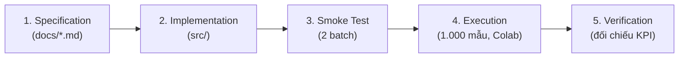
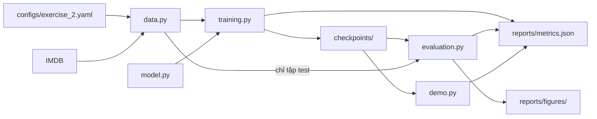

# Practice 3 — Get Started with Hugging Face: Đặc Tả Tổng Quan

## 0. Thông tin tài liệu

| Trường | Nội dung |
| --- | --- |
| Name | Practice 3 — Get Started with Hugging Face: Đặc Tả Tổng Quan |
| Created date | Chưa xác nhận |
| Created by | Chưa xác nhận người tạo nội dung |
| Ghi nhận Git đầu tiên | 2026-11-04T10:34:00+07:00 ; HoangDang ; aee3dd8 |
| Last updated | 2026-11-11T08:52:28+07:00 |
| Updated by | HoangDang (Nguyễn Hoàng Đăng), hỗ trợ OpenAI Codex |
| Phạm vi | Tài liệu kế thừa bản QuocAn; nội dung lịch sử, xem bộ 01–12 cho bản chính |

## 1. Bài Toán & Mục Tiêu
- **Lĩnh vực**: Xử lý ngôn ngữ tự nhiên (NLP), phân loại văn bản.
- **Công nghệ**: `transformers`, `datasets`, `evaluate`, `accelerate` và PyTorch.
- **Mục tiêu**: Dùng model có sẵn để phân tích cảm xúc (Exercise 1) và fine-tune model để phân loại nhị phân (Exercise 2).

Hai tên gọi trong tài liệu cũ tương ứng với đề bài như sau: **Module A = Exercise 1**, **Module B = Exercise 2**. Từ đây trở đi, tài liệu dùng tên theo đề bài.

### Đầu vào và đầu ra

| Exercise | Đầu vào | Đầu ra |
| :--- | :--- | :--- |
| **Exercise 1** | Một câu văn bản, không rỗng | Danh sách token, nhãn cảm xúc (1 trong 5 nhãn), điểm tin cậy |
| **Exercise 2 (huấn luyện)** | Tập IMDB và `configs/exercise_2.yaml` | Các mốc trong `checkpoints/`, `reports/metrics.json`, biểu đồ trong `reports/figures/` |
| **Exercise 2 (suy luận)** | Một đánh giá phim | `POSITIVE` hoặc `NEGATIVE` kèm độ tin cậy |

---

## 2. Đối Chiếu Với Đề Bài

| Đề bài | Yêu cầu | Đặc tả | Mã nguồn |
| :--- | :--- | :--- | :--- |
| Exercise 1, bước 1 | Cài `transformers` | `README.md` | `requirements.txt`, cell cài đặt trong notebook |
| Exercise 1, bước 2 | Dùng model sentiment có sẵn | `model.md` mục 1 | `src/exercise_1/sentiment_analysis.py` |
| Exercise 1, bước 3 | Tokenize một câu | `demo.md` mục 1 | `src/exercise_1/sentiment_analysis.py` |
| Exercise 1, bước 4 | Phân tích cảm xúc | `demo.md` mục 1 | `src/exercise_1/sentiment_analysis.py` |
| Exercise 2, bước 1 | Cài `transformers`, `datasets`, `evaluate` | `README.md` | `requirements.txt`, cell cài đặt trong notebook |
| Exercise 2, bước 2 | Tải dataset nhị phân | `data.md` mục 1–2 | `src/exercise_2/data.py` |
| Exercise 2, bước 3 | Tải model và tokenizer | `model.md` mục 2 | `src/exercise_2/model.py` |
| Exercise 2, bước 4 | Tiền xử lý dữ liệu | `data.md` mục 3 | `src/exercise_2/data.py` |
| Exercise 2, bước 5 | Khai báo training arguments | `training.md` mục 1 | `configs/exercise_2.yaml`, `src/exercise_2/training.py` |
| Exercise 2, bước 6 | Tạo `Trainer` và fine-tune | `training.md` mục 2–4 | `src/exercise_2/training.py` |
| Exercise 2, bước 7 | Đánh giá model | `evaluation.md` | `src/exercise_2/evaluation.py` |

---

## 3. Phạm Vi, Ràng Buộc & Giả Định

- **Ngoài phạm vi**: So sánh với CNN, triển khai thành dịch vụ, huấn luyện trên toàn bộ IMDB, dò siêu tham số tự động, tiếp tục huấn luyện từ giữa chừng.
- **Ràng buộc môi trường**: Máy cá nhân không đủ khả năng huấn luyện. Giảng viên cho phép viết mã trong file `.py` và chạy qua `.ipynb` trên Google Colab để lấy số liệu.
- **Ràng buộc dữ liệu**: Đề bài không quy định số mẫu. Nhóm chọn 1.000 train, 200 val, 200 test.
- **Giả định**: Colab có GPU T4 và Google Drive còn trống khoảng 1,03 GB cho 4 thư mục checkpoint (mỗi thư mục đo được 257 MB).

---

## 4. Quy Trình Thực Hiện

---

## 5. Thiết Kế Exercise 2

### Luồng dữ liệu

### Giao diện giữa các file

| File | Hàm chính | Đầu vào | Đầu ra |
| :--- | :--- | :--- | :--- |
| `common.py` | `load_config`, `update_report`, `read_report` | Đường dẫn cấu hình; tên mục và giá trị | Cấu hình dạng `dict`; `metrics.json` |
| `data.py` | `load_splits` | Cấu hình | Tập train, val, test |
| `data.py` | `tokenize_dataset` | Dataset, tokenizer, cấu hình | Dataset đã tokenize |
| `model.py` | `load_model`, `load_tokenizer` | Cấu hình | Model 2 lớp; tokenizer |
| `training.py` | `is_better` | Mốc đang xét và mốc tốt nhất hiện tại | `True` nếu mốc đang xét tốt hơn |
| `evaluation.py` | `compute_metrics` | Logits và nhãn | Accuracy, precision, recall, F1, Macro F1 |

### Rủi ro kỹ thuật

| Rủi ro | Ảnh hưởng | Cách xử lý |
| :--- | :--- | :--- |
| Tập test chỉ có 200 mẫu | Sai số khoảng ±5 điểm phần trăm | Báo cáo khoảng tin cậy 95% cùng accuracy |
| Colab ngắt phiên khi đang train | Mất tiến trình | Chạy lại từ đầu; mốc `best` cũ chỉ bị thay khi lần chạy mới hoàn tất |
| Không có GPU | Không đo được KPI tốc độ và VRAM | Vẫn chạy, các KPI đó ghi "Không đo được" |
| Phiên bản thư viện thay đổi | API có thể khác | Ghi phiên bản thật vào `metrics.json` và `evaluation.md` |

---

## 6. Chỉ Số Đánh Giá (KPIs)

1. **Chất lượng model**: Validation Accuracy và Test Accuracy $\ge 85.0\%$; Macro F1 trên tập test $\ge 0.85$; báo cáo thêm Precision, Recall và F1 binary.
2. **Tốc độ**: Thời gian train mỗi epoch $\le 180$ giây với 1.000 mẫu, batch 16, GPU T4; độ trễ suy luận $\le 25$ ms/mẫu.
3. **Tài nguyên**: VRAM cao nhất $\le 4.0$ GB; RAM cao nhất $\le 6.0$ GB.

Cách đo từng chỉ số nằm trong `evaluation.md` mục 2. Nếu kết quả không đạt, giữ nguyên mục tiêu và ghi "Không đạt" kèm lý do.

---

## 7. Chính Sách Checkpoint & Early Stopping

| Mốc | Đường dẫn | Điều kiện |
| :--- | :--- | :--- |
| **`final_epoch`** | `checkpoints/final_epoch/` | Trọng số của epoch cuối cùng đã chạy. |
| **`best_val_loss`** | `checkpoints/best_val_loss/` | Epoch có validation loss thấp nhất. |
| **`best_val_acc`** | `checkpoints/best_val_acc/` | Epoch có validation accuracy cao nhất; nếu bằng nhau thì lấy loss thấp hơn. |
| **`best_val_pause`** | Không có thư mục riêng | Quy tắc dừng sớm: `patience=2`, ngưỡng cải thiện $1\%$. Epoch dừng được ghi trong `evaluation.md`. |
| **`best`** | `checkpoints/best/` | Bản sao của `best_val_acc`, dùng cho đánh giá test và demo. |

**Quy tắc chọn `best`**: chỉ dựa trên tập validation. Tập test tuyệt đối không tham gia vào việc chọn model.

---

## 8. Bảng Nghiệm Thu

Cột "Kết quả" chỉ được ghi Đạt hoặc Không đạt sau khi đã có bằng chứng từ lần chạy thật.

| Mã | Tiêu chí | Cách kiểm tra | Bằng chứng | Kết quả |
| :--- | :--- | :--- | :--- | :--- |
| AC-01 | Exercise 1 in ra token, nhãn và điểm cho câu hợp lệ | `python -m exercise_1.sentiment_analysis --text "..."` | Đầu ra trong notebook, `demo.md` | Đạt: đầu ra Colab khớp `demo.md` |
| AC-02 | Exercise 1 từ chối câu rỗng | `tests/test_exercise_2.py` | Kết quả pytest | Đạt: 18/18 test trên Colab |
| AC-03 | Các tập dữ liệu đúng số mẫu và không trùng mẫu | `tests/test_exercise_2.py`, `python -m exercise_2.data` | Kết quả pytest, mục `data` trong `metrics.json` | Đạt: 1.000/200/200 mẫu, 0 câu trùng |
| AC-04 | Smoke test 2 batch đạt | `tests/test_smoke.py` | Kết quả pytest | Đạt trên GPU T4: VRAM 2,26 GB |
| AC-05 | Huấn luyện xong tạo đủ 4 thư mục checkpoint | `python -m exercise_2.training` | Thư mục `checkpoints/` | Đạt: đủ 4 thư mục, mỗi thư mục 257 MB |
| AC-06 | Early stopping dừng đúng quy tắc | `python -m exercise_2.training` | Mục `training.stopped_early`, nhật ký epoch | Đạt: dừng ở epoch 4/5 đúng `patience = 2`, ngưỡng 0,01 |
| AC-07 | Tất cả KPI được đo và đối chiếu | `python -m exercise_2.evaluation` | Mục `evaluation.kpi`, `evaluation.md` | Đạt: đo đủ 7 KPI và cả 7 đều đạt |
| AC-08 | Demo suy luận được bằng mốc `best` | `python -m exercise_2.demo` | Mục `demo`, `demo.md` | Đạt: 2/2 câu có nhãn dự đoán đúng |
| AC-09 | Run all trên notebook không lỗi | Chạy `notebooks/Lab_3_colab.ipynb` trên Colab | Notebook đã lưu kết quả | Đạt: 13 cell code chạy theo thứ tự, không lỗi, đã lưu đầu ra |

## Nguồn và phạm vi

- Nhập từ nhánh QuocAn, đầu nhánh `32ca8b1`; không diễn giải kết quả cũ thành số đo sau chuẩn hóa.
- [Bản chính](01_lab_3_description.md), [nhật ký đồng bộ](../../BRANCH_SYNC_2026-11-11.md). Lần cập nhật hiện tại chỉ chuẩn hóa thông tin và phân loại tài liệu.
