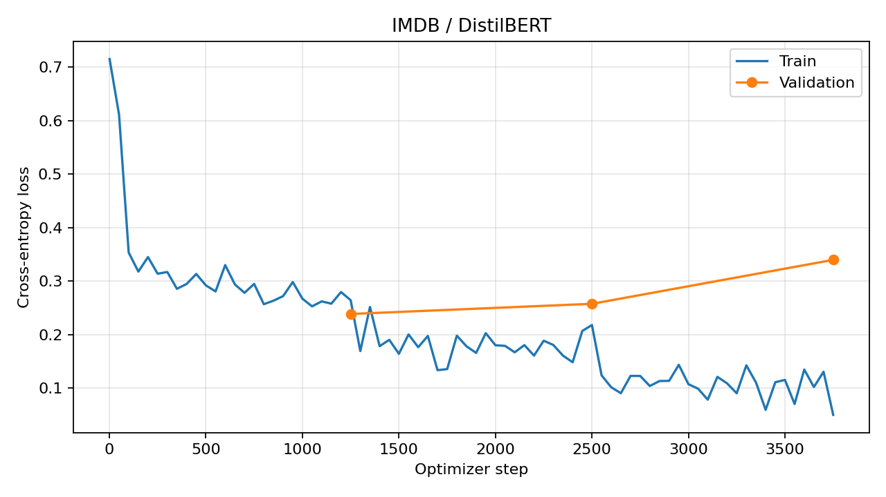
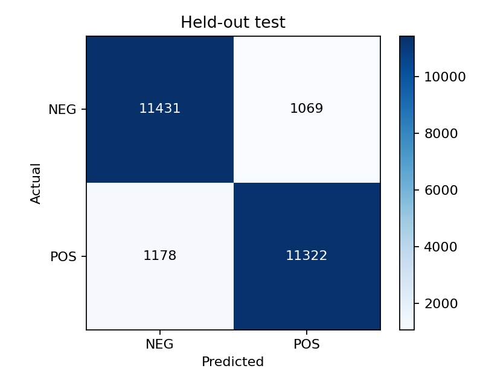

# Lab 3 — báo cáo thực nghiệm

Mode: **full**; thiết bị: NVIDIA GeForce RTX 5060 Laptop GPU.
Smoke/quick không thay thế nghiệm thu full. Test không dùng chọn checkpoint.

| Chỉ số test | Giá trị |
| --- | ---: |
| test_loss | 0.346539 |
| test_model_preparation_time | 0.001000 |
| test_accuracy | 0.910120 |
| test_precision | 0.913728 |
| test_recall | 0.905760 |
| test_f1_binary | 0.909726 |
| test_f1_macro | 0.910118 |
| test_runtime | 31.420200 |
| test_samples_per_second | 795.666000 |
| test_steps_per_second | 49.745000 |

| Tiêu chí | Kết quả |
| --- | --- |
| test_accuracy_ge_0.85 | True |
| test_macro_f1_ge_0.85 | True |
| validation_accuracy_ge_0.85 | True |
| latency_mean_le_25ms | True |
| gpu_peak_le_4GiB | True |
| host_observed_rss_le_6GiB | True |
| T4_epoch_le_180s | N/A: device is not Colab T4 |

## Epoch

| Epoch | Val loss | Val accuracy | Macro F1 | Wall seconds |
| ---: | ---: | ---: | ---: | ---: |
| 1.00 | 0.238463 | 0.9104 | 0.9104 | 113.11 |
| 2.00 | 0.257449 | 0.9132 | 0.9132 | 111.24 |
| 3.00 | 0.339619 | 0.9134 | 0.9134 | 109.95 |

Chi tiết số đo, phân lớp, latency, RAM/GPU và cấu hình: [metrics.json](metrics.json).
Nguồn/hash từng artifact: [artifacts.md](artifacts.md).

## Nguồn và phạm vi

- Đặc tả: `docs/implementation.md`, `docs/evaluation.md`, `docs/AI_Usage.md` (tính từ Lab 3/).
- Dữ liệu trực tiếp: `metrics.json`, `epoch_history.json`, `trainer_history.json` cùng run.
- Sinh bằng `lab3.py::render_report`; không sao chép số từ run khác.
