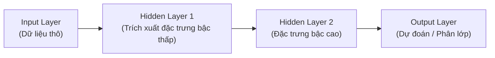

# Chapter 01 — Introduction to Deep Learning

> **Giảng viên**: PhD. Nguyễn Thị Khánh Tiên (`tienntk@ut.edu.vn`)  
> **Đơn vị**: Viện Công Nghệ Thông Tin, Điện, Điện Tử — Trường Đại Học Giao Thông Vận Tải TP.HCM  
> **Tài liệu gốc**: `Chapter 01 - Introduction to Deep Learning.pdf`

---

## 📑 Mục Lục
1. [Khái Niệm Cốt Lõi Về Deep Learning](#1-khái-niệm-cốt-lõi-về-deep-learning)
2. [So Sánh Deep Learning vs Machine Learning Truyền Thống](#2-so-sánh-deep-learning-vs-machine-learning-truyền-thống)
3. [Lịch Sử Phát Triển (History & Milestones)](#3-lịch-sử-phát-triển-history--milestones)
4. [Động Lực & Đột Phá (Motivation & Evolution)](#4-động-lực--đột-phá-motivation--evolution)
5. [Các Kiến Trúc Mạng Deep Learning Phổ Biến](#5-các-kiến-trúc-mạng-deep-learning-phổ-biến)
6. [Các Bài Toán Cốt Lõi Deep Learning Giải Quyết](#6-các-bài-toán-cốt-lõi-deep-learning-giải-quyết)
7. [Những Thách Thức Trong Deep Learning](#7-những-thách-thức-trong-deep-learning)
8. [Các Bộ Dữ Liệu Kinh Điển Cho Người Mới Bắt Đầu](#8-các-bộ-dữ-liệu-kinh-điển-cho-người-mới-bắt-đầu)
9. [Nguồn Bài Tập & Tài Liệu Tham Khảo](#9-nguồn-bài-tập--tài-liệu-tham-khảo)
10. [💡 Liên Hệ Thực Hành Với Các Bài Lab](#10--liên-hệ-thực-hành-với-các-bài-lab)

---

## 1. Khái Niệm Cốt Lõi Về Deep Learning

**Deep Learning (Học sâu)** là một nhánh con của **Machine Learning (Học máy)**, tập trung vào việc mô phỏng các mạng nơ-ron nhân tạo lấy cảm hứng từ cấu trúc não bộ con người nhằm giải quyết các bài toán biểu diễn dữ liệu phức tạp.

### Các thành phần chính:
- **Neural Networks (Mạng nơ-ron)**: Tập hợp các nút tính toán (neurons) liên kết với nhau theo các tầng (layers):
  - **Input Layer**: Tiếp nhận dữ liệu thô (ảnh, chuỗi text, vector số).
  - **Hidden Layers (Các tầng ẩn)**: Thực hiện các phép tính tuyến tính và phi tuyến phức tạp. Càng nhiều tầng ẩn thì mạng càng "sâu" (deep).
  - **Output Layer**: Trả về kết quả đầu ra cuối cùng (nhãn phân loại, giá trị hồi quy).
- **Cơ chế hoạt động**:
  1. Mô hình xử lý khối lượng lớn dữ liệu thông qua lan truyền tiến (**Forward Propagation**).
  2. Tự động rút trích đặc trưng (**Automatic Feature Extraction**), loại bỏ bước trích xuất thủ công.
  3. Cập nhật và tinh chỉnh các trọng số (**Weights**) và độ lệch (**Biases**) thông qua thuật toán lan truyền ngược (**Backpropagation**) cùng giải thuật tối ưu (Gradient Descent) để cực tiểu hóa sai số giữa kết quả dự đoán và nhãn thực tế.

---

## 2. So Sánh Deep Learning vs Machine Learning Truyền Thống

| Tiêu Chí Đối Chiếu | Traditional Machine Learning | Deep Learning |
| :--- | :--- | :--- |
| **Trích xuất đặc trưng (Feature Extraction)** | **Thủ công (Manual)**: Cần chuyên gia nghiên cứu chọn lọc đặc trưng (SIFT, HOG, TF-IDF). | **Tự động (End-to-End)**: Mô hình tự học các tầng đặc trưng từ dữ liệu thô. |
| **Yêu cầu dữ liệu (Data Dependency)** | Hiệu quả tốt trên tập dữ liệu nhỏ đến trung bình. | Cần khối lượng dữ liệu khổng lồ (Big Data) để đạt độ chính xác cao. |
| **Độ phức tạp & Khả năng xử lý** | Phù hợp với bài toán tuyến tính, dữ liệu có cấu trúc bảng (Tabular data). | Xử lý xuất sắc dữ liệu phi cấu trúc phức tạp (Ảnh, Video, Âm thanh, Văn bản). |
| **Phần cứng yêu cầu** | Chạy tốt trên CPU thông thường. | Cần phần cứng chuyên dụng: GPU, TPU, VRAM dung lượng lớn. |
| **Thời gian huấn luyện** | Nhanh (vài giây đến vài giờ). | Rất lâu (vài giờ, vài ngày hoặc hàng tuần). |
| **Khả năng giải thích (Interpretability)** | Tương đối rõ ràng, dễ phân tích trọng số. | Mô hình "Hộp đen" (**Black Box**), khó giải thích cơ chế suy luận chi tiết. |

---

## 3. Lịch Sử Phát Triển (History & Milestones)

- **Giai đoạn sơ khai (1940s – 1960s)**:
  - `1943`: Warren McCulloch & Walter Pitts đề xuất mô hình tính toán nơ-ron đầu tiên.
  - `1958`: Frank Rosenblatt giới thiệu **Perceptron** — nơ-ron nhân tạo có khả năng học trọng số.
  - Sau đó gặp giới hạn (không giải được bài toán XOR) dẫn đến giai đoạn trầm lắng (**AI Winter**).
- **Giai đoạn tái khởi sắc (1980s – 1990s)**:
  - `1986`: Sự ra đời của thuật toán **Backpropagation** (Geoffrey Hinton và cộng sự) cho phép huấn luyện mạng nơ-ron nhiều tầng.
  - `1989 - 1998`: Yann LeCun phát triển mạng tích chập **LeNet-5** nhận dạng chữ số viết tay trên séc ngân hàng, chứng minh tiềm năng thực tiễn của CNN.
- **Cuộc cách mạng Deep Learning bùng nổ (2000s – Hiện nay)**:
  - `2012`: **AlexNet** chiến thắng áp đảo tại cuộc thi ImageNet nhờ sức mạnh tính toán của GPU.
  - `2016`: **AlphaGo** (DeepMind) đánh bại nhà vô địch cờ vây thế giới Lee Sedol.
  - `2017 - nay`: Kiến trúc **Transformer** ra đời với cơ chế Self-Attention, cách mạng hóa toàn bộ ngành Xử lý ngôn ngữ tự nhiên (NLP) với BERT, GPT, LLMs.

---

## 4. Động Lực & Đột Phá (Motivation & Evolution)

Sự trỗi dậy của Deep Learning được thúc đẩy bởi 4 yếu tố cốt lõi:
1. **Mô phỏng não bộ**: Khả năng phân cấp biểu diễn (Hierarchical representations) tương tự vỏ não thị giác.
2. **Tự động hóa Feature Engineering**: Tiết kiệm hàng ngàn giờ tiền xử lý dữ liệu thủ công.
3. **Sự bùng nổ của Dữ liệu lớn (Big Data)**: Internet, mạng xã hội, thiết bị IoT cung cấp nguồn dữ liệu dồi dào.
4. **Phần cứng tính toán vượt bậc**: Card đồ họa GPU (Nvidia CUDA), Google TPU giúp tính toán ma trận song song tốc độ cao.

---

## 5. Các Kiến Trúc Mạng Deep Learning Phổ Biến

1. **Convolutional Neural Networks (CNNs)**:
   - *Ứng dụng*: Nhận diện hình ảnh, phân loại ảnh, Object Detection, phân tích video.
   - *Thành phần*: Convolutional layer, Pooling layer, Fully Connected layer.
   - *Mô hình tiêu biểu*: AlexNet, VGG, ResNet, EfficientNet.
2. **Recurrent Neural Networks (RNNs)**:
   - *Ứng dụng*: Dữ liệu dạng chuỗi (Sequential data), Time series, Xử lý tiếng nói.
   - *Biến thể*: LSTM (Long Short-Term Memory), GRU (Gated Recurrent Unit).
3. **Transformers**:
   - *Ứng dụng*: Dịch máy, tóm tắt văn bản, hỏi đáp, LLM, gần đây mở rộng sang thị giác máy (Vision Transformer - ViT).
   - *Cơ chế*: Attention Mechanism (Cơ chế chú ý).
   - *Mô hình tiêu biểu*: BERT, RoBERTa, GPT series, T5.
4. **Generative Adversarial Networks (GANs)**:
   - *Ứng dụng*: Sinh ảnh chân thực, tổng hợp nhạc, biến đổi phong cách ảnh.
   - *Cơ chế*: 2 mạng đối nghịch gồm Generator (Sinh) và Discriminator (Phân biệt).
5. **Autoencoders**:
   - *Ứng dụng*: Giảm chiều dữ liệu, nén ảnh, phát hiện bất thường (Anomaly Detection).
   - *Cấu trúc*: Bộ mã hóa (Encoder) và Bộ giải mã (Decoder).
6. **Graph Neural Networks (GNNs)**:
   - *Ứng dụng*: Dữ liệu đồ thị (Mạng xã hội, cấu trúc hóa học phân tử, tri thức liên kết).

---

## 6. Các Bài Toán Cốt Lõi Deep Learning Giải Quyết

1. **Classification (Phân loại)**:
   - Gán đối tượng vào các danh mục định trước (ví dụ: Phân biệt chó/mèo, phân loại email Spam/Ham).
   - *Kỹ thuật*: CNN, Transformer, Softmax cross-entropy loss.
2. **Regression (Hồi quy)**:
   - Dự đoán giá trị số liên tục (ví dụ: Dự báo giá nhà đất, dự báo nhiệt độ).
   - *Kỹ thuật*: Feedforward Neural Networks (MLP), MSE loss.
3. **Object Detection (Phát hiện vật thể)**:
   - Vừa phân loại vừa xác định tọa độ khung chứa (Bounding box) của vật thể.
   - *Mô hình*: YOLO, Faster R-CNN, SSD.
4. **Image Segmentation (Phân đoạn ảnh)**:
   - Gán nhãn cho từng điểm ảnh (Pixel-level classification).
   - *Mô hình*: U-Net, Mask R-CNN, FCN.
5. **Natural Language Processing (NLP)**:
   - Phân tích cảm xúc (Sentiment Analysis), dịch máy, trả lời câu hỏi.
6. **Generative Modeling (Mô hình sinh)**:
   - Sinh dữ liệu mẫu mới (DALL-E, Midjourney, ChatGPT).

---

## 7. Những Thách Thức Trong Deep Learning

- **Phụ thuộc dữ liệu (Data Dependence)**: Đòi hỏi nhãn chuẩn, dễ bị sai lệch nếu dữ liệu đầu vào chứa thiên kiến (bias).
- **Yêu cầu tài nguyên tính toán (Computational Demands)**: Chi phí điện năng, GPU đắt đỏ, thời gian huấn luyện dài.
- **Tính chất "Hộp đen" (Black-Box Nature)**: Khó giải thích logic vì sao mô hình đưa ra quyết định (quan trọng trong y tế, tài chính, tư pháp).
- **Overfitting & Underfitting**: Hiện tượng mô hình học vẹt dữ liệu huấn luyện nhưng dự đoán kém trên dữ liệu mới.
- **Triển khai thực tế (Edge Deployment)**: Khó khăn khi nén mô hình để chạy trên điện thoại, chip nhúng, thiết bị IoT.

---

## 8. Các Bộ Dữ Liệu Kinh Điển Cho Người Mới Bắt Đầu

| Tên Dataset | Loại dữ liệu | Tác vụ chính | Đặc điểm & Ứng dụng |
| :--- | :--- | :--- | :--- |
| **MNIST** | Ảnh xám $28 \times 28$ | Phân loại chữ số viết tay (0-9) | Bộ "Hello World" chuẩn mực để học nơ-ron cơ bản và CNN. |
| **Fashion-MNIST** | Ảnh xám $28 \times 28$ | Phân loại 10 loại trang phục | Khó hơn MNIST, dùng thay thế MNIST để kiểm thử thuật toán. |
| **CIFAR-10** | Ảnh màu $32 \times 32 \times 3$ | Phân loại 10 lớp vật thể (xe hơi, mèo, chó...) | Tập ảnh màu cỡ nhỏ, thích hợp học kiến trúc CNN cơ bản. |
| **IMDB Reviews** | Văn bản (Text) | Phân tích cảm xúc (Tích cực / Tiêu cực) | Dataset chuẩn nhập môn NLP, dùng trong RNN và Transformers. |
| **Boston Housing** | Bảng số liệu (Tabular) | Hồi quy dự đoán giá nhà | Thích hợp học Linear Regression và mạng MLP nhiều tầng. |

---

## 9. Nguồn Bài Tập & Tài Liệu Tham Khảo

- **Khóa học thực hành tương tác**:
  - [Google Developers Machine Learning Crash Course](https://developers.google.com/machine-learning/crash-course)
  - [Kaggle Deep Learning Exercises](https://www.kaggle.com/learn/intro-to-deep-learning)
- **Sách giáo khoa kinh điển**:
  - *Deep Learning* — Ian Goodfellow, Yoshua Bengio, Aaron Courville (MIT Press).
- **Khóa học học thuật**:
  - [NYU Deep Learning SP20 — Yann LeCun & Alfredo Canziani](https://atcold.github.io/NYU-DLSP20/)
  - [YouTube Playlist NYU DLSP20](https://www.youtube.com/watch?v=0bMe_vCZo30&list=PL80I41oVxglKcAHllsU0txr3OuTTaWX2v)

---

## 10. 💡 Liên Hệ Thực Hành Với Các Bài Lab

Kiến thức từ **Chapter 01** kết nối trực tiếp với các bài Lab trong thư mục học tập:

1. **Với bài [`Lab 1`](../Lab%201/)**:
   - Sử dụng các bộ dữ liệu cơ bản (như MNIST hoặc bài toán phân lớp nhị phân) để làm quen với **Forward Propagation**, hàm kích hoạt (**Activation Function**) và tính toán hàm mất mát (**Loss Function**).
2. **Với bài [`Lab 3`](../Lab%203/) & Notebook [`Lab_3 (1).ipynb`](../Lab_3%20(1).ipynb)**:
   - Bài Lab 3 sử dụng chính bộ dữ liệu **IMDB Dataset** (`load_dataset("stanfordnlp/imdb")`) và mô hình Transformer **DistilBERT** để phân tích cảm xúc (Sentiment Analysis) — chính là ứng dụng thực tế của phần *NLP & Transformers* được giới thiệu trong slide này!

