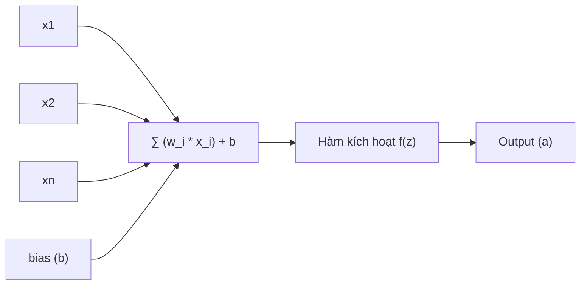
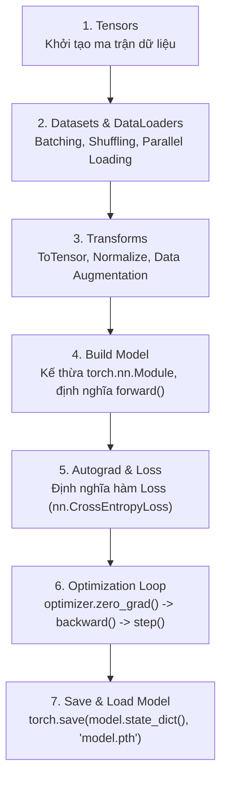

# Chapter 02 — Artificial Neural Networks (ANNs)

> **Giảng viên**: PhD. Nguyễn Thị Khánh Tiên (`tienntk@ut.edu.vn`)  
> **Đơn vị**: Viện Công Nghệ Thông Tin, Điện, Điện Tử — Trường Đại Học Giao Thông Vận Tải TP.HCM  
> **Tài liệu gốc**: `Chapter 02 - Artificial Neural Networks.pdf`

---

## 📑 Mục Lục
1. [Giới Thiệu Mạng Nơ-ron Nhân Tạo (ANNs)](#1-giới-thiệu-mạng-nơ-ron-nhân-tạo-anns)
2. [Cơ Chế Hoạt Động Của Một Nơ-ron (Neuron Computation)](#2-cơ-chế-hoạt-động-của-một-nơ-ron-neuron-computation)
3. [Thuật Toán Lan Truyền Xuôi & Ngược (Forward & Backward Propagation)](#3-thuật-toán-lan-truyền-xuôi--ngược-forward--backward-propagation)
4. [Các Hàm Mất Mát Cốt Lõi (Loss Functions)](#4-các-hàm-mất-mát-cốt-lõi-loss-functions)
5. [Mạng Perceptron Đa Tầng (Multilayer Perceptron - MLP)](#5-mạng-perceptron-đa-tầng-multilayer-perceptron---mlp)
6. [Mạng Nơ-ron Cho Bài Toán Phân Lớp (Classification)](#6-mạng-nơ-ron-cho-bài-toán-phân-lớp-classification)
7. [Các Chỉ Số Đánh Giá Mô Hình (Evaluation Metrics)](#7-các-chỉ-số-đánh-giá-mô-hình-evaluation-metrics)
8. [Vấn Đề Overfitting & Kỹ Thuật Kiểm Soát](#8-vấn-đề-overfitting--kỹ-thuật-kiểm-soát)
9. [MLP Trong Phân Loại Ảnh & Giới Hạn So Với CNN](#9-mlp-trong-phân-loại-ảnh--giới-hạn-so-với-cnn)
10. [Mạng Nơ-ron Cho Bài Toán Hồi Quy (Regression)](#10-mạng-nơ-ron-cho-bài-toán-hồi-quy-regression)
11. [Quy Trình Hoàn Chỉnh Với PyTorch & Bài Thực Hành](#11-quy-trình-hoàn-chỉnh-với-pytorch--bài-thực-hành)
12. [💡 Liên Hệ Thực Hành Với Bài Lab 1](#12--liên-hệ-thực-hành-với-bài-lab-1)

---

## 1. Giới Thiệu Mạng Nơ-ron Nhân Tạo (ANNs)

**Artificial Neural Networks (ANNs)** là mô hình tính toán lấy cảm hứng từ mạng lưới hàng tỷ nơ-ron sinh học trong não bộ con người.
- **Nút (Nodes/Neurons)**: Đơn vị xử lý cơ bản, mô phỏng thân nơ-ron. Giá trị đầu ra sau khi kích hoạt gọi là *activation*.
- **Liên kết (Links/Synapses)**: Mỗi liên kết giữa 2 nơ-ron mang một giá trị số gọi là **Trọng số (Weight - $w$)**.
- **Quá trình học (Learning process)**: Bản chất của việc mô hình học chính là quá trình liên tục điều chỉnh các giá trị trọng số $w$ và độ lệch $b$ để giảm thiểu sai số dự đoán.

---

## 2. Cơ Chế Hoạt Động Của Một Nơ-ron (Neuron Computation)

Mỗi nơ-ron nhân tạo hoạt động tương tự như một mô hình hồi quy tuyến tính kết hợp với hàm kích hoạt phi tuyến:



### Công thức toán học:
1. **Tổng tuyến tính có trọng số (Weighted Sum)**:
   $$z = \sum_{i=1}^n w_i x_i + b = w_1 x_1 + w_2 x_2 + \dots + w_n x_n + b = \mathbf{W}^T \mathbf{x} + b$$
2. **Kích hoạt phi tuyến (Activation)**:
   $$a = f(z)$$
   - *Hàm bước nhảy (Step function - Perceptron cổ điển)*:
     $$f(z) = \begin{cases} 1 & \text{nếu } z \ge 0 \\ 0 & \text{nếu } z < 0 \end{cases}$$
   - *Hàm Sigmoid (Logistic)*: $f(z) = \frac{1}{1 + e^{-z}}$ (đưa đầu ra về khoảng $(0, 1)$).
   - *Hàm ReLU (Rectified Linear Unit)*: $f(z) = \max(0, z)$ (chuẩn mực trong Deep Learning hiện đại).

---

## 3. Thuật Toán Lan Truyền Xuôi & Ngược (Forward & Backward Propagation)

Quy trình huấn luyện mạng nơ-ron gồm 3 pha liên tục lặp lại qua các Epochs:

```mermaid
sequenceDiagram
    autonumber
    participant Data as Dữ liệu Input
    participant Net as Mạng Nơ-ron (Layers)
    participant Loss as Hàm Mất Mát (Loss)
    participant Opt as Thuật toán Tối ưu (Optimizer)

    Data->>Net: 1. Lan truyền xuôi (Forward Pass)
    Net->>Loss: 2. Tính sai số giữa ŷ và y thực tế
    Loss->>Net: 3. Lan truyền ngược (Backward Pass - Chain Rule)
    Net->>Opt: 4. Chuyển Gradient đạo hàm ∂L/∂w, ∂L/∂b
    Opt->>Net: 5. Cập nhật trọng số w = w - η * (∂L/∂w)
```

### 1. Forward Pass (Lan truyền tiến)
- Dữ liệu $x$ truyền từ Input Layer qua các Hidden Layers.
- Mỗi tầng tính $z^{[l]} = W^{[l]} a^{[l-1]} + b^{[l]}$ và $a^{[l]} = f(z^{[l]})$.
- Tầng Output trả về dự đoán $\hat{y}$.

### 2. Backward Pass (Lan truyền ngược - Backpropagation)
- Áp dụng quy tắc chuỗi đạo hàm (**Chain Rule**) để tính toán gradient sai số đối với từng trọng số:
  $$\frac{\partial \mathcal{L}}{\partial w} = \frac{\partial \mathcal{L}}{\partial a} \cdot \frac{\partial a}{\partial z} \cdot \frac{\partial z}{\partial w}$$
- Gradient cho biết hướng và độ lớn cần điều chỉnh để giảm thiểu sai số.

### 3. Cập nhật trọng số (Gradient Descent Update)
$$w \leftarrow w - \eta \frac{\partial \mathcal{L}}{\partial w}, \quad b \leftarrow b - \eta \frac{\partial \mathcal{L}}{\partial b}$$
- Trong đó: $\eta$ (**Learning Rate**) là hệ số kiểm soát kích thước bước nhảy.

---

## 4. Các Hàm Mất Mát Cốt Lõi (Loss Functions)

### 1. Mean Squared Error (MSE) — Dùng cho Hồi quy (Regression)
$$\text{MSE} = \frac{1}{n} \sum_{i=1}^n (y_i - \hat{y}_i)^2$$
- Đo lường trung bình bình phương độ lệch giữa nhãn thực tế $y_i$ và giá trị dự đoán $\hat{y}_i$. Phạt rất nặng các điểm ngoại lai (outliers).

### 2. Cross-Entropy Loss — Dùng cho Phân loại (Classification)
- **Binary Cross-Entropy (BCE - Phân loại 2 lớp)**:
  $$\mathcal{L}_{\text{BCE}} = -\frac{1}{n} \sum_{i=1}^n \left[ y_i \log(\hat{y}_i) + (1 - y_i) \log(1 - \hat{y}_i) \right]$$
- **Categorical Cross-Entropy (CCE - Phân loại đa lớp)**:
  $$\mathcal{L}_{\text{CCE}} = -\sum_{c=1}^C y_c \log(\hat{y}_c)$$

### 3. Mean Absolute Percentage Error (MAPE)
$$\text{MAPE} = \frac{100\%}{n} \sum_{i=1}^n \left| \frac{y_i - \hat{y}_i}{y_i} \right|$$
- Đo lường sai số tương đối theo tỷ lệ phần trăm (phổ biến trong dự báo kinh tế, chuỗi thời gian).

---

## 5. Mạng Perceptron Đa Tầng (Multilayer Perceptron - MLP)

- **Đặc trưng**: Mạng truyền thẳng (**Feedforward Neural Network**) kết nối đầy đủ (**Fully Connected / Dense Layer**), trong đó mỗi nơ-ron ở tầng này liên kết tới toàn bộ nơ-ron ở tầng kế tiếp.
- **Khả năng biểu diễn**: Nhờ các hàm kích hoạt phi tuyến ở tầng ẩn, MLP có thể xấp xỉ bất kỳ hàm số toán học nào (Định lý xấp xỉ phổ quát - *Universal Approximation Theorem*).

---

## 6. Mạng Nơ-ron Cho Bài Toán Phân Lớp (Classification)

### Cấu hình tầng đầu ra:
- **Nhị phân (Binary Classification - 2 lớp)**: 
  - Output Layer: **1 neuron**.
  - Hàm kích hoạt: **Sigmoid**.
  - Loss: **Binary Cross-Entropy**.
- **Đa lớp loại trừ (Multi-class Classification - $C > 2$ lớp, chọn 1)**:
  - Output Layer: **$C$ neurons**.
  - Hàm kích hoạt: **Softmax** ($\hat{y}_i = \frac{e^{z_i}}{\sum_{j=1}^C e^{z_j}}$).
  - Loss: **Categorical Cross-Entropy**.
- **Đa nhãn (Multi-label Classification - 1 mẫu có thể thuộc nhiều nhãn)**:
  - Output Layer: **$C$ neurons**.
  - Hàm kích hoạt: **Sigmoid** độc lập cho từng nơ-ron.
  - Loss: **Binary Cross-Entropy** trên từng lớp.

---

## 7. Các Chỉ Số Đánh Giá Mô Hình (Evaluation Metrics)

Bảng ma trận nhầm lẫn (**Confusion Matrix**):
- **TP (True Positive)**: Dự đoán Đúng là Dương tính.
- **TN (True Negative)**: Dự đoán Đúng là Âm tính.
- **FP (False Positive - Type I Error)**: Báo động giả (Thực tế Âm tính, đoán nhầm thành Dương tính).
- **FN (False Negative - Type II Error)**: Bỏ sót (Thực tế Dương tính, đoán nhầm thành Âm tính).

| Metric | Công thức | Ý nghĩa sử dụng |
| :--- | :---: | :--- |
| **Accuracy (Độ chính xác)** | $\frac{\text{TP} + \text{TN}}{\text{TP} + \text{TN} + \text{FP} + \text{FN}}$ | Đo tỷ lệ đoán đúng tổng thể. Dễ bị đánh lừa khi dữ liệu mất cân bằng (imbalanced data). |
| **Precision (Độ chuẩn xác)** | $\frac{\text{TP}}{\text{TP} + \text{FP}}$ | Trong các ca mô hình đoán Dương tính, có bao nhiêu ca thực sự đúng? (Quan trọng khi chi phí cho FP cao, ví dụ lọc spam). |
| **Recall / Sensitivity (Độ nhạy)** | $\frac{\text{TP}}{\text{TP} + \text{FN}}$ | Trong toàn bộ các ca thực tế Dương tính, mô hình bắt được bao nhiêu ca? (Quan trọng khi không được bỏ sót FN, ví dụ chẩn đoán bệnh ung thư). |
| **F1-Score** | $2 \cdot \frac{\text{Precision} \cdot \text{Recall}}{\text{Precision} + \text{Recall}}$ | Trung bình điều hòa cân bằng giữa Precision và Recall. |

---

## 8. Vấn Đề Overfitting & Kỹ Thuật Kiểm Soát

- **Overfitting (Học vẹt)**: Mô hình đạt Loss cực thấp trên tập Train nhưng Loss lại tăng vọt trên tập Validation/Test.
- **Các giải pháp khắc phục**:
  1. **Regularization (L1 / L2)**: Phạt trọng số quá lớn ($\lambda \sum |w|$ hoặc $\frac{\lambda}{2} \sum w^2$), giúp mô hình đơn giản và trơn hơn.
  2. **Dropout**: Ngẫu nhiên ngắt kết nối một tỷ lệ nơ-ron (thường $p = 0.2 \sim 0.5$) trong mỗi bước forward pass để chống phụ thuộc chéo giữa các nơ-ron.
  3. **Early Stopping**: Theo dõi loss trên tập validation; nếu validation loss không giảm sau một số epoch định trước (patience), dừng huấn luyện sớm.
  4. **Data Augmentation**: Tăng cường dữ liệu bằng các phép biến đổi (xoay ảnh, lật ngang, crop ngẫu nhiên).

---

## 9. MLP Trong Phân Loại Ảnh & Giới Hạn So Với CNN

Để đưa một bức ảnh (ví dụ ảnh $28 \times 28$ pixels) vào MLP:
1. Bức ảnh 2D phải bị **"làm phẳng" (Flatten)** thành 1 vector 1D kích thước $784$.
2. **3 Nhược điểm chí mạng của MLP với dữ liệu ảnh**:
   - **Mất thông tin không gian (Loss of Spatial Information)**: Các điểm ảnh lân cận bị tách rời theo vector phẳng, phá vỡ mối liên hệ cục bộ của các đường nét, góc cạnh.
   - **Bùng nổ tham số tính toán (High Parameter Count)**: Ảnh màu $224 \times 224 \times 3$ làm phẳng thành $150,528$ inputs. Nếu hidden layer có 1,024 neurons, chỉ riêng tầng đầu tiên đã tốn hơn **154 triệu tham số**!
   - **Kém hiệu quả trong trích xuất đặc trưng**: Không có cơ chế chia sẻ trọng số (weight sharing) như CNN.

$\Rightarrow$ **Kết luận**: MLP chỉ phù hợp với ảnh nhỏ đơn giản (như MNIST); với thị giác máy tính thực tế, **CNN** là chuẩn mực bắt buộc.

---

## 10. Mạng Nơ-ron Cho Bài Toán Hồi Quy (Regression)

- **Kiến trúc**:
  - Hidden layers: Sử dụng hàm kích hoạt phi tuyến (ReLU, LeakyReLU, ELU).
  - Output layer: **1 neuron duy nhất** (cho đơn biến) hoặc $k$ neurons (cho đa biến), **không dùng hàm kích hoạt** (linear activation: $a = z$) để đầu ra có thể nhận mọi giá trị thực $(-\infty, +\infty)$.
- **Hàm mất mát**: Mean Squared Error (MSE) hoặc Mean Absolute Error (MAE).
- **Ứng dụng**: Dự báo giá nhà đất, định giá cổ phiếu, dự báo phụ tải điện năng, nhu cầu chuỗi cung ứng.

---

## 11. Quy Trình Hoàn Chỉnh Với PyTorch & Bài Thực Hành

7 bước chuẩn để xây dựng một pipeline Deep Learning trong PyTorch:



### Bài thực hành chuẩn (Practice 1 — FashionMNIST):
```python
import torch
from torch import nn
from torch.utils.data import DataLoader
from torchvision import datasets
from torchvision.transforms import ToTensor

# 1. Tải dữ liệu FashionMNIST
training_data = datasets.FashionMNIST(root="data", train=True, download=True, transform=ToTensor())
test_data = datasets.FashionMNIST(root="data", train=False, download=True, transform=ToTensor())
train_dataloader = DataLoader(training_data, batch_size=64, shuffle=True)
test_dataloader = DataLoader(test_data, batch_size=64)

# 2. Xây dựng mạng MLP
class NeuralNetwork(nn.Module):
    def __init__(self):
        super().__init__()
        self.flatten = nn.Flatten()
        self.linear_relu_stack = nn.Sequential(
            nn.Linear(28*28, 512),
            nn.ReLU(),
            nn.Linear(512, 512),
            nn.ReLU(),
            nn.Linear(512, 10)
        )

    def forward(self, x):
        x = self.flatten(x)
        logits = self.linear_relu_stack(x)
        return logits

model = NeuralNetwork()

# 3. Định nghĩa Loss và Optimizer
loss_fn = nn.CrossEntropyLoss()
optimizer = torch.optim.SGD(model.parameters(), lr=1e-3)

# 4. Training Loop
def train(dataloader, model, loss_fn, optimizer):
    model.train()
    for batch, (X, y) in enumerate(dataloader):
        pred = model(X)
        loss = loss_fn(pred, y)

        optimizer.zero_grad()
        loss.backward()
        optimizer.step()
```

---

## 12. 💡 Liên Hệ Thực Hành Với Bài Lab 1

- Toàn bộ bài thực hành trong **[`Lab 1`](../../Lab%201/)** xây dựng chính xác dựa trên cấu trúc PyTorch cơ bản của Chapter 02:
  - Khởi tạo kiến trúc mạng nơ-ron kế thừa `nn.Module`.
  - Phân tích sự ảnh hưởng của **Learning Rate** và số lượng **Hidden Neurons** tới tốc độ hội tụ.
  - Vẽ biểu đồ Training Loss vs Validation Loss để quan sát hiện tượng **Overfitting**.
  - Tính toán ma trận **Confusion Matrix** và chỉ số **F1-Score** để đánh giá hiệu năng bài toán phân lớp.

