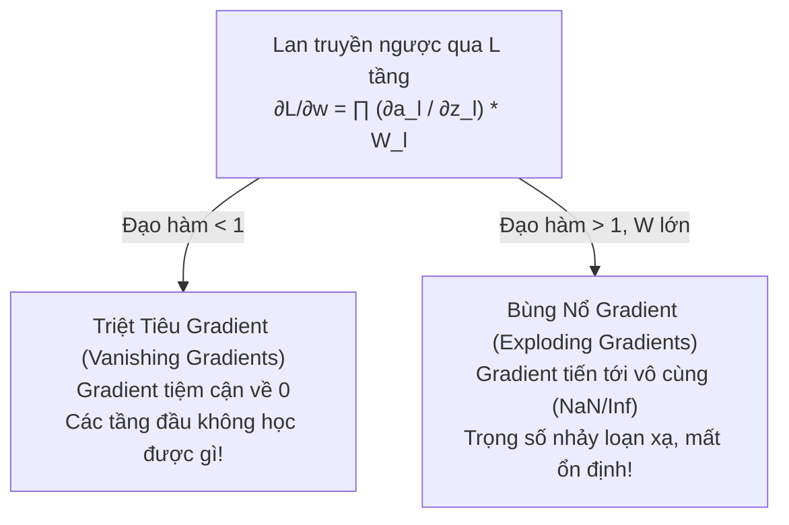
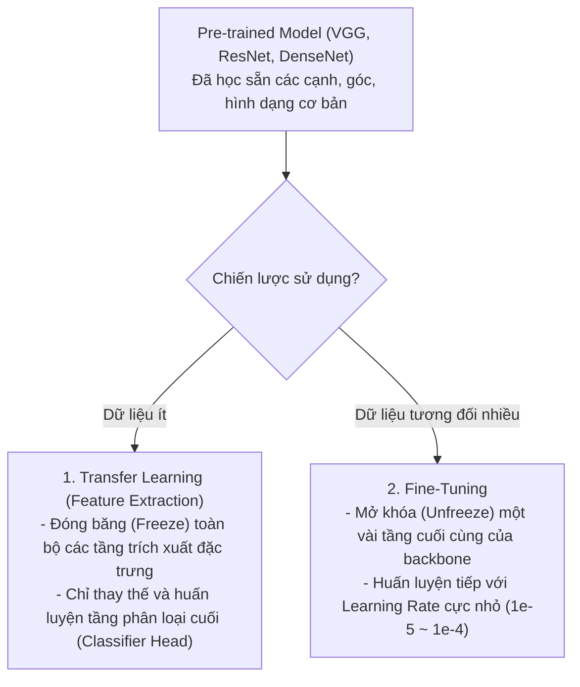

# Chapter 03 — Training Deep Neural Networks (DNNs)

> **Giảng viên**: PhD. Nguyễn Thị Khánh Tiên (`tienntk@ut.edu.vn`)  
> **Đơn vị**: Viện Công Nghệ Thông Tin, Điện, Điện Tử — Trường Đại Học Giao Thông Vận Tải TP.HCM  
> **Tài liệu gốc**: `Chapter 03 - Training Deep Neural Networks.pdf`

---

## 📑 Mục Lục
1. [Tổng Quan Quá Trình Huấn Luyện Mạng Sâu (DNNs)](#1-tổng-quan-quá-trình-huấn-luyện-mạng-sâu-dnns)
2. [Hiện Tượng Vanishing & Exploding Gradients](#2-hiện-tượng-vanishing--exploding-gradients)
3. [Kỹ Thuật Khởi Tạo Trọng Số (Weight Initialization)](#3-kỹ-thuật-khởi-tạo-trọng-số-weight-initialization)
4. [Các Hàm Kích Hoạt Hiện Đại (Activation Functions)](#4-các-hàm-kích-hoạt-hiện-đại-activation-functions)
5. [Chuẩn Hóa Theo Lô (Batch Normalization)](#5-chuẩn-hóa-theo-lô-batch-normalization)
6. [Quy Trình Huấn Luyện & Đánh Giá Trong PyTorch](#6-quy-trình-huấn-luyện--đánh-giá-trong-pytorch)
7. [Lưu Trữ & Tái Sử Dụng Mô Hình (Save & Load Model)](#7-lưu-trữ--tái-sử-dụng-mô-hình-save--load-model)
8. [Trực Quan Hóa Quá Trình Huấn Luyện Với TensorBoard](#8-trực-quan-hóa-quá-trình-huấn-luyện-với-tensorboard)
9. [Kỹ Thuật Chống Học Vẹt (Regularization & Dropout)](#9-kỹ-thuật-chống-học-vẹt-regularization--dropout)
10. [Học Chuyển Giao & Tinh Chỉnh (Transfer Learning & Fine-Tuning)](#10-học-chuyển-giao--tinh-chỉnh-transfer-learning--fine-tuning)
11. [Bài Thực Hành Thực Tế (Practice 2 — CIFAR-10)](#11-bài-thực-hành-thực-tế-practice-2--cifar-10)
12. [💡 Liên Hệ Thực Hành Với Bài Lab 2](#12--liên-hệ-thực-hành-với-bài-lab-2)

---

## 1. Tổng Quan Quá Trình Huấn Luyện Mạng Sâu (DNNs)

**Deep Neural Networks (DNNs)** là mạng nơ-ron chứa nhiều tầng ẩn (Hidden Layers). Số lượng tầng ẩn càng lớn, mô hình càng có khả năng trích xuất các đặc trưng phân cấp phức tạp.

### 4 Yếu tố quyết định trong huấn luyện DNN:
1. **Dữ liệu (Data)**: Cần tập dữ liệu gán nhãn lớn và được chia thành 3 tập riêng biệt: Train, Validation và Test.
2. **Thuật toán lan truyền ngược (Backpropagation)**: Truyền ngược sai số qua hàng chục hoặc hàng trăm tầng để tính gradient.
3. **Thuật toán tối ưu (Optimization)**: SGD, Momentum, RMSprop, Adam giúp tìm điểm cực tiểu của hàm mất mát.
4. **Vòng lặp Epochs**: Duyệt qua toàn bộ dữ liệu nhiều lần theo từng lô nhỏ (Mini-batches).

---

## 2. Hiện Tượng Vanishing & Exploding Gradients

Khi mạng nơ-ron có nhiều tầng ẩn, việc nhân liên tiếp các đạo hàm theo quy tắc chuỗi (**Chain Rule**) gây ra 2 thảm họa huấn luyện:



### Bảng giải pháp khắc phục triệt để:

| Vấn đề | Nguyên nhân chính | Giải pháp khắc phục |
| :--- | :--- | :--- |
| **Vanishing Gradients** | Dùng hàm Sigmoid hoặc Tanh ở các tầng ẩn (đạo hàm cực đại của Sigmoid chỉ là $0.25$). | - Chuyển sang dùng hàm kích hoạt **ReLU / LeakyReLU / ELU**.<br>- Áp dụng kỹ thuật khởi tạo trọng số **He (Kaiming) Initialization**.<br>- Sử dụng **Batch Normalization** giữa các tầng. |
| **Exploding Gradients** | Trọng số ban đầu quá lớn, mạng RNN duyệt chuỗi dài. | - Kỹ thuật cắt xén gradient (**Gradient Clipping**): nếu $\|\mathbf{g}\| > \text{threshold}$ thì $\mathbf{g} \leftarrow \text{threshold} \cdot \frac{\mathbf{g}}{\|\mathbf{g}\|}$.<br>- Dùng khởi tạo trọng số chuẩn xác (**Xavier / Glorot**). |

---

## 3. Kỹ Thuật Khởi Tạo Trọng Số (Weight Initialization)

Không bao giờ khởi tạo tất cả trọng số bằng 0 (vì sẽ gây ra hiện tượng *Symmetry Problem* — tất cả nơ-ron cập nhật giống hệt nhau).

1. **Khởi tạo ngẫu nhiên (Random Normal / Uniform)**:
   - Dễ gây bùng nổ hoặc triệt tiêu nếu độ lệch chuẩn $\sigma$ không phù hợp.
2. **Xavier / Glorot Initialization** (Tối ưu cho Sigmoid, Tanh):
   - Duy trì phương sai của tín hiệu và gradient bằng nhau qua các tầng:
     $$W \sim \mathcal{N}\left(0, \; \sqrt{\frac{2}{n_{\text{in}} + n_{\text{out}}}}\right)$$
3. **He / Kaiming Initialization** (Tối ưu tuyệt đối cho ReLU, LeakyReLU):
   - Bù trừ cho việc hàm ReLU triệt tiêu một nửa miền giá trị âm:
     $$W \sim \mathcal{N}\left(0, \; \sqrt{\frac{2}{n_{\text{in}}}}\right)$$

```python
import torch.nn as nn
# Áp dụng trong PyTorch
nn.init.kaiming_normal_(layer.weight, nonlinearity='relu')
```

---

## 4. Các Hàm Kích Hoạt Hiện Đại (Activation Functions)

| Hàm kích hoạt | Công thức toán | Đạo hàm | Ưu & Nhược điểm |
| :--- | :---: | :---: | :--- |
| **Sigmoid** | $\sigma(z) = \frac{1}{1 + e^{-z}}$ | $\sigma(z)(1 - \sigma(z)) \le 0.25$ | ❌ Gây vanishing gradient, không zero-centered.<br>✅ Thích hợp cho tầng Output của bài toán nhị phân. |
| **Tanh** | $\tanh(z) = \frac{e^z - e^{-z}}{e^z + e^{-z}}$ | $1 - \tanh^2(z) \le 1.0$ | ❌ Vẫn bị bão hòa ở 2 đầu.<br>✅ Zero-centered (đầu ra trong khoảng $[-1, 1]$). |
| **ReLU** | $\max(0, z)$ | $1 \text{ (nếu } z > 0), \; 0 \text{ (nếu } z < 0)$ | ✅ Tính toán cực nhanh, giải quyết triệt để vanishing gradient.<br>❌ Bị hiện tượng "Dying ReLU" khi $z \le 0$. |
| **LeakyReLU** | $\max(\alpha z, z) \text{ với } \alpha \approx 0.01$ | $1 \text{ (nếu } z > 0), \; \alpha \text{ (nếu } z \le 0)$ | ✅ Tránh nơ-ron chết vì luôn duy trì gradient nhỏ ở miền âm. |

---

## 5. Chuẩn Hóa Theo Lô (Batch Normalization - BatchNorm)

Được giới thiệu bởi Sergey Ioffe & Christian Szegedy (2015), BatchNorm giúp giải quyết vấn đề **Internal Covariate Shift** (sự thay đổi phân phối đầu vào của các tầng ẩn trong quá trình huấn luyện).

### Thuật toán BatchNorm trên một mini-batch $\mathcal{B} = \{x_1, \dots, x_m\}$:
1. **Tính giá trị trung bình**: $\mu_{\mathcal{B}} = \frac{1}{m} \sum_{i=1}^m x_i$
2. **Tính phương sai**: $\sigma_{\mathcal{B}}^2 = \frac{1}{m} \sum_{i=1}^m (x_i - \mu_{\mathcal{B}})^2$
3. **Chuẩn hóa**: $\hat{x}_i = \frac{x_i - \mu_{\mathcal{B}}}{\sqrt{\sigma_{\mathcal{B}}^2 + \epsilon}}$ (với $\epsilon$ là hằng số chống chia cho 0)
4. **Scale và Shift học được**: $y_i = \gamma \hat{x}_i + \beta$ (trong đó $\gamma, \beta$ là tham số huấn luyện)

```python
# 1D cho dữ liệu bảng/dense; 2D cho dữ liệu ảnh (B, C, H, W)
nn.BatchNorm1d(num_features=512)
nn.BatchNorm2d(num_features=64)
```

> **Lưu ý sống còn**: BatchNorm hoạt động khác nhau giữa lúc **Train** (tính $\mu, \sigma$ trên batch hiện tại) và lúc **Eval** (dùng $\mu, \sigma$ tích lũy toàn cục - running mean/var). Do đó **bắt buộc** phải gọi `model.eval()` khi đánh giá!

---

## 6. Quy Trình Huấn Luyện & Đánh Giá Trong PyTorch

```python
import torch

device = torch.device('cuda' if torch.cuda.is_available() else 'cpu')
model = MyDNNModel().to(device)
loss_fn = nn.CrossEntropyLoss()
optimizer = torch.optim.Adam(model.parameters(), lr=1e-3, weight_decay=1e-4) # L2 Regularization

def train_and_validate(epochs, train_loader, val_loader):
    for epoch in range(epochs):
        # 1. PHA HUẤN LUYỆN
        model.train()
        train_loss = 0.0
        for X, y in train_loader:
            X, y = X.to(device), y.to(device)
            optimizer.zero_grad()        # Xóa gradient tích lũy cũ
            pred = model(X)              # Forward pass
            loss = loss_fn(pred, y)      # Tính loss
            loss.backward()              # Lan truyền ngược
            # nn.utils.clip_grad_norm_(model.parameters(), max_norm=1.0) # Gradient clipping nếu cần
            optimizer.step()             # Cập nhật trọng số
            train_loss += loss.item()

        # 2. PHA ĐÁNH GIÁ (VALIDATION)
        model.eval()                     # Chuyển Dropout, BatchNorm sang chế độ test
        val_loss, correct = 0.0, 0
        with torch.no_grad():            # Tắt tính toán gradient để tiết kiệm RAM/VRAM
            for X, y in val_loader:
                X, y = X.to(device), y.to(device)
                pred = model(X)
                val_loss += loss_fn(pred, y).item()
                correct += (pred.argmax(1) == y).type(torch.float).sum().item()

        print(f"Epoch {epoch+1}: Train Loss: {train_loss/len(train_loader):.4f} | "
              f"Val Acc: {correct/len(val_loader.dataset)*100:.2f}%")
```

---

## 7. Lưu Trữ & Tái Sử Dụng Mô Hình (Save & Load Model)

Trong PyTorch, phương pháp chuẩn được khuyến nghị là lưu **`state_dict`** (từ điển trọng số của mô hình):

```python
# Lưu mô hình có kết quả tốt nhất
torch.save(model.state_dict(), "best_model.pth")

# Tải lại mô hình để inference hoặc tiếp tục train
loaded_model = MyDNNModel()
loaded_model.load_state_dict(torch.load("best_model.pth", weights_only=True))
loaded_model.to(device)
loaded_model.eval()
```

---

## 8. Trực Quan Hóa Quá Trình Huấn Luyện Với TensorBoard

```python
from torch.utils.tensorboard import SummaryWriter

writer = SummaryWriter('runs/deep_learning_experiment_1')

# 1. Ghi lại đồ thị hàm Loss & Accuracy theo từng epoch
writer.add_scalar('Loss/train', train_loss, epoch)
writer.add_scalar('Accuracy/val', val_accuracy, epoch)

# 2. Trực quan hóa cấu trúc mạng (Graph)
dummy_input = torch.randn(1, 3, 32, 32).to(device)
writer.add_graph(model, dummy_input)

# 3. Phân phối trọng số (Histogram)
for name, param in model.named_parameters():
    writer.add_histogram(name, param, epoch)

writer.close()
```
Khởi chạy TensorBoard trên Terminal:
```bash
tensorboard --logdir=runs
# Truy cập giao diện web tại: http://localhost:6006/
```

---

## 9. Kỹ Thuật Chống Học Vẹt (Regularization & Dropout)

### 1. Dropout (`nn.Dropout(p=0.5)`)
- Tắt ngẫu nhiên nơ-ron trong quá trình Forward pass với xác suất $p$.
- Ngăn chặn nơ-ron dựa dẫm vào nhau (*Co-adaptation*), ép mạng phải học nhiều biểu diễn độc lập mạnh mẽ.

### 2. L1 & L2 Regularization
- **L2 Regularization (Weight Decay)**: Phạt các trọng số có độ lớn lớn:
  $$\mathcal{L}_{\text{total}} = \mathcal{L}_0 + \frac{\lambda}{2} \sum w_i^2$$
  *Triển khai trong PyTorch*: Thêm trực tiếp `weight_decay=1e-4` vào optimizer (`optim.Adam` hoặc `optim.SGD`).
- **L1 Regularization (Lasso)**: Phạt tổng giá trị tuyệt đối $\lambda \sum |w_i|$, tạo ra ma trận trọng số thưa (Sparse Weights), có tác dụng chọn lọc đặc trưng (Feature Selection).

---

## 10. Học Chuyển Giao & Tinh Chỉnh (Transfer Learning & Fine-Tuning)

Khi tập dữ liệu huấn luyện của bạn quá nhỏ, thay vì huấn luyện từ đầu (**Train from Scratch**), hãy tận dụng các mô hình đã được huấn luyện trước (**Pre-trained Models**) trên các tập dữ liệu hàng triệu ảnh (ImageNet).



### Triển khai chuyển giao trong PyTorch:
```python
import torchvision.models as models

# 1. Tải mô hình ResNet-50 có sẵn trọng số
model = models.resnet50(weights=models.ResNet50_Weights.DEFAULT)

# 2. Đóng băng các tầng trích xuất đặc trưng (Feature Extractor)
for param in model.parameters():
    param.requires_grad = False

# 3. Thay thế Classifier Head cho tập dữ liệu mới (ví dụ bài toán 10 lớp)
num_features = model.fc.in_features
model.fc = nn.Linear(num_features, 10) # Tầng mới này tự động có requires_grad = True

# 4. Chỉ truyền các tham số cần cập nhật vào Optimizer
optimizer = torch.optim.Adam(model.fc.parameters(), lr=1e-3)
```

---

## 11. Bài Thực Hành Thực Tế (Practice 2 — CIFAR-10)

Quy trình bài tập:
1. Nạp tập dữ liệu ảnh màu **CIFAR-10** (10 nhãn: máy bay, xe hơi, chim, mèo,...).
2. Tải mô hình pre-trained từ `torchvision.models` (VGG-16 hoặc ResNet-18).
3. Đóng băng backbone, thay thế tầng `fc` cuối cùng thành 10 outputs.
4. Chạy vòng lặp huấn luyện, ghi nhận scalar vào TensorBoard.
5. Đánh giá Accuracy trên tập Test và trực quan hóa ảnh dự đoán đúng/sai.

---

## 12. 💡 Liên Hệ Thực Hành Với Bài Lab 2

Kiến thức từ **Chapter 03** là nền tảng cốt lõi của bài **[`Lab 2`](../../Lab%202/)**:
- Thiết lập vòng lặp huấn luyện chuẩn xác với `model.train()` và `model.eval()`.
- So sánh hiệu năng mô hình khi có và không có **Batch Normalization** và **Dropout**.
- Áp dụng **L2 Regularization (Weight Decay)** và **Learning Rate Scheduling** để đưa mô hình vượt qua điểm kẹt cục bộ.
- Kỹ thuật **Transfer Learning** thay thế đầu ra Classifier để phân loại bộ dữ liệu mục tiêu.

