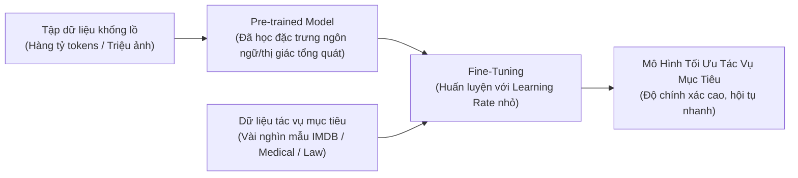

# Chapter 04 — Fine-Tune Models & Training Algorithms

> **Giảng viên**: PhD. Nguyễn Thị Khánh Tiên (`tienntk@ut.edu.vn`)  
> **Đơn vị**: Viện Công Nghệ Thông Tin, Điện, Điện Tử — Trường Đại Học Giao Thông Vận Tải TP.HCM  
> **Tài liệu gốc**: `Chapter 04 - Fine-Tune Models and Training Algorithms.pdf`

---

## 📑 Mục Lục
1. [Khái Niệm & Động Lực Của Fine-Tuning](#1-khái-niệm--động-lực-của-fine-tuning)
2. [Chiến Lược Fine-Tuning & Quy Trình 8 Bước](#2-chiến-lược-fine-tuning--quy-trình-8-bước)
3. [Hiện Tượng Quên Thảm Họa (Catastrophic Forgetting)](#3-hiện-tượng-quên-thảm-họa-catastrophic-forgetting)
4. [Các Giải Thuật Tối Ưu Cốt Lõi (Optimization Algorithms)](#4-các-giải-thuật-tối-ưu-cốt-lõi-optimization-algorithms)
   - [4.1 So Sánh GD vs Mini-Batch GD vs SGD](#41-so-sánh-gd-vs-mini-batch-gd-vs-sgd)
   - [4.2 Momentum & Nesterov Accelerated Gradient (NAG)](#42-momentum--nesterov-accelerated-gradient-nag)
   - [4.3 AdaGrad & RMSprop](#43-adagrad--rmsprop)
   - [4.4 Adam & AdamW (State-of-the-Art)](#44-adam--adamw-state-of-the-art)
5. [Chiến Lược Điều Chỉnh Tốc Độ Học (Learning Rate Scheduling)](#5-chiến-lược-điều-chỉnh-tốc-độ-học-learning-rate-scheduling)
6. [Kỹ Thuật Cắt Xén Gradient (Gradient Clipping)](#6-kỹ-thuật-cắt-xén-gradient-gradient-clipping)
7. [Dừng Huấn Luyện Sớm (Early Stopping)](#7-dừng-huấn-luyện-sớm-early-stopping)
8. [Thực Hành Với Hệ Sinh Thái Hugging Face (Practice 3)](#8-thực-hành-với-hệ-sinh-thái-hugging-face-practice-3)
9. [💡 Liên Hệ Trực Tiếp Với Bài Lab 3 & Notebook Lab_3](#9--liên-hệ-trực-tiếp-với-bài-lab-3--notebook-lab_3)

---

## 1. Khái Niệm & Động Lực Của Fine-Tuning

**Fine-tuning (Tinh chỉnh)** là kỹ thuật trong Machine Learning/Deep Learning, trong đó ta lấy một mô hình đã được huấn luyện trước (**Pre-trained Model**) trên tập dữ liệu khổng lồ (ImageNet, Wikipedia, Common Crawl) và tiếp tục huấn luyện trên một tập dữ liệu nhỏ hơn của một tác vụ chuyên biệt cụ thể.



### 4 Lợi ích sống còn của Fine-tuning:
1. **Tận dụng đặc trưng đã học**: Không phải học lại từ đầu các đặc trưng cơ bản (cạnh, nét chữ, ngữ pháp).
2. **Tiết kiệm dữ liệu**: Chỉ cần vài trăm đến vài nghìn mẫu gán nhãn thay vì hàng triệu mẫu.
3. **Tiết kiệm thời gian & chi phí tính toán**: Huấn luyện hội tụ chỉ sau vài epochs (vài chục phút thay vì vài tuần).
4. **Hiệu năng vượt trội**: Mô hình fine-tune đạt độ chính xác và khả năng tổng quát hóa cao hơn nhiều so với việc *Train from Scratch* trên tập dữ liệu nhỏ.

---

## 2. Chiến Lược Fine-Tuning & Quy Trình 8 Bước

1. **Chọn mô hình Pre-trained**: Kiến trúc phù hợp với bài toán (BERT/DistilBERT cho NLP; ResNet/ViT cho Vision).
2. **Chuẩn bị dữ liệu**: Tiền xử lý theo đúng định dạng mà mô hình ban đầu đã dùng (cùng Tokenizer, kích thước ảnh, mean/std chuẩn hóa).
3. **Thay thế Classifier Head**: Thay thế tầng phân loại cuối cùng bằng một tầng mới có số classes tương ứng với nhãn bài toán.
4. **Đóng băng (Freeze) các tầng đầu**: Giữ nguyên trọng số các tầng backbone trích xuất đặc trưng.
5. **Huấn luyện Classifier Head**: Chạy với Learning Rate tiêu chuẩn để tầng phân loại mới thích nghi.
6. **Mở khóa (Unfreeze) một phần hoặc toàn bộ**: Cho phép các tầng trên cùng của backbone cập nhật.
7. **Fine-tune toàn mạng**: Huấn luyện với Learning Rate rất nhỏ ($\eta \approx 10^{-5} \sim 10^{-4}$) để không phá vỡ tri thức đã có.
8. **Đánh giá & Điều chỉnh siêu tham số**: Theo dõi Loss/Accuracy trên tập Validation để chống Overfitting.

---

## 3. Hiện Tượng Quên Thảm Họa (Catastrophic Forgetting)

- **Định nghĩa**: Xảy ra khi tinh chỉnh mô hình quá mạnh bạo (Learning rate quá lớn, số epochs quá nhiều) trên tác vụ mới, khiến mô hình xóa sạch toàn bộ kiến thức tổng quát hữu ích đã học trong giai đoạn pre-training.
- **Biện pháp phòng tránh**:
  - Dùng **Learning Rate cực nhỏ** cho các tầng pre-trained ($\eta \le 2 \times 10^{-5}$).
  - Áp dụng **Discriminative Fine-Tuning**: Tầng sâu hơn dùng learning rate nhỏ hơn tầng ngoài cùng.
  - Sử dụng các kỹ thuật PEFT hiện đại như **LoRA (Low-Rank Adaptation)** (chỉ train ma trận adapter nhỏ).

---

## 4. Các Giải Thuật Tối Ưu Cốt Lõi (Optimization Algorithms)

### 4.1 So Sánh GD vs Mini-Batch GD vs SGD

| Thuật toán | Số mẫu dùng cho mỗi bước cập nhật | Ưu điểm | Nhược điểm |
| :--- | :---: | :--- | :--- |
| **Batch GD** | Toàn bộ tập dữ liệu ($N$) | Hướng đi dốc chính xác, ổn định. | Cực chậm, không thể nạp vừa RAM/VRAM nếu dữ liệu lớn. |
| **Stochastic GD (SGD)** | Đúng 1 mẫu ngẫu nhiên ($1$) | Rất nhanh, thoát được các điểm kẹt yên ngựa. | Biến thiên dao động dữ dội, khó hội tụ mượt mà. |
| **Mini-Batch GD** | Một cụm mẫu ($B = 32, 64, 128$) | Cân bằng hoàn hảo giữa tốc độ, độ ổn định và tận dụng tối đa GPU vectorization. | Cần điều chỉnh thêm siêu tham số batch size. |

---

### 4.2 Momentum & Nesterov Accelerated Gradient (NAG)

- **SGD với Momentum**: Bổ sung vận tốc quán tính $v_t$ để triệt tiêu dao động ziczac ở thung lũng dốc và tăng tốc lăn xuống dốc:
  $$v_t = \beta v_{t-1} + (1 - \beta) g_t$$
  $$\theta_t = \theta_{t-1} - \eta v_t$$
  *(Thông thường $\beta = 0.9$)*
- **NAG (Nesterov Accelerated Gradient)**: Tính trước vị trí bước nhảy tương lai $\theta - \beta v_{t-1}$ trước khi tính gradient, giúp "phanh xe" kịp thời trước khi lao quá đà qua cực tiểu.

---

### 4.3 AdaGrad & RMSprop

- **AdaGrad**: Tự động giảm Learning Rate cho các tham số xuất hiện thường xuyên và tăng Learning Rate cho các đặc trưng hiếm:
  $$s_t = s_{t-1} + g_t^2, \quad \theta_t = \theta_{t-1} - \frac{\eta}{\sqrt{s_t} + \epsilon} g_t$$
  *Nhược điểm*: Tổng bình phương $s_t$ tăng đơn điệu theo thời gian, làm Learning Rate tiệm cận về 0 quá sớm khiến mô hình ngừng học hoàn toàn.
- **RMSprop (Geoff Hinton)**: Sửa nhược điểm của AdaGrad bằng cách lấy trung bình trượt phân rã hàm mũ (Exponential Moving Average):
  $$s_t = \beta s_{t-1} + (1 - \beta) g_t^2$$
  $$\theta_t = \theta_{t-1} - \frac{\eta}{\sqrt{s_t} + \epsilon} g_t$$

---

### 4.4 Adam & AdamW (Chuẩn Mực Hiện Đại)

**Adam (Adaptive Moment Estimation)**: Kết hợp hoàn hảo giữa **Momentum** (Moment bậc 1 $m_t$) và **RMSprop** (Moment bậc 2 $v_t$), đồng thời có cơ chế hiệu chỉnh sai lệch ban đầu (**Bias Correction**):

$$m_t = \beta_1 m_{t-1} + (1 - \beta_1) g_t \quad (\beta_1 \approx 0.9)$$
$$v_t = \beta_2 v_{t-1} + (1 - \beta_2) g_t^2 \quad (\beta_2 \approx 0.999)$$
$$\hat{m}_t = \frac{m_t}{1 - \beta_1^t}, \quad \hat{v}_t = \frac{v_t}{1 - \beta_2^t}$$
$$\theta_t = \theta_{t-1} - \frac{\eta}{\sqrt{\hat{v}_t} + \epsilon} \hat{m}_t$$

> **AdamW (Loshchilov & Hutter)**: Tách rời trực tiếp quá trình phân rã trọng số (**Decoupled Weight Decay**) ra khỏi tính toán gradient của Adam:
> $$\theta_t = (1 - \eta \lambda) \theta_{t-1} - \frac{\eta}{\sqrt{\hat{v}_t} + \epsilon} \hat{m}_t$$
> **Đây là optimizer mặc định và hiệu quả nhất cho Transformers và NLP hiện nay!**

---

## 5. Chiến Lược Điều Chỉnh Tốc Độ Học (Learning Rate Scheduling)

Thay vì giữ $\eta$ cố định, ta giảm dần theo thời gian:
1. **StepLR / MultiStepLR**: Giảm $\eta$ đi $\gamma$ lần sau mỗi $k$ epochs.
2. **CosineAnnealingLR**: Giảm theo hình sóng Cosine mượt mà.
3. **ReduceLROnPlateau**: Tự động giảm $\eta$ khi validation loss đi ngang (plateau) không chịu giảm tiếp.
4. **Linear Warmup with Decay**: Tăng dần $\eta$ từ 0 lên giá trị mong muốn trong những bước đầu (warmup), sau đó giảm dần tuyến tính về 0 (chuẩn mực trong huấn luyện BERT/Transformers).

```python
from torch.optim.lr_scheduler import ReduceLROnPlateau
scheduler = ReduceLROnPlateau(optimizer, mode='min', factor=0.1, patience=3)
# Trong validation loop:
scheduler.step(val_loss)
```

---

## 6. Kỹ Thuật Cắt Xén Gradient (Gradient Clipping)

Đặc biệt tối quan trọng khi huấn luyện **RNN, LSTM, hoặc các mô hình Transformer rất sâu**:

```python
# 1. Cắt theo độ lớn L2 Norm (Khuyên dùng)
torch.nn.utils.clip_grad_norm_(model.parameters(), max_norm=1.0)

# 2. Cắt theo giá trị tuyệt đối từng phần tử
torch.nn.utils.clip_grad_value_(model.parameters(), clip_value=0.5)
```
*Vị trí đặt trong code*: Luôn đặt **sau `loss.backward()`** và **trước `optimizer.step()`**!

---

## 7. Dừng Huấn Luyện Sớm (Early Stopping)

Cơ chế tự động ngắt huấn luyện khi mô hình bắt đầu học vẹt (Overfitting):

```python
class EarlyStopping:
    def __init__(self, patience=5, min_delta=1e-4):
        self.patience = patience
        self.min_delta = min_delta
        self.counter = 0
        self.best_loss = None
        self.early_stop = False

    def __call__(self, val_loss, model):
        if self.best_loss is None:
            self.best_loss = val_loss
            torch.save(model.state_dict(), 'best_checkpoint.pth')
        elif val_loss > self.best_loss - self.min_delta:
            self.counter += 1
            if self.counter >= self.patience:
                self.early_stop = True
        else:
            self.best_loss = val_loss
            torch.save(model.state_dict(), 'best_checkpoint.pth')
            self.counter = 0
```

---

## 8. Thực Hành Với Hệ Sinh Thái Hugging Face (Practice 3)

### Bài tập 1: Pipeline Phân Tích Cảm Xúc (Quick Inference)
```python
from transformers import pipeline

classifier = pipeline("sentiment-analysis", model="distilbert-base-uncased-finetuned-sst-2-english")
result = classifier("Antigravity makes writing AI documentation so easy and intuitive!")
print(result) # [{'label': 'POSITIVE', 'score': 0.9998}]
```

### Bài tập 2: Fine-Tuning Với Hugging Face `Trainer`
```python
from transformers import AutoTokenizer, AutoModelForSequenceClassification, TrainingArguments, Trainer
from datasets import load_dataset
import evaluate
import numpy as np

# 1. Dataset & Tokenizer
dataset = load_dataset("imdb")
tokenizer = AutoTokenizer.from_pretrained("distilbert-base-uncased")

def tokenize_func(examples):
    return tokenizer(examples["text"], padding="max_length", truncation=True, max_length=256)

tokenized_datasets = dataset.map(tokenize_func, batched=True)

# 2. Model
model = AutoModelForSequenceClassification.from_pretrained("distilbert-base-uncased", num_labels=2)

# 3. Metric
metric = evaluate.load("accuracy")
def compute_metrics(eval_pred):
    logits, labels = eval_pred
    predictions = np.argmax(logits, axis=-1)
    return metric.compute(predictions=predictions, references=labels)

# 4. Training Arguments
training_args = TrainingArguments(
    output_dir="./results",
    learning_rate=2e-5,          # LR nhỏ đặc trưng cho Fine-tuning
    per_device_train_batch_size=16,
    per_device_eval_batch_size=16,
    num_train_epochs=3,
    weight_decay=0.01,           # AdamW weight decay
    evaluation_strategy="epoch",
    save_strategy="epoch",
    load_best_model_at_end=True
)

# 5. Trainer
trainer = Trainer(
    model=model,
    args=training_args,
    train_dataset=tokenized_datasets["train"].shuffle(seed=42).select(range(2000)),
    eval_dataset=tokenized_datasets["test"].shuffle(seed=42).select(range(500)),
    compute_metrics=compute_metrics,
)

trainer.train()
```

---

## 9. 💡 Liên Hệ Trực Tiếp Với Bài Lab 3 & Notebook Lab_3

File notebook **[`Lab_3 (1).ipynb`](../../Lab_3%20(1).ipynb)** trong thư mục học tập chính là sự hiện thực hóa 100% của phần **Practice 3 trong Chapter 04**:
- **Cell 1**: `Exercise 1` chạy pipeline phân tích cảm xúc đa ngôn ngữ (`tabularisai/multilingual-sentiment-analysis`).
- **Cell 3 - 12**: `Exercise 2` tải dataset IMDB, dùng tokenizer `distilbert-base-uncased`, tạo `DataCollatorWithPadding`, cấu hình `TrainingArguments`, xây dựng hàm `compute_metrics` tính Accuracy, Precision, Recall, F1 và gọi `Trainer.train()`.

