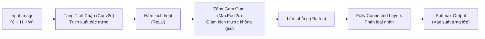

# Chapter 05.1 — Convolutional Neural Networks (CNNs - Part 1)

> **Giảng viên**: PhD. Nguyễn Thị Khánh Tiên (`tienntk@ut.edu.vn`)  
> **Đơn vị**: Viện Công Nghệ Thông Tin, Điện, Điện Tử — Trường Đại Học Giao Thông Vận Tải TP.HCM  
> **Tài liệu gốc**: `Chapter 05.1 - CNNs (Part 1).pdf`

---

## 📑 Mục Lục
1. [Cảm Hứng Sinh Học & Dữ Liệu Đa Phương Tiện (Visual Cortex)](#1-cảm-hứng-sinh-học--dữ-liệu-đa-phương-tiện-visual-cortex)
2. [Tại Sao MLP Thất Bại Trước Dữ Liệu Hình Ảnh?](#2-tại-sao-mlp-thất-bại-trước-dữ-liệu-hình-ảnh)
3. [Các Thành Phần Cốt Lõi Của Mạng CNN](#3-các-thành-phần-cốt-lõi-của-mạng-cnn)
   - [3.1 Phép Tích Chập (Convolutional Layer)](#31-phép-tích-chập-convolutional-layer)
   - [3.2 Tầng Gom Cụm (Pooling Layer)](#32-tầng-gom-cụm-pooling-layer)
   - [3.3 Tầng Kết Nối Đầy Đủ (Fully Connected Layer)](#33-tầng-kết-nối-đầy-đủ-fully-connected-layer)
4. [Công Thức Toán Học Tính Chiều Feature Map](#4-công-thức-toán-học-tính-chiều-feature-map)
5. [Triển Khai CNN Trong PyTorch Với `torch.nn`](#5-triển-khai-cnn-trong-pytorch-với-torchnn)
6. [Tiến Trình Tiến Hóa Của 13 Kiến Trúc CNN Kinh Điển](#6-tiến-trình-tiến-hóa-của-13-kiến-trúc-cnn-kinh-điển)
   - [6.1 LeNet-5 (1998) & AlexNet (2012)](#61-lenet-5-1998--alexnet-2012)
   - [6.2 VGG-16 (2014) & GoogLeNet / Inception (2014)](#62-vgg-16-2014--googlenet--inception-2014)
   - [6.3 ResNet (2015) — Đột Phá Skip Connections](#63-resnet-2015--đột-phá-skip-connections)
   - [6.4 DenseNet (2017) — Tái Sử Dụng Đặc Trưng Tối Đa](#64-densenet-2017--tái-sử-dụng-đặc-trưng-tối-đa)
   - [6.5 MobileNet (2017) — Tối Ưu Hóa Thiết Bị Di Động](#65-mobilenet-2017--tối-ưu-hóa-thiết-bị-di-động)
   - [6.6 EfficientNet (2019) — Compound Scaling Đỉnh Cao](#66-efficientnet-2019--compound-scaling-đỉnh-cao)
7. [Bảng Tổng Hợp So Sánh Các Kiến Trúc](#7-bảng-tổng-hợp-so-sánh-các-kiến-trúc)
8. [💡 Liên Hệ Thực Hành Với Các Bài Lab](#8--liên-hệ-thực-hành-với-các-bài-lab)

---

## 1. Cảm Hứng Sinh Học & Dữ Liệu Đa Phương Tiện (Visual Cortex)

Vỏ não thị giác (**Visual Cortex**) của động vật xử lý hình ảnh theo cấu trúc tầng bậc:
- Các tế bào thần kinh đơn giản (*Simple Cells*) phát hiện các đường biên, góc, hướng cạnh cục bộ.
- Các tế bào phức tạp (*Complex Cells*) tổng hợp thông tin để nhận diện họa tiết, hình khối bất biến với vị trí dịch chuyển.

Mạng tích chập **Convolutional Neural Networks (CNNs)** ra đời mô phỏng trực tiếp cơ chế này để xử lý dữ liệu lưới đa chiều (2D Grids cho ảnh xám/màu, 3D Grids cho video).

---

## 2. Tại Sao MLP Thất Bại Trước Dữ Liệu Hình Ảnh?

Nếu dùng mạng MLP truyền thống (Fully Connected):
1. **Bùng nổ số lượng tham số (Curse of Dimensionality)**: Một ảnh $224 \times 224 \times 3$ có $150,528$ giá trị. Nếu nối vào tầng ẩn 1,024 neurons, cần $> 154$ triệu weights $\rightarrow$ Không thể nạp vừa bộ nhớ và chắc chắn bị Overfitting nghiêm trọng.
2. **Mất liên kết không gian (Spatial Relationships)**: Phép ép phẳng (`Flatten`) biến ảnh 2D thành vector 1D làm đứt gãy mối quan hệ lân cận giữa các điểm ảnh kề nhau.
3. **Thiếu tính bất biến dịch chuyển (Lack of Translation Invariance)**: Nếu một con mèo nằm ở góc trên bên trái, MLP học được bộ trọng số nhận diện ở góc đó; nếu con mèo chuyển sang góc dưới bên phải, MLP sẽ xem như đối tượng hoàn toàn mới và đoán sai.

$\Rightarrow$ **CNN giải quyết triệt để 3 vấn đề trên nhờ 2 nguyên lý**:
- **Trường tiếp nhận cục bộ (Local Receptive Fields)**: Neuron chỉ kết nối với một vùng ảnh nhỏ lân cận.
- **Chia sẻ trọng số (Weight Sharing)**: Cùng một bộ lọc (Kernel) được trượt qua toàn bộ bức ảnh, giúp giảm hàng triệu lần tham số và nhận diện vật thể ở mọi vị trí!

---

## 3. Các Thành Phần Cốt Lõi Của Mạng CNN



### 3.1 Phép Tích Chập (Convolutional Layer)
- Một bộ lọc (Filter / Kernel) kích thước nhỏ ($3 \times 3$ hoặc $5 \times 5$) trượt qua toàn bộ ma trận ảnh.
- Tại mỗi vị trí dừng, tính tích vô hướng phần tử với phần tử (**Element-wise Multiplication**) rồi cộng dồn lại kèm theo bias:
  $$S(i, j) = (I * K)(i, j) + b = \sum_{m} \sum_{n} I(i-m, j-n) K(m, n) + b$$
- Các khái niệm quan trọng:
  - **Stride ($S$)**: Bước nhảy của kernel mỗi lần di chuyển (mặc định $S=1$).
  - **Padding ($P$)**: Đệm thêm các viền số 0 (Zero-Padding) quanh ảnh để giữ nguyên kích thước không gian (Same Padding) hoặc chống mất thông tin góc cạnh.

### 3.2 Tầng Gom Cụm (Pooling Layer)
- **Mục đích**: Giảm kích thước không gian (chiều rộng $W$ và chiều cao $H$) của Feature Map, giảm chi phí tính toán và kiểm soát Overfitting.
- **Max Pooling ($2 \times 2$, Stride 2)**: Lấy giá trị lớn nhất trong cửa sổ trượt (giữ lại các đặc trưng nổi bật nhất).
- **Average Pooling**: Lấy giá trị trung bình (thường dùng ở tầng cuối cùng — *Global Average Pooling* để thay thế Dense layer).

### 3.3 Tầng Kết Nối Đầy Đủ (Fully Connected Layer)
- Sau nhiều khối `[Conv + ReLU + Pool]`, dữ liệu được làm phẳng thành 1 vector đặc trưng cấp cao và đưa vào các tầng `nn.Linear` để đưa ra quyết định phân loại.

---

## 4. Công Thức Toán Học Tính Chiều Feature Map

Cho ảnh đầu vào kích thước $I \times I$, bộ lọc kích thước $K \times K$, đệm viền $P$ và bước nhảy $S$:

$$\text{Output Size } O = \left\lfloor \frac{I - K + 2P}{S} \right\rfloor + 1$$

*Ví dụ tính toán*:
- Đầu vào: $32 \times 32$, Kernel $3 \times 3$, Padding $P = 1$, Stride $S = 1$:
  $$O = \left\lfloor \frac{32 - 3 + 2(1)}{1} \right\rfloor + 1 = 32 \quad (\text{Kích thước được bảo toàn!})$$
- Tiếp theo đi qua Max Pooling $2 \times 2$, Stride $S = 2$:
  $$O = \left\lfloor \frac{32 - 2 + 0}{2} \right\rfloor + 1 = 16 \quad (\text{Giảm đúng một nửa!})$$

---

## 5. Triển Khai CNN Trong PyTorch Với `torch.nn`

```python
import torch
import torch.nn as nn

class StandardCNN(nn.Module):
    def __init__(self, num_classes=10):
        super().__init__()
        # Khối trích xuất đặc trưng (Feature Extractor)
        self.features = nn.Sequential(
            # Khối Conv 1: Ảnh RGB (3 channels) -> 32 channels
            nn.Conv2d(in_channels=3, out_channels=32, kernel_size=3, padding=1),
            nn.BatchNorm2d(32),
            nn.ReLU(inplace=True),
            nn.MaxPool2d(kernel_size=2, stride=2), # Giảm kích thước / 2

            # Khối Conv 2: 32 channels -> 64 channels
            nn.Conv2d(in_channels=32, out_channels=64, kernel_size=3, padding=1),
            nn.BatchNorm2d(64),
            nn.ReLU(inplace=True),
            nn.MaxPool2d(kernel_size=2, stride=2)  # Giảm kích thước tiếp / 2
        )
        
        # Khối phân loại (Classifier)
        self.classifier = nn.Sequential(
            nn.Flatten(),
            nn.Linear(64 * 8 * 8, 256), # Giả sử đầu vào ban đầu là 32x32 -> qua 2 lần pool còn 8x8
            nn.ReLU(inplace=True),
            nn.Dropout(p=0.5),
            nn.Linear(256, num_classes)
        )

    def forward(self, x):
        x = self.features(x)
        logits = self.classifier(x)
        return logits
```

---

## 6. Tiến Trình Tiến Hóa Của 13 Kiến Trúc CNN Kinh Điển

### 6.1 LeNet-5 (1998) & AlexNet (2012)
- **LeNet-5 (Yann LeCun)**: 7 tầng, tiên phong dùng Conv và Average Pooling để nhận diện chữ số viết tay.
- **AlexNet (Alex Krizhevsky - ILSVRC 2012)**: 8 tầng, kích hoạt cuộc cách mạng Deep Learning.
  - *Đột phá*: Lần đầu áp dụng **ReLU** (thay Sigmoid), **Dropout** (0.5), **Data Augmentation** và huấn luyện song song trên 2 GPUs NVIDIA GTX 580.

### 6.2 VGG-16 (2014) & GoogLeNet / Inception (2014)
- **VGG-16 (Simonyan & Zisserman)**:
  - *Triết lý*: Đồng nhất hóa toàn bộ kiến trúc chỉ dùng các bộ lọc cực nhỏ **$3 \times 3$**. Hai tầng $3 \times 3$ liên tiếp có cùng trường tiếp nhận (Effective Receptive Field) như một tầng $5 \times 5$ nhưng ít tham số hơn và có 2 lần kích hoạt phi tuyến.
- **GoogLeNet / Inception-v1 (Szegedy et al.)**:
  - *Inception Module*: Không chọn filter $1 \times 1, 3 \times 3$ hay $5 \times 5$, mà chạy **tất cả song song** rồi ghép lại (Concatenate).
  - Sử dụng phép tích chập $1 \times 1$ để nén chiều sâu kênh (*Bottleneck dimension reduction*), giúp mạng sâu 22 tầng mà tham số ít hơn AlexNet 12 lần!

---

### 6.3 ResNet (Residual Networks - 2015) — Đột Phá Skip Connections
- **Vấn đề suy thoái (Degradation Problem)**: Khi mạng đạt đến độ sâu 30-50 tầng, việc thêm tầng làm tăng lỗi huấn luyện (không phải do overfitting mà do khó tối ưu).
- **Giải pháp Residual Block**: Thêm đường tắt kết nối tắt (**Skip Connection / Shortcut**):
  $$\mathcal{H}(x) = \mathcal{F}(x) + x$$
  Mạng chỉ cần học phần dư thừa $\mathcal{F}(x) = \mathcal{H}(x) - x$. Nếu tầng đó vô dụng, mô hình chỉ việc triệt tiêu $\mathcal{F}(x) \rightarrow 0$ để giữ nguyên $\mathcal{H}(x) = x$ (Identity mapping).
- *Thành tựu*: Huấn luyện thành công mạng sâu tới **152 tầng** (ResNet-152) và giành quán quân ILSVRC 2015.

---

### 6.4 DenseNet (Densely Connected Networks - 2017)
- Thay vì cộng dồn $\mathcal{F}(x) + x$ như ResNet, DenseNet **ghép nối (Concatenate)** Feature Map của tất cả các tầng trước đó vào tất cả các tầng tiếp theo:
  $$x_l = H_l([x_0, x_1, \dots, x_{l-1}])$$
- Tối đa hóa việc tái sử dụng đặc trưng (*Feature Reuse*), gradient lan truyền cực mạnh qua mạng mà cần rất ít tham số.

---

### 6.5 MobileNet (2017) — Tối Ưu Hóa Thiết Bị Di Động
- Sử dụng **Depthwise Separable Convolution** (tách phép tích chập thông thường thành 2 bước):
  1. *Depthwise Conv*: 1 kernel $3 \times 3$ cho từng kênh độc lập.
  2. *Pointwise Conv*: Kernel $1 \times 1$ để kết hợp các kênh lại với nhau.
- **Giảm chi phí tính toán từ 8 đến 9 lần** so với phép tích chập tiêu chuẩn, cho phép chạy mô hình thời gian thực trên điện thoại thông minh và thiết bị nhúng.

---

### 6.6 EfficientNet (2019) — Compound Scaling Đỉnh Cao
- Trước đây, khi muốn mô hình mạnh hơn, người ta chỉ mở rộng đơn lẻ: Tăng độ sâu (Depth), hoặc tăng độ rộng kênh (Width), hoặc tăng độ phân giải ảnh (Resolution).
- EfficientNet giới thiệu nguyên lý mở rộng đồng thời (**Compound Scaling Method**):
  $$\text{Depth: } d = \alpha^\phi, \quad \text{Width: } w = \beta^\phi, \quad \text{Resolution: } r = \gamma^\phi$$
  với điều kiện $\alpha \cdot \beta^2 \cdot \gamma^2 \approx 2$ (để FLOPS tăng $2^\phi$).
- Kết quả: EfficientNet-B7 đạt độ chính xác cao nhất ImageNet thời điểm bấy giờ với kích thước nhỏ hơn 8.4 lần so với GPipe.

---

## 7. Bảng Tổng Hợp So Sánh Các Kiến Trúc

| Kiến trúc | Năm | Số tầng tiêu biểu | Đột phá kiến trúc cốt lõi |
| :--- | :---: | :---: | :--- |
| **LeNet-5** | 1998 | 7 | Khung kiến trúc Conv-Pool-FC chuẩn mực. |
| **AlexNet** | 2012 | 8 | ReLU, Dropout, GPU training. |
| **VGG-16** | 2014 | 16 | Chuẩn hóa kernel nhỏ $3 \times 3$ xuyên suốt. |
| **GoogLeNet** | 2014 | 22 | Inception module đa nhánh song song, $1 \times 1$ conv. |
| **ResNet-50** | 2015 | 50 - 152 | Skip Connections $\mathcal{F}(x) + x$, phá vỡ rào cản độ sâu. |
| **DenseNet** | 2017 | 121 - 201 | Ghép nối toàn bộ đặc trưng mọi tầng trước (*Dense connectivity*). |
| **MobileNet** | 2017 | 28 | Depthwise Separable Convolution, siêu nhẹ cho thiết bị nhúng. |
| **EfficientNet** | 2019 | B0 - B7 | Compound Scaling đồng thời chiều sâu, rộng và phân giải. |

---

## 8. 💡 Liên Hệ Thực Hành Với Các Bài Lab

- Kiến thức từ **Chapter 05.1** là chìa khóa để triển khai bài toán Computer Vision trong **[`Lab 1`](../../Lab%201/)** và **[`Lab 2`](../../Lab%202/)**:
  - Dùng `torch.nn.Conv2d` và `torch.nn.MaxPool2d` thay vì Flatten toàn bộ ảnh vào MLP.
  - Sử dụng các backbone nổi tiếng từ `torchvision.models` (như `resnet18`, `vgg16`) để thực hiện Transfer Learning.
  - Hiểu cách tính toán kích thước ma trận Feature Map qua các tầng để cấu hình chính xác số chiều `in_features` ở tầng Linear cuối cùng.

