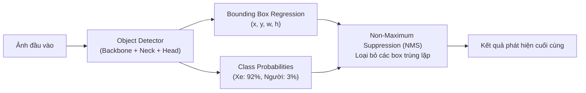
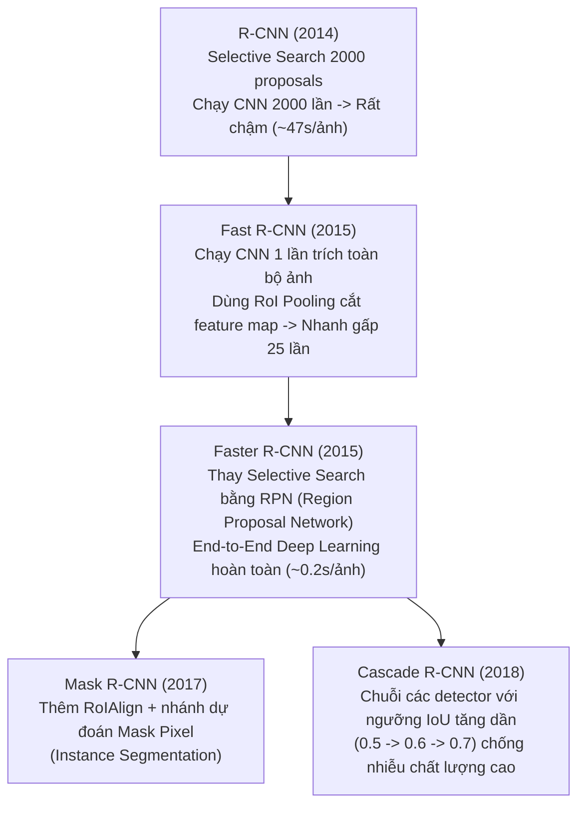
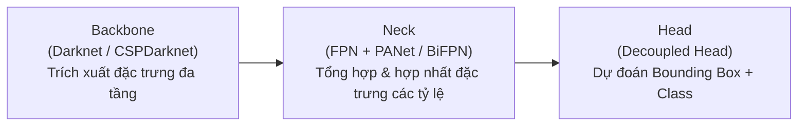
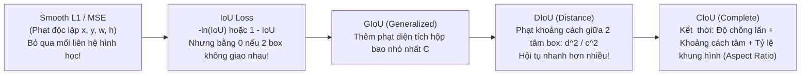

# Chapter 05.2 — Object Detection Survey (CNNs - Part 2)

> **Giảng viên**: PhD. Nguyễn Thị Khánh Tiên (`tienntk@ut.edu.vn`)  
> **Đơn vị**: Viện Công Nghệ Thông Tin, Điện, Điện Tử — Trường Đại Học Giao Thông Vận Tải TP.HCM  
> **Tài liệu gốc**: `Chapter 05.2 - CNNs (Part 2) - Object Detection Survey.pdf`

---

## 📑 Mục Lục
1. [Khái Niệm Cốt Lõi Về Phát Hiện Vật Thể (Object Detection)](#1-khái-niệm-cốt-lõi-về-phát-hiện-vật-thể-object-detection)
2. [Bộ Khung Phân Loại: Two-Stage vs One-Stage Detectors](#2-bộ-khung-phân-loại-two-stage-vs-one-stage-detectors)
3. [Dòng Họ Mô Hình Hai Giai Đoạn (R-CNN Family)](#3-dòng-họ-mô-hình-hai-giai-đoạn-r-cnn-family)
   - [3.1 Từ R-CNN đến Fast R-CNN](#31-từ-r-cnn-đến-fast-r-cnn)
   - [3.2 Faster R-CNN & Mạng Đề Xuất Vùng (RPN)](#32-faster-r-cnn--mạng-đề-xuất-vùng-rpn)
   - [3.3 Mask R-CNN & Cascade R-CNN](#33-mask-r-cnn--cascade-r-cnn)
4. [Các Kiến Trúc Một Giai Đoạn (One-Stage Detectors)](#4-các-kiến-trúc-một-giai-đoạn-one-stage-detectors)
   - [4.1 SSD (Single Shot MultiBox Detector)](#41-ssd-single-shot-multibox-detector)
   - [4.2 RetinaNet & Đột Phá Focal Loss](#42-retinanet--đột-phá-focal-loss)
   - [4.3 CenterNet (Anchor-Free Detection)](#43-centernet-anchor-free-detection)
5. [Đế Chế YOLO (You Only Look Once: v1 đến v8)](#5-đế-chế-yolo-you-only-look-once-v1-đến-v8)
   - [5.1 Cấu Trúc 3 Khối Chuẩn: Backbone — Neck — Head](#51-cấu-trúc-3-khối-chuẩn-backbone--neck--head)
   - [5.2 Bảng So Sánh Các Phiên Bản YOLO](#52-bảng-so-sánh-các-phiên-bản-yolo)
6. [Hàm Mất Mát Chuyên Dụng Cho Object Detection](#6-hàm-mất-mát-chuyên-dụng-cho-object-detection)
   - [6.1 Classification Loss & Focal Loss](#61-classification-loss--focal-loss)
   - [6.2 Bounding Box Regression Loss: IoU, GIoU, DIoU, CIoU](#62-bounding-box-regression-loss-iou-giou-diou-ciou)
7. [Khái Niệm Anchors & Gán Nhãn Mẫu (Label Assignment)](#7-khái-niệm-anchors--gán-nhãn-mẫu-label-assignment)
8. [Các Chỉ Số Đánh Giá Chuẩn Mực (IoU, AP, mAP@0.5)](#8-các-chỉ-số-đánh-giá-chuẩn-mực-iou-ap-map05)
9. [💡 Liên Hệ Ứng Dụng Thực Hành Với Bài Lab](#9--liên-hệ-ứng-dụng-thực-hành-với-bài-lab)

---

## 1. Khái Niệm Cốt Lõi Về Phát Hiện Vật Thể (Object Detection)

**Object Detection (Phát hiện vật thể)** là tác vụ thị giác máy tính giải quyết đồng thời 2 bài toán:
1. **Phân loại (Classification)**: Đối tượng trong ảnh là gì? (Chó, mèo, ô tô, người đi bộ).
2. **Định vị (Localization)**: Đối tượng nằm ở tọa độ nào trong ảnh? Biểu diễn bằng khung chữ nhật bao quanh (**Bounding Box** gồm 4 tham số: tâm $x, y$, chiều rộng $w$, chiều cao $h$).

### 4 Thành phần chính của một hệ thống Object Detection:
- **Model**: Mạng nơ-ron trích xuất đặc trưng và dự đoán bounding boxes + nhãn.
- **Ground Truth Encoding**: Mã hóa nhãn thực tế sang tọa độ ô lưới / anchor box.
- **Loss Function**: Kết hợp giữa Classification Loss và Bounding Box Regression Loss.
- **Prediction Decoding**: Giải mã đầu ra mô hình thành tọa độ pixel thực tế và áp dụng **NMS (Non-Maximum Suppression)** để lọc bỏ các box chồng lấn.

---

## 2. Bộ Khung Phân Loại: Two-Stage vs One-Stage Detectors

| Tiêu chí | Two-Stage Detectors (Hai giai đoạn) | One-Stage Detectors (Một giai đoạn) |
| :--- | :--- | :--- |
| **Đại diện tiêu biểu** | R-CNN, Fast R-CNN, **Faster R-CNN**, Mask R-CNN, Cascade R-CNN. | **SSD**, **RetinaNet**, **CenterNet**, **YOLO (v1 - v8)**. |
| **Cơ chế hoạt động** | Bước 1: Tạo vùng đề xuất (**Region Proposals**). Bước 2: Phân loại và tinh chỉnh tọa độ trên từng vùng đề xuất. | Dự đoán trực tiếp tọa độ box và xác suất lớp trên các ô lưới của ảnh trong **duy nhất một lần forward pass**. |
| **Tốc độ (FPS)** | Chậm ($5 \sim 15$ FPS), không đạt thời gian thực. | Cực nhanh ($30 \sim 150+$ FPS), chạy mượt trên video thời gian thực (**Real-Time**). |
| **Độ chính xác (mAP)** | Rất cao, bắt vật thể nhỏ tốt hơn. | Ngày càng thu hẹp khoảng cách, các bản YOLOv5/v8 hiện nay đã tiệm cận hoặc vượt Two-Stage. |
| **Vấn đề cốt lõi** | Tốn tài nguyên vì phải xử lý hàng nghìn vùng RoI. | Mất cân bằng mẫu trầm trọng giữa nền (Background) và vật thể (Foreground). |

---

## 3. Dòng Họ Mô Hình Hai Giai Đoạn (R-CNN Family)

### 3.2 Faster R-CNN & Mạng Đề Xuất Vùng (RPN)
- **Region Proposal Network (RPN)**: Một mạng tích chập nhỏ trượt qua Feature Map cuối cùng của backbone (ResNet-50-FPN).
- Tại mỗi vị trí ô, RPN tạo ra $k$ khung giả định (**Anchors**) với nhiều kích thước (Scales: $128^2, 256^2, 512^2$) và tỷ lệ khung hình (Aspect Ratios: $1:1, 1:2, 2:1$).
- RPN phân loại nhị phân xem anchor đó chứa vật thể (*Objectness Score*) hay là nền, đồng thời điều chỉnh sơ bộ tọa độ box.

---

## 4. Các Kiến Trúc Một Giai Đoạn (One-Stage Detectors)

### 4.1 SSD (Single Shot MultiBox Detector)
- Dùng Feature Maps ở **nhiều tỷ lệ khác nhau** (Multi-Scale Feature Maps):
  - Tầng nông (kích thước lớn, độ phân giải cao): Phát hiện các vật thể nhỏ.
  - Tầng sâu (kích thước nhỏ, trường nhìn rộng): Phát hiện các vật thể to lớn.

### 4.2 RetinaNet & Đột Phá Focal Loss (Lin et al. - 2017)
- **Vấn đề của One-stage**: Hàng trăm nghìn anchor boxes được sinh ra nhưng $>99\%$ là nền (Negative samples). Khi dùng hàm Cross-Entropy thông thường, tổng lỗi từ hàng vạn mẫu dễ này lấn át hoàn toàn lỗi của các mẫu vật thể hiếm hoi, khiến mô hình học lệch.
- **Giải pháp Focal Loss (FL)**: Bổ sung nhân tố điều chế $(1 - p_t)^\gamma$:
  $$\text{FL}(p_t) = -\alpha_t (1 - p_t)^\gamma \log(p_t)$$
  - Với mẫu dễ ($p_t \rightarrow 1$): Nhân tử $(1 - p_t)^\gamma \rightarrow 0 \Rightarrow$ Giảm mạnh trọng số của mẫu dễ!
  - Với mẫu khó ($p_t \rightarrow 0$): Nhân tử $(1 - p_t)^\gamma \approx 1 \Rightarrow$ Tập trung toàn bộ gradient để mô hình học các mẫu khó!

### 4.3 CenterNet (Anchor-Free Detection)
- Loại bỏ hoàn toàn Anchor boxes.
- Mô hình phát hiện vật thể dưới dạng **điểm tâm (Center Point)** và hồi quy trực tiếp độ lệch tâm ($x, y$) cùng kích thước chiều rộng, chiều cao ($w, h$). Đơn giản hóa kiến trúc và tăng tốc suy luận.

---

## 5. Đế Chế YOLO (You Only Look Once: v1 đến v8)

### 5.1 Cấu Trúc 3 Khối Chuẩn Của YOLO Hiện Đại:

1. **Backbone**: Trích xuất các tầng đặc trưng từ nông đến sâu (Darknet-53, CSPDarknet).
2. **Neck**: Kết hợp đường truyền từ trên xuống (**Top-Down - FPN**) và từ dưới lên (**Bottom-Up - PANet**) để bảo toàn thông tin không gian chi tiết cho vật thể nhỏ.
3. **Head**: Tầng tích chập cuối cùng để đưa ra tọa độ và xác suất lớp.

### 5.2 Bảng So Sánh Các Phiên Bản YOLO:

| Phiên bản | Tác giả & Năm | Đột phá kiến trúc cốt lõi |
| :--- | :---: | :--- |
| **YOLOv1** | Joseph Redmon (2016) | Chia ảnh thành lưới $S \times S$, biến bài toán detection thành bài toán hồi quy đơn giản. |
| **YOLOv2 (YOLO9000)** | Joseph Redmon (2017) | Đưa Anchor boxes vào, chuẩn hóa Darknet-19, huấn luyện đa độ phân giải (Multi-scale). |
| **YOLOv3** | Joseph Redmon (2018) | Backbone Darknet-53 (Residual blocks), dự đoán tại 3 tỷ lệ khác nhau (tương tự FPN). |
| **YOLOv4** | Alexey Bochkovskiy (2020) | CSPDarknet53, PANet neck, kỹ thuật tăng cường ảnh **Mosaic Augmentation**, Mish activation. |
| **YOLOv5** | Ultralytics (Glenn Jocher - 2020) | Triển khai hoàn toàn bằng PyTorch gốc, tích hợp Auto-Anchor, siêu nhẹ và thân thiện cho triển khai production. |
| **YOLOv8** | Ultralytics (2023) | **Anchor-Free**, khối C2f module thay C3, Decoupled Head (tách riêng nhánh Box loss và Class loss), hỗ trợ đồng thời Detection, Segmentation, Pose estimation. |

---

## 6. Hàm Mất Mát Chuyên Dụng Cho Object Detection

$$\mathcal{L}_{\text{total}} = \lambda_{\text{cls}} \mathcal{L}_{\text{cls}} + \lambda_{\text{box}} \mathcal{L}_{\text{box}} + \lambda_{\text{obj}} \mathcal{L}_{\text{obj}}$$

### 6.2 Bounding Box Regression Loss: Sự Tiến Hóa Của Các Dạng IoU Loss

#### Công thức CIoU (Complete IoU - Chuẩn mực trong YOLO):
$$\mathcal{L}_{\text{CIoU}} = 1 - \text{IoU} + \frac{\rho^2(b, b^{\text{gt}})}{c^2} + \alpha v$$
Trong đó:
- $\rho(b, b^{\text{gt}})$: Khoảng cách Euclidean giữa tâm của box dự đoán và ground truth.
- $c$: Độ dài đường chéo của hình chữ nhật nhỏ nhất bao quanh cả 2 boxes.
- $v$: Tham số đo lường sự tương đồng về tỷ lệ khung hình: $v = \frac{4}{\pi^2} \left( \arctan\frac{w^{\text{gt}}}{h^{\text{gt}}} - \arctan\frac{w}{h} \right)^2$.

---

## 7. Khái Niệm Anchors & Gán Nhãn Mẫu (Label Assignment)

- **Anchor Boxes**: Các hộp mẫu định sẵn kích thước và tỷ lệ đặt tại các tâm ô lưới.
- **Label Assignment**: Quá trình phân loại anchor nào là **Positive** (chứa vật thể) và anchor nào là **Negative** (thuộc nền):
  - *Truyền thống*: Tính IoU của anchor với ground truth; nếu $\text{IoU} > 0.5$ là Positive, $\text{IoU} < 0.4$ là Negative.
  - *Hiện đại*: **PAA (Probabilistic Anchor Assignment)** và **Task-Aligned Assigner (trong YOLOv8)** tính điểm số kết hợp giữa chất lượng phân loại và độ chính xác vị trí ($t = s^\alpha \times \text{IoU}^\beta$).

---

## 8. Các Chỉ Số Đánh Giá Chuẩn Mực (IoU, AP, mAP@0.5)

### 1. Intersection over Union (IoU)
$$\text{IoU} = \frac{\text{Diện tích vùng giao (Overlap)}}{\text{Diện tích vùng hợp (Union)}}$$
- Nếu $\text{IoU} \ge \text{ngưỡng}$ (thường là $0.5$): Bounding box được xem là **True Positive (TP)**.

### 2. Đường Cong Precision - Recall (PR-Curve) & Average Precision (AP)
- **Precision**: $P = \frac{\text{TP}}{\text{TP} + \text{FP}}$ (Đoán trúng bao nhiêu %).
- **Recall**: $R = \frac{\text{TP}}{\text{TP} + \text{FN}}$ (Bắt được bao nhiêu % vật thể thực tế).
- **AP (Average Precision)**: Diện tích dưới đường cong PR-Curve của một lớp đối tượng cụ thể:
  $$\text{AP} = \int_0^1 P(R) \, dR$$

### 3. Mean Average Precision (mAP)
- Trung bình chỉ số AP trên toàn bộ $C$ lớp đối tượng:
  $$\text{mAP} = \frac{1}{C} \sum_{c=1}^C \text{AP}_c$$
- **mAP@0.5**: Tính mAP với ngưỡng $\text{IoU} = 0.5$ (chuẩn PASCAL VOC).
- **mAP@[0.5:0.95]**: Lấy trung bình mAP tại 10 ngưỡng IoU từ $0.50$ đến $0.95$ với bước nhảy $0.05$ (chuẩn khắt khe của MS COCO).

---

## 9. 💡 Liên Hệ Ứng Dụng Thực Hành Với Bài Lab

- Khảo sát toàn diện trong **Chapter 05.2** là tài liệu tham khảo cho các đồ án phát hiện vật thể:
  - Khi cần tốc độ cao trên thiết bị biên / Colab: Sử dụng thư viện **Ultralytics YOLOv8** (`from ultralytics import YOLO; model = YOLO('yolov8n.pt')`).
  - Khi cần phát hiện phân đoạn ảnh chi tiết: Dùng **Mask R-CNN** từ `torchvision.models.detection.maskrcnn_resnet50_fpn`.
  - Hiểu tường tận cơ chế tính điểm **mAP@0.5** để đối chiếu và nghiệm thu kết quả bài lab theo đúng chuẩn khoa học.

