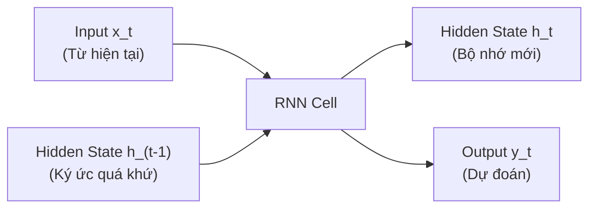
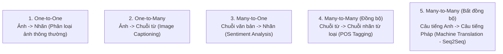
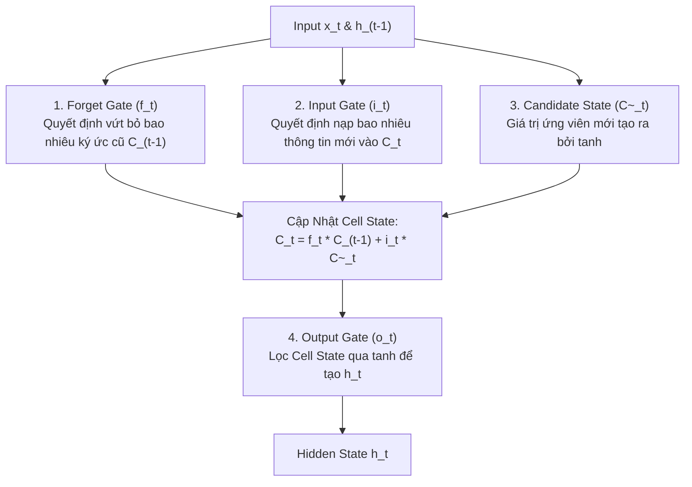

# Chapter 06 — Recurrent Neural Networks (RNNs)

> **Giảng viên**: PhD. Nguyễn Thị Khánh Tiên (`tienntk@ut.edu.vn`)  
> **Đơn vị**: Viện Công Nghệ Thông Tin, Điện, Điện Tử — Trường Đại Học Giao Thông Vận Tải TP.HCM  
> **Tài liệu gốc**: `Chapter 06 - RNNs.pdf`

---

## 📑 Mục Lục
1. [Bản Chất Của Dữ Liệu Dạng Chuỗi (Sequence Data)](#1-bản-chất-của-dữ-liệu-dạng-chuỗi-sequence-data)
2. [Nguyên Lý Hoạt Động Của Mạng RNN Truyền Thống (Vanilla RNN)](#2-nguyên-lý-hoạt-động-của-mạng-rnn-truyền-thống-vanilla-rnn)
3. [5 Mô Hình Xử Lý Chuỗi Phổ Biến (Sequence Modeling Paradigms)](#3-5-mô-hình-xử-lý-chuỗi-phổ-biến-sequence-modeling-paradigms)
4. [Hạn Chế Của Simple RNN & Vấn Đề Triệt Tiêu Gradient Dài Hạn](#4-hạn-chế-của-simple-rnn--vấn-đề-triệt-tiêu-gradient-dài-hạn)
5. [Mạng Bộ Nhớ Dài - Ngắn (Long Short-Term Memory - LSTM)](#5-mạng-bộ-nhớ-dài---ngắn-long-short-term-memory---lstm)
   - [5.1 Cấu Trúc 3 Cổng Cốt Lõi (Forget, Input, Output Gates)](#51-cấu-trúc-3-cổng-cốt-lõi-forget-input-output-gates)
   - [5.2 Băng Chuyền Trạng Thái Ô (Cell State)](#52-băng-chuyền-trạng-thái-ô-cell-state)
6. [Gated Recurrent Units (GRUs) — Phiên Bản Tinh Gọn Của LSTM](#6-gated-recurrent-units-grus--phiên-bản-tinh-gọn-của-lstm)
7. [Mạng RNN Hai Chiều (Bidirectional RNN) & Mô Hình Encoder - Decoder](#7-mạng-rnn-hai-chiều-bidirectional-rnn--mô-hình-encoder---decoder)
8. [Biểu Diễn Chuỗi Dữ Liệu (Word Embeddings, Padding, Truncation)](#8-biểu-diễn-chuỗi-dữ-liệu-word-embeddings-padding-truncation)
9. [Triển Khai RNN & LSTM Với PyTorch](#9-triển-khai-rnn--lstm-với-pytorch)
10. [💡 Bước Đệm Tiến Lên Attention & Transformer Trong Bài Lab 3](#10--bước-đệm-tiến-lên-attention--transformer-trong-bài-lab-3)

---

## 1. Bản Chất Của Dữ Liệu Dạng Chuỗi (Sequence Data)

**Sequence Data (Dữ liệu dạng chuỗi)** là dữ liệu mà **thứ tự xuất hiện của các phần tử mang ý nghĩa quyết định**:
- *Ví dụ*: "Không thích phim này" hoàn toàn trái ngược với "Thích phim này, không chê điểm nào".

### 3 Đặc tính cốt lõi của Sequence Data:
1. **Thứ tự quan trọng (Order Matters)**: Hoán đổi vị trí làm thay đổi hoàn toàn ngữ nghĩa.
2. **Phụ thuộc ngữ cảnh (Temporal Dependencies)**: Phần tử hiện tại phụ thuộc chặt chẽ vào các phần tử đứng trước (và đứng sau).
3. **Độ dài biến thiên (Variable Length)**: Mỗi câu văn, đoạn âm thanh hay chuỗi tín hiệu có số lượng bước thời gian ($T$) khác nhau, không cố định kích thước như ma trận ảnh.

---

## 2. Nguyên Lý Hoạt Động Của Mạng RNN Truyền Thống (Vanilla RNN)

Khác với mạng Feedforward (xử lý độc lập từng input), mạng **RNN** sở hữu các kết nối phản hồi (**Recurrent Connections**), cho phép duy trì một vector trạng thái ẩn (**Hidden State - $h_t$**) đóng vai trò như bộ nhớ lưu giữ thông tin của toàn bộ chuỗi đã duyệt qua.



### Công thức toán học tại bước thời gian $t$:
1. **Cập nhật trạng thái ẩn (Hidden State)**:
   $$h_t = \tanh(W_{hh} h_{t-1} + W_{xh} x_t + b_h)$$
2. **Tính toán đầu ra (Output)**:
   $$\hat{y}_t = \text{softmax}(W_{hy} h_t + b_y)$$

- Trọng số $W_{hh}, W_{xh}, W_{hy}$ được **chia sẻ xuyên suốt mọi bước thời gian $t$** (Weight Sharing over Time).

---

## 3. 5 Mô Hình Xử Lý Chuỗi Phổ Biến (Sequence Modeling Paradigms)

Theo phân loại kinh điển của Andrej Karpathy:



---

## 4. Hạn Chế Của Simple RNN & Vấn Đề Triệt Tiêu Gradient Dài Hạn

Khi chuỗi dài ($T > 10 \sim 20$ bước), thuật toán lan truyền ngược qua thời gian (**Backpropagation Through Time - BPTT**) phải liên tục nhân ma trận trọng số chuyển vị $W_{hh}^T$ qua từng bước:

$$\frac{\partial \mathcal{L}_T}{\partial h_1} = \frac{\partial \mathcal{L}_T}{\partial h_T} \prod_{j=2}^T \frac{\partial h_j}{\partial h_{j-1}}$$

- Nếu giá trị riêng lớn nhất của $W_{hh} < 1$: Gradient suy giảm theo hàm mũ về 0 $\rightarrow$ **Vanishing Gradients**. Mạng bị mất trí nhớ dài hạn (**Short-Term Memory**), không nhớ được thông tin từ đầu câu.
- Nếu giá trị riêng lớn nhất của $W_{hh} > 1$: Gradient tăng theo hàm mũ $\rightarrow$ **Exploding Gradients** (gây lỗi `NaN`).

$\Rightarrow$ Để giải quyết triệt để vấn đề này, kiến trúc **LSTM** và **GRU** ra đời.

---

## 5. Mạng Bộ Nhớ Dài - Ngắn (Long Short-Term Memory - LSTM)

Được đề xuất bởi Sepp Hochreiter & Jürgen Schmidhuber (1997), LSTM giới thiệu cơ chế cổng kiểm soát dòng chảy thông tin và tách bộ nhớ thành 2 luồng:
- **Cell State ($C_t$)**: Băng chuyền thông tin dài hạn xuyên suốt chuỗi với ít biến đổi tuyến tính.
- **Hidden State ($h_t$)**: Bộ nhớ làm việc ngắn hạn tại bước $t$.



### 5.1 Hệ phương trình toán học chi tiết của LSTM:

1. **Cổng quên (Forget Gate)**:
   $$f_t = \sigma(W_f \cdot [h_{t-1}, x_t] + b_f)$$
2. **Cổng vào (Input Gate)** & **Trạng thái ứng viên**:
   $$i_t = \sigma(W_i \cdot [h_{t-1}, x_t] + b_i)$$
   $$\tilde{C}_t = \tanh(W_c \cdot [h_{t-1}, x_t] + b_c)$$
3. **Cập nhật Cell State dài hạn**:
   $$C_t = f_t \odot C_{t-1} + i_t \odot \tilde{C}_t$$
4. **Cổng ra (Output Gate)** & **Hidden State**:
   $$o_t = \sigma(W_o \cdot [h_{t-1}, x_t] + b_o)$$
   $$h_t = o_t \odot \tanh(C_t)$$

*(Trong đó $\odot$ là phép nhân từng phần tử - Hadamard Product, $\sigma$ là hàm Sigmoid trả về giá trị từ 0 đến 1)*.

---

## 6. Gated Recurrent Units (GRUs) — Phiên Bản Tinh Gọn Của LSTM

Kyunghyun Cho et al. (2014) đề xuất GRU đơn giản hóa LSTM:
1. Gộp Cell State và Hidden State thành **duy nhất một vector $h_t$**.
2. Chỉ dùng **2 cổng** thay vì 3 cổng:
   - **Reset Gate ($r_t$)**: Quyết định kết hợp thông tin quá khứ với input mới như thế nào.
   - **Update Gate ($z_t$)**: Đóng vai trò vừa là Forget Gate vừa là Input Gate đồng thời.
3. **Ưu thế**: Số lượng tham số ít hơn khoảng $25\%$, tính toán nhanh hơn, hội tụ tốt hơn trên các tập dữ liệu nhỏ.

---

## 7. Mạng RNN Hai Chiều (Bidirectional RNN) & Mô Hình Encoder - Decoder

### 1. Bidirectional RNN / LSTM (BiLSTM)
- Trong ngôn ngữ tự nhiên, hiểu một từ cần biết cả từ phía trước (**Past Context**) lẫn từ phía sau (**Future Context**).
- BiLSTM gồm 2 luồng độc lập: một mạng duyệt từ trái sang phải ($\overrightarrow{h_t}$) và một mạng duyệt từ phải sang trái ($\overleftarrow{h_t}$). Kết quả cuối cùng là ghép nối 2 vector: $h_t = [\overrightarrow{h_t}, \overleftarrow{h_t}]$.

### 2. Mô hình Encoder - Decoder (Seq2Seq)
- **Encoder**: Đọc chuỗi đầu vào độ dài $T_x$ và nén toàn bộ ngữ nghĩa vào một vector ngữ cảnh duy nhất (**Context Vector**).
- **Decoder**: Lấy Context Vector làm trạng thái khởi tạo và giải mã từng từ để sinh ra chuỗi đầu ra độ dài $T_y$ (dùng cho dịch máy, tóm tắt văn bản).

---

## 8. Biểu Diễn Chuỗi Dữ Liệu (Word Embeddings, Padding, Truncation)

Để đưa văn bản vào RNN/LSTM trong PyTorch:
1. **Tokenization & Numerical Encoding**: Chuyển từ thành số nguyên chỉ mục (Index).
2. **Embedding Layer (`nn.Embedding`)**: Biến mỗi chỉ mục số nguyên thành một vector thực dày đặc (Dense Vector, ví dụ 128 hoặc 300 chiều) mang thông tin ngữ nghĩa.
3. **Padding & Truncation**: Cắt ngắn các câu quá dài (`truncation`) và thêm số 0 vào các câu ngắn (`padding`) để gom thành batch ma trận có cùng kích thước.

---

## 9. Triển Khai RNN & LSTM Với PyTorch

```python
import torch
import torch.nn as nn

class SentimentLSTM(nn.Module):
    def __init__(self, vocab_size, embedding_dim, hidden_dim, output_dim, n_layers, dropout=0.5):
        super().__init__()
        # 1. Tầng Embedding chuyển đổi index từ sang vector
        self.embedding = nn.Embedding(vocab_size, embedding_dim, padding_idx=0)

        # 2. Tầng LSTM đa tầng, hỗ trợ 2 chiều (Bidirectional)
        self.lstm = nn.LSTM(
            input_size=embedding_dim,
            hidden_size=hidden_dim,
            num_layers=n_layers,
            bidirectional=True,
            batch_first=True,    # Dạng tensor: (Batch, Seq_Len, Features)
            dropout=dropout if n_layers > 1 else 0
        )

        # 3. Tầng phân loại đầu ra (Do bidirectional nên hidden_dim * 2)
        self.fc = nn.Linear(hidden_dim * 2, output_dim)
        self.dropout = nn.Dropout(dropout)

    def forward(self, text):
        # text: [batch_size, seq_len]
        embedded = self.dropout(self.embedding(text)) # [batch_size, seq_len, embedding_dim]
        
        # out: [batch_size, seq_len, hidden_dim * 2]
        # hidden: [num_layers * 2, batch_size, hidden_dim]
        out, (hidden, cell) = self.lstm(embedded)

        # Lấy hidden state ở bước thời gian cuối cùng của 2 chiều
        last_hidden = torch.cat((hidden[-2, :, :], hidden[-1, :, :]), dim=1)
        
        logits = self.fc(self.dropout(last_hidden))
        return logits
```

---

## 10. 💡 Bước Đệm Tiến Lên Attention & Transformer Trong Bài Lab 3

Mặc dù LSTM và GRU giải quyết được vấn đề vanishing gradient của Simple RNN, nhưng chúng vẫn có 2 nhược điểm cố hữu:
1. **Điểm nghẽn thông tin (Bottleneck)**: Phải nén toàn bộ câu dài vào một vector cố định, làm giảm hiệu năng khi câu vượt quá 50 từ.
2. **Xử lý tuần tự không thể song song hóa (Sequential Computation)**: Phải chờ tính xong bước $t-1$ mới tính được bước $t$, làm chậm quá trình huấn luyện trên GPU lớn.

$\Rightarrow$ **Cơ chế Self-Attention** và kiến trúc **Transformer (BERT, DistilBERT, GPT)** ra đời loại bỏ hoàn toàn tính tuần tự, cho phép tính toán song song toàn bộ các từ cùng lúc!

Trong bài **[`Lab 3`](../../Lab%203/)** và file **[`Lab_3 (1).ipynb`](../../Lab_3%20(1).ipynb)**:
- Bạn sử dụng chính mô hình Transformer kế thừa tư tưởng giải quyết bài toán chuỗi văn bản của Chapter 06:
  - Tokenization và phân tích cảm xúc chuỗi text (Sentiment Analysis trên IMDB).
  - Tận dụng cơ chế Attention để đạt Accuracy vượt trội so với các mạng LSTM truyền thống.

